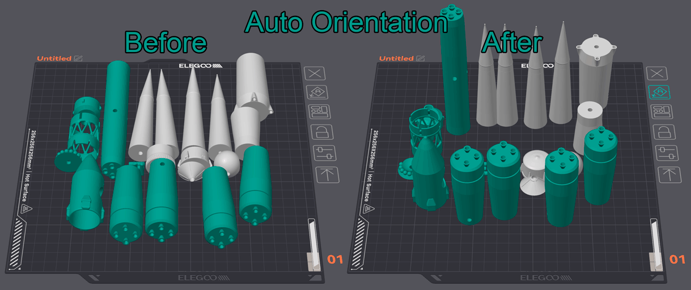

# Auto Orientation¶

Auto Orientation is a feature that automatically finds the optimal orientation for 3D models to minimize support requirements and improve print quality.

## How It Works[¶](auto-orientation.md#how-it-works) 

1. **Analyzes** the mesh geometry to extract face normals and areas.
2. **Generates** candidate orientations.
3. **Evaluates** each orientation based on overhang area, bottom contact, support interface, and contour complexity
4. **Selects** the orientation with the lowest unprintability score.

Important

Auto Orientation may not always find the best orientation for complex models. Always review the suggested orientation.\
Remember that strength characteristics of the printed part may vary with orientation due to layer adhesion.
