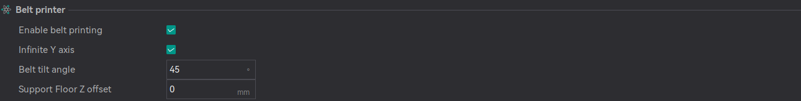
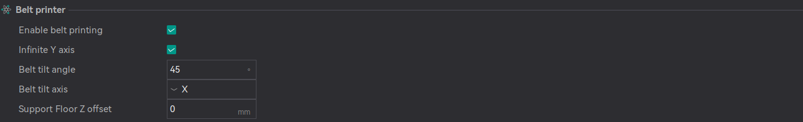

# Belt Printer¶

Important

NEW FEATURE: **Belt printer support**\
Available in: [Nightly builds](https://github.com/OrcaSlicer/OrcaSlicer/releases/tag/nightly-builds) or Releases greater than **2.4.2**.

These settings configure conveyor belt printers and are found in **Printer settings → Basic information → Belt printer**. The group is shown when the settings mode is **Advanced** or higher. The settings below [Enable belt printing](belt-printer.md#enable-belt-printing) remain hidden until that option is enabled.

The [Belt Printing](/broken/pages/226f2361e5d5e6ef3f7abf3becc7918d447a2ef7) guide explains how these settings work together. The belt profiles included with OrcaSlicer are configured for a typical 45° machine, so most users only need to check the [Tilt angle](belt-printer.md#tilt-angle).

* [Enable belt printing](belt-printer.md#enable-belt-printing)
* [Infinite Y axis](belt-printer.md#infinite-y-axis)
* [Belt tilt](belt-printer.md#belt-tilt)
  * [Tilt angle](belt-printer.md#tilt-angle)
  * [Tilt axis](belt-printer.md#tilt-axis)
* [Support floor Z offset](belt-printer.md#support-floor-z-offset)

## Enable belt printing[¶](belt-printer.md#enable-belt-printing) 

[Mode](/broken/pages/246b4d07eed07a8ac878abc4613a350fbce2c022): `Advanced`.\
[Variable](/broken/pages/2ce6fff32f5448d0159c2e2dfbcb54f26d3c6918): `belt_printer`.\
[Type](/broken/pages/726477a877bf7a8efe103413c86723285f8ca2eb#boolean): `Boolean`.\
[CLI Example](/broken/pages/f439233018f603f29dcf6b1fcc75b0ab21b6fd24#setting-overrides): `--belt-printer=1`.\
Enables belt printer mode. The model is rotated by the [belt tilt](belt-printer.md#belt-tilt) before slicing, and the G-code is transformed for the tilted gantry and moving belt.

Enabling this option also changes how several features behave:

* The [brim](/broken/pages/8f34753934cc3186e335ccb9927588ff743c306a) is printed on the belt, and additional brim options become available.
* Supports end on the belt surface.
* The [belt purge tower](/broken/pages/74f57ccd9ce07fa1f5a18d2766d92d9e5cb458ca#belt-purge-tower) replaces the prime tower.
* Features that cannot work on a belt are disabled. See [Features that are not available](/broken/pages/226f2361e5d5e6ef3f7abf3becc7918d447a2ef7#features-that-are-not-available).

When this option is disabled, belt-specific processing is inactive and the remaining settings on this page are hidden.

## Infinite Y axis[¶](belt-printer.md#infinite-y-axis) 

[Mode](/broken/pages/246b4d07eed07a8ac878abc4613a350fbce2c022): `Advanced`.\
[Variable](/broken/pages/2ce6fff32f5448d0159c2e2dfbcb54f26d3c6918): `belt_printer_infinite_y`.\
[Type](/broken/pages/726477a877bf7a8efe103413c86723285f8ca2eb#boolean): `Boolean`.\
[CLI Example](/broken/pages/f439233018f603f29dcf6b1fcc75b0ab21b6fd24#setting-overrides): `--belt-printer-infinite-y=1`.\
Removes the build volume limit along Y, allowing a part to extend beyond the plate displayed in Prepare.

The displayed plate size stays the same, but OrcaSlicer ignores the Y boundary when checking whether an object lies outside the printable area. The belt width (X) and the [printable height](/broken/pages/0d906d45479df31a3f89c370bdbfa417919f98de#printable-height) are still enforced.

Disable this option to have OrcaSlicer flag parts that extend beyond the plate along Y.

## Belt tilt[¶](belt-printer.md#belt-tilt) 

[Type](/broken/pages/726477a877bf7a8efe103413c86723285f8ca2eb): `belt_slice_rotation_angle` (Float), `belt_slice_rotation` (Choice: none, x, y, z).\
[CLI Example](/broken/pages/f439233018f603f29dcf6b1fcc75b0ab21b6fd24#setting-overrides): `--belt-slice-rotation-angle=45` (`belt_slice_rotation_angle` shown; other variables above follow their own type).\
Defines the tilt of the gantry relative to the belt. The angle and axis control:

* the rotation applied to the model before slicing,
* the [machine-frame tilt](/broken/pages/df5fc5714e332bba3841f83b76b802a9cacdf887#machine-frame-tilt) applied to the G-code,
* the belt surface used to generate supports and the brim,
* the [build plate tilt](/broken/pages/eeff389a3bf7caa2aee6f13fbffe1d91ee4800d4#build-plate-tilt) used for support generation,
* the size and position of the [belt purge tower](/broken/pages/74f57ccd9ce07fa1f5a18d2766d92d9e5cb458ca#belt-purge-tower) and the order in which [Auto arrange](/broken/pages/0fcd3913806f2ebe7be268c6b82f8de56ec468b6) packs parts.

Every object is rotated about one common origin, so parts at different positions along the belt share the same set of tilted layers and each part prints at its assigned position.

### Tilt angle[¶](belt-printer.md#tilt-angle) 

[Mode](/broken/pages/246b4d07eed07a8ac878abc4613a350fbce2c022): `Advanced`.\
[Variable](/broken/pages/2ce6fff32f5448d0159c2e2dfbcb54f26d3c6918): `belt_slice_rotation_angle`.\
[Type](/broken/pages/726477a877bf7a8efe103413c86723285f8ca2eb#integer-float-percentage): `Float`.\
[CLI Example](/broken/pages/f439233018f603f29dcf6b1fcc75b0ab21b6fd24#setting-overrides): `--belt-slice-rotation-angle=1`.\
The angle between the belt and the gantry, in degrees. Most belt printers use 45°.

A positive value rotates counter-clockwise when looking down the positive tilt axis. The sign determines the direction in which the layers lean, and the magnitude specifies the physical tilt angle.

Note

A brim is only generated on a belt printer when the tilt axis is X or Y and the angle is between 1° and 85°.

### Tilt axis[¶](belt-printer.md#tilt-axis) 

[Mode](/broken/pages/246b4d07eed07a8ac878abc4613a350fbce2c022): `Developer`.\
[Variable](/broken/pages/2ce6fff32f5448d0159c2e2dfbcb54f26d3c6918): `belt_slice_rotation`.\
[Type](/broken/pages/726477a877bf7a8efe103413c86723285f8ca2eb#choice): `Choice`.\
[Options](/broken/pages/726477a877bf7a8efe103413c86723285f8ca2eb#choice): `none, x, y, z`.\
[CLI Example](/broken/pages/f439233018f603f29dcf6b1fcc75b0ab21b6fd24#setting-overrides): `--belt-slice-rotation=none`.\
The axis about which the model is rotated. It is part of the printer's kinematics, so it is only shown when the settings [mode](/broken/pages/246b4d07eed07a8ac878abc4613a350fbce2c022) is **Developer**; the belt profiles set it once.

* **X:** The usual layout. The gantry is tilted about X and the belt travels along Y in Prepare.
* **Y:** The gantry is tilted about Y and the belt travels along X in Prepare.
* **Z:** Rotates the model in the plane of the bed. This is not a tilt: no machine-frame transform is applied and no brim is generated.
* **None:** No rotation. The model is sliced as on a flat bed.

## Support floor Z offset[¶](belt-printer.md#support-floor-z-offset) 

[Mode](/broken/pages/246b4d07eed07a8ac878abc4613a350fbce2c022): `Advanced`.\
[Variable](/broken/pages/2ce6fff32f5448d0159c2e2dfbcb54f26d3c6918): `belt_support_floor_offset`.\
[Type](/broken/pages/726477a877bf7a8efe103413c86723285f8ca2eb#integer-float-percentage): `Float`.\
[CLI Example](/broken/pages/f439233018f603f29dcf6b1fcc75b0ab21b6fd24#setting-overrides): `--belt-support-floor-offset=1`.\
Shifts the belt surface used for support generation up or down, in mm. A negative value lowers this support floor, preserving more of the support geometry. A positive value raises it.

This is a diagnostic setting. Leave it at 0 unless supports are cut off above the belt or extend below it.

Supports always stop at the belt surface. Under an overhang at the leading end of a part they reach the belt ahead of the part's first contact with it, so the support can start before the part itself.
