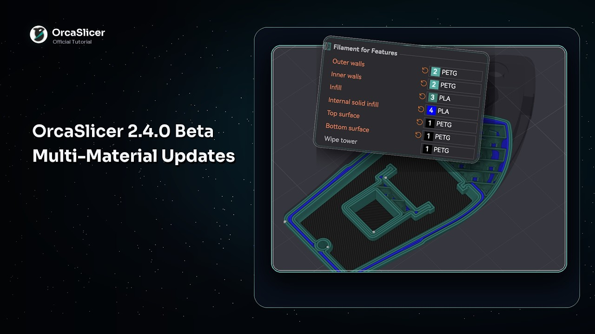
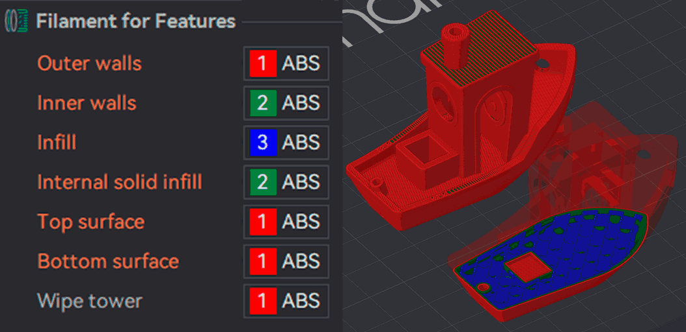

# Filament for Features¶

These settings allow you to specify which filament to use for different features of the print, such as walls, infill, and the wipe tower.

## Outer Walls[¶](filament-for-features.md#outer-walls) 

[Mode](/broken/pages/246b4d07eed07a8ac878abc4613a350fbce2c022): `Advanced`.\
[Variable](/broken/pages/2ce6fff32f5448d0159c2e2dfbcb54f26d3c6918): `outer_wall_filament_id`.\
[Type](/broken/pages/726477a877bf7a8efe103413c86723285f8ca2eb#integer-float-percentage): `Integer`.\
[CLI Example](/broken/pages/f439233018f603f29dcf6b1fcc75b0ab21b6fd24#setting-overrides): `--outer-wall-filament-id=1`.\
Filament to print outer walls.\
You can also print the outer walls with a translucent filament to achieve a frosted glass effect.\
When using a [mixed nozzle size setup](/broken/pages/d8b1228608cc1b174a441c764cc6cf625c30317d), it's recommended to use the smaller nozzle for outer walls to achieve better surface quality and detail.

## Inner Walls[¶](filament-for-features.md#inner-walls) 

[Mode](/broken/pages/246b4d07eed07a8ac878abc4613a350fbce2c022): `Advanced`.\
[Variable](/broken/pages/2ce6fff32f5448d0159c2e2dfbcb54f26d3c6918): `inner_wall_filament_id`.\
[Type](/broken/pages/726477a877bf7a8efe103413c86723285f8ca2eb#integer-float-percentage): `Integer`.\
[CLI Example](/broken/pages/f439233018f603f29dcf6b1fcc75b0ab21b6fd24#setting-overrides): `--inner-wall-filament-id=1`.\
Filament to print inner walls.\
When using a [mixed nozzle size setup](/broken/pages/d8b1228608cc1b174a441c764cc6cf625c30317d), you can use a larger nozzle for inner walls to speed up printing while maintaining good layer adhesion.

## Sparse Infill[¶](filament-for-features.md#sparse-infill) 

[Mode](/broken/pages/246b4d07eed07a8ac878abc4613a350fbce2c022): `Advanced`.\
[Variable](/broken/pages/2ce6fff32f5448d0159c2e2dfbcb54f26d3c6918): `sparse_infill_filament_id`.\
[Type](/broken/pages/726477a877bf7a8efe103413c86723285f8ca2eb#integer-float-percentage): `Integer`.\
[CLI Example](/broken/pages/f439233018f603f29dcf6b1fcc75b0ab21b6fd24#setting-overrides): `--sparse-infill-filament-id=1`.\
Filament to print internal sparse infill.\
When using a [mixed nozzle size setup](/broken/pages/d8b1228608cc1b174a441c764cc6cf625c30317d), you can use a larger nozzle for infill to speed up printing while maintaining good layer adhesion.

## Internal Solid Infill[¶](filament-for-features.md#internal-solid-infill) 

[Mode](/broken/pages/246b4d07eed07a8ac878abc4613a350fbce2c022): `Advanced`.\
[Variable](/broken/pages/2ce6fff32f5448d0159c2e2dfbcb54f26d3c6918): `internal_solid_filament_id`.\
[Type](/broken/pages/726477a877bf7a8efe103413c86723285f8ca2eb#integer-float-percentage): `Integer`.\
[CLI Example](/broken/pages/f439233018f603f29dcf6b1fcc75b0ab21b6fd24#setting-overrides): `--internal-solid-filament-id=1`.\
Filament to print internal solid infill.\
When using a [mixed nozzle size setup](/broken/pages/d8b1228608cc1b174a441c764cc6cf625c30317d), you can use a larger nozzle for internal solid infill to speed up printing while maintaining good layer adhesion.

## Top Surface[¶](filament-for-features.md#top-surface) 

[Mode](/broken/pages/246b4d07eed07a8ac878abc4613a350fbce2c022): `Advanced`.\
[Variable](/broken/pages/2ce6fff32f5448d0159c2e2dfbcb54f26d3c6918): `top_surface_filament_id`.\
[Type](/broken/pages/726477a877bf7a8efe103413c86723285f8ca2eb#integer-float-percentage): `Integer`.\
[CLI Example](/broken/pages/f439233018f603f29dcf6b1fcc75b0ab21b6fd24#setting-overrides): `--top-surface-filament-id=1`.\
Filament to print top surfaces.\
It's recommended to use the same filament for top surfaces as for outer walls to achieve a consistent appearance.\
When using a [mixed nozzle size setup](/broken/pages/d8b1228608cc1b174a441c764cc6cf625c30317d), it's recommended to use the smaller nozzle for top surfaces to achieve better surface quality and detail.

## Bottom Surface[¶](filament-for-features.md#bottom-surface) 

[Mode](/broken/pages/246b4d07eed07a8ac878abc4613a350fbce2c022): `Advanced`.\
[Variable](/broken/pages/2ce6fff32f5448d0159c2e2dfbcb54f26d3c6918): `bottom_surface_filament_id`.\
[Type](/broken/pages/726477a877bf7a8efe103413c86723285f8ca2eb#integer-float-percentage): `Integer`.\
[CLI Example](/broken/pages/f439233018f603f29dcf6b1fcc75b0ab21b6fd24#setting-overrides): `--bottom-surface-filament-id=1`.\
Filament to print bottom surfaces.\
You can use a different filament for the bottom surfaces, such as a more adhesive one to improve bed adhesion.\
When using a [mixed nozzle size setup](/broken/pages/d8b1228608cc1b174a441c764cc6cf625c30317d), you can use a larger nozzle for bottom surfaces to speed up printing while maintaining good layer adhesion.

## Wipe Tower[¶](filament-for-features.md#wipe-tower) 

[Mode](/broken/pages/246b4d07eed07a8ac878abc4613a350fbce2c022): `Advanced`.\
[Variable](/broken/pages/2ce6fff32f5448d0159c2e2dfbcb54f26d3c6918): `wipe_tower_filament`.\
[Type](/broken/pages/726477a877bf7a8efe103413c86723285f8ca2eb#integer-float-percentage): `Integer`.\
[CLI Example](/broken/pages/f439233018f603f29dcf6b1fcc75b0ab21b6fd24#setting-overrides): `--wipe-tower-filament=1`.\
Filament to print the perimeter of the wipe tower. Set to `Default` to use any available filament, preferring a non-soluble one.
