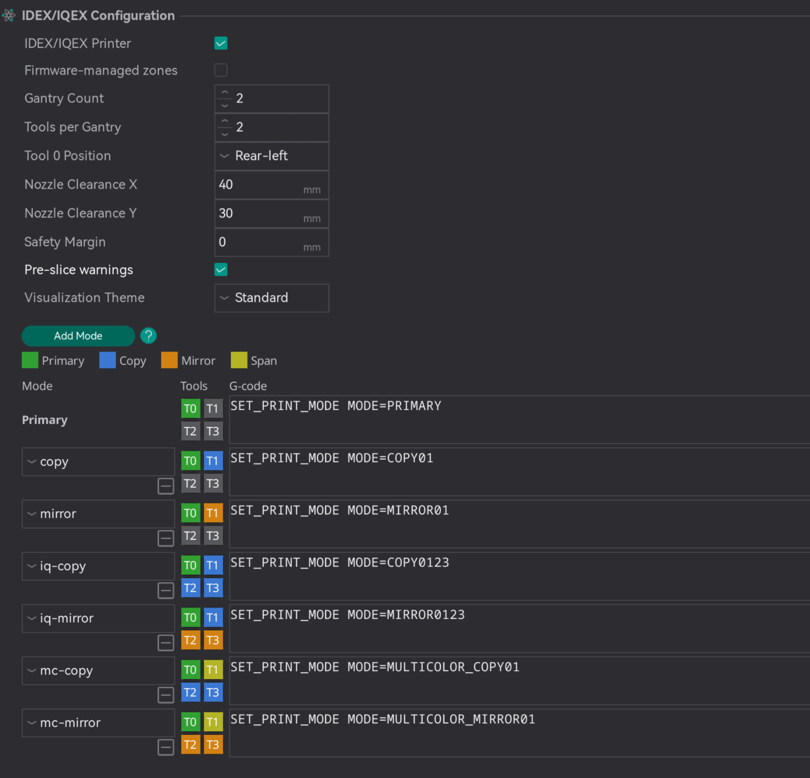

# IDEX/IQEX Configuration¶

Important

NEW FEATURE: **IDEX/IQEX parallel printing**\
Available in: [Nightly builds](https://github.com/OrcaSlicer/OrcaSlicer/releases/tag/nightly-builds) or Releases greater than **2.4.2**.

These settings describe a printer with independent carriages that print at the same time. OrcaSlicer slices the part for T0, and the printer's firmware repeats it on the other carriages. An IDEX (independent dual extruder) printer has two carriages, either side by side on one gantry or one on each of two gantries, front and rear; an IQEX (independent quad extruder) printer has two gantries with two carriages each. Other layouts, such as three or four carriages on one gantry, use the same settings.

The settings are found in **Printer settings → Multimaterial → IDEX/IQEX Configuration**, which is shown when the settings mode is **Advanced** or higher. Until [IDEX/IQEX Printer](idex-iqex-configuration.md#idexiqex-printer) is enabled, the settings below it, except Pre-slice warnings, are grayed out and the [Modes](idex-iqex-configuration.md#modes) grid is hidden.

The [IDEX/IQEX Parallel Printing](/broken/pages/7504f7206fda5eed2774f5bbda65f043c617d65b) guide explains how the settings work together and how to choose a mode for each plate.

* [IDEX/IQEX Printer](idex-iqex-configuration.md#idexiqex-printer)
* [Firmware-managed zones](idex-iqex-configuration.md#firmware-managed-zones)
* [Gantry Count](idex-iqex-configuration.md#gantry-count)
* [Tools per Gantry](idex-iqex-configuration.md#tools-per-gantry)
* [Tool 0 Position](idex-iqex-configuration.md#tool-0-position)
* [Nozzle Clearance X](idex-iqex-configuration.md#nozzle-clearance-x)
* [Nozzle Clearance Y](idex-iqex-configuration.md#nozzle-clearance-y)
* [Safety Margin](idex-iqex-configuration.md#safety-margin)
* [Pre-slice warnings](idex-iqex-configuration.md#pre-slice-warnings)
* [Visualization Theme](idex-iqex-configuration.md#visualization-theme)
* [Modes](idex-iqex-configuration.md#modes)
  * [Mode name](idex-iqex-configuration.md#mode-name)
  * [Tool roles](idex-iqex-configuration.md#tool-roles)
  * [Mode G-code](idex-iqex-configuration.md#mode-g-code)

## IDEX/IQEX Printer[¶](idex-iqex-configuration.md#idexiqex-printer) 

[Mode](/broken/pages/246b4d07eed07a8ac878abc4613a350fbce2c022): `Advanced`.\
[Variable](/broken/pages/2ce6fff32f5448d0159c2e2dfbcb54f26d3c6918): `is_imex`.\
[Type](/broken/pages/726477a877bf7a8efe103413c86723285f8ca2eb#boolean): `Boolean`.\
[CLI Example](/broken/pages/f439233018f603f29dcf6b1fcc75b0ab21b6fd24#setting-overrides): `--is-imex=1`.\
Marks the printer as having independent carriages that can print in parallel. Each plate then gains a mode icon for choosing a parallel mode, and the other settings on this page become editable.

Leave it disabled for printers whose toolheads only print one at a time, including ordinary dual-extruder and tool-changer machines.

## Firmware-managed zones[¶](idex-iqex-configuration.md#firmware-managed-zones) 

[Mode](/broken/pages/246b4d07eed07a8ac878abc4613a350fbce2c022): `Advanced`.\
[Variable](/broken/pages/2ce6fff32f5448d0159c2e2dfbcb54f26d3c6918): `imex_firmware_managed_zones`.\
[Type](/broken/pages/726477a877bf7a8efe103413c86723285f8ca2eb#boolean): `Boolean`.\
[CLI Example](/broken/pages/f439233018f603f29dcf6b1fcc75b0ab21b6fd24#setting-overrides): `--imex-firmware-managed-zones=1`.\
In parallel modes, writes the G-code with the middle of T0's zone at X0 Y0, and the firmware moves each carriage from there into its own zone. Primary mode is not affected.

Leave it disabled for firmware that repeats T0's moves from where T0 prints, such as Klipper's copy and mirror modes.

When enabled, the plate draws no ghost copies, and the preview shows the shifted G-code.

## Gantry Count[¶](idex-iqex-configuration.md#gantry-count) 

[Mode](/broken/pages/246b4d07eed07a8ac878abc4613a350fbce2c022): `Advanced`.\
[Variable](/broken/pages/2ce6fff32f5448d0159c2e2dfbcb54f26d3c6918): `imex_gantry_count`.\
[Type](/broken/pages/726477a877bf7a8efe103413c86723285f8ca2eb#integer-float-percentage): `Integer`.\
[CLI Example](/broken/pages/f439233018f603f29dcf6b1fcc75b0ab21b6fd24#setting-overrides): `--imex-gantry-count=1`.\
The number of independent Y gantries: `1` for a single gantry, such as a classic IDEX; `2` for a front and a rear gantry, such as an IQEX or a dual-gantry IDEX. A mode that uses both gantries divides the bed into a front row and a rear row of zones.

## Tools per Gantry[¶](idex-iqex-configuration.md#tools-per-gantry) 

[Mode](/broken/pages/246b4d07eed07a8ac878abc4613a350fbce2c022): `Advanced`.\
[Variable](/broken/pages/2ce6fff32f5448d0159c2e2dfbcb54f26d3c6918): `imex_tools_per_gantry`.\
[Type](/broken/pages/726477a877bf7a8efe103413c86723285f8ca2eb#integer-float-percentage): `Integer`.\
[CLI Example](/broken/pages/f439233018f603f29dcf6b1fcc75b0ab21b6fd24#setting-overrides): `--imex-tools-per-gantry=1`.\
The number of independent carriages on each gantry, side by side along X. A classic IDEX has `2`.

Tools are numbered across T0's gantry first: on an IQEX, T0 and T1 share a gantry, and T2 and T3 are on the other one, with T2 directly across from T0.

## Tool 0 Position[¶](idex-iqex-configuration.md#tool-0-position) 

[Mode](/broken/pages/246b4d07eed07a8ac878abc4613a350fbce2c022): `Advanced`.\
[Variable](/broken/pages/2ce6fff32f5448d0159c2e2dfbcb54f26d3c6918): `imex_tool_layout`.\
[Type](/broken/pages/726477a877bf7a8efe103413c86723285f8ca2eb#choice): `Choice`.\
[Options](/broken/pages/726477a877bf7a8efe103413c86723285f8ca2eb#choice): `front-left, front-right, rear-left, rear-right`.\
[CLI Example](/broken/pages/f439233018f603f29dcf6b1fcc75b0ab21b6fd24#setting-overrides): `--imex-tool-layout=front-left`.\
The corner of the bed where T0 sits. T0 is the primary tool: it prints the sliced part, and the other carriages copy or mirror it. This setting tells OrcaSlicer which zone is T0's, and the other tools' zones follow from it.

On a single-gantry printer, only left or right matters; on a dual-gantry printer, T0 can be in any of the four corners. Front means low Y (near you), and rear means high Y.

## Nozzle Clearance X[¶](idex-iqex-configuration.md#nozzle-clearance-x) 

[Mode](/broken/pages/246b4d07eed07a8ac878abc4613a350fbce2c022): `Advanced`.\
[Variable](/broken/pages/2ce6fff32f5448d0159c2e2dfbcb54f26d3c6918): `imex_nozzle_clearance_x`.\
[Type](/broken/pages/726477a877bf7a8efe103413c86723285f8ca2eb#integer-float-percentage): `Float`.\
[CLI Example](/broken/pages/f439233018f603f29dcf6b1fcc75b0ab21b6fd24#setting-overrides): `--imex-nozzle-clearance-x=1`.\
The distance in mm from the center of a nozzle to the outermost point of its toolhead, fans and ducts included, on the side facing the neighboring carriage. Measure it on the printer.

Next to the boundary between T0's zone and a Mirror zone on the same gantry, OrcaSlicer draws a strip this wide inside T0's zone, because mirrored carriages move toward each other. The plate will not slice while a part or the prime tower overlaps the strip. Copy carriages move with T0 and cannot collide, so they get no strip.

The one value covers both carriages at the boundary. Mirror-image toolheads, and toolheads with the nozzle centered in X, measure the same on both sides. If the sides differ, for example on identical toolheads with the nozzle off-center in X, enter the larger value.

## Nozzle Clearance Y[¶](idex-iqex-configuration.md#nozzle-clearance-y) 

[Mode](/broken/pages/246b4d07eed07a8ac878abc4613a350fbce2c022): `Advanced`.\
[Variable](/broken/pages/2ce6fff32f5448d0159c2e2dfbcb54f26d3c6918): `imex_nozzle_clearance_y`.\
[Type](/broken/pages/726477a877bf7a8efe103413c86723285f8ca2eb#integer-float-percentage): `Float`.\
[CLI Example](/broken/pages/f439233018f603f29dcf6b1fcc75b0ab21b6fd24#setting-overrides): `--imex-nozzle-clearance-y=1`.\
The distance in mm from the center of a nozzle to the outermost point of its toolhead toward the other gantry. On a dual-gantry printer, it sets the width of the strip next to the boundary between the front and rear rows, drawn only when the carriage across that boundary is Mirror.

As with X, if the two sides differ, for example on identical toolheads with the nozzle off-center in Y, enter the larger value.

## Safety Margin[¶](idex-iqex-configuration.md#safety-margin) 

[Mode](/broken/pages/246b4d07eed07a8ac878abc4613a350fbce2c022): `Advanced`.\
[Variable](/broken/pages/2ce6fff32f5448d0159c2e2dfbcb54f26d3c6918): `imex_carriage_margin`.\
[Type](/broken/pages/726477a877bf7a8efe103413c86723285f8ca2eb#integer-float-percentage): `Float`.\
[CLI Example](/broken/pages/f439233018f603f29dcf6b1fcc75b0ab21b6fd24#setting-overrides): `--imex-carriage-margin=1`.\
An optional extra band, in mm, drawn in T0's zone beside each clearance strip as a reminder to keep parts away from it. Unlike the clearance strips, parts placed inside the band still slice. It only appears where a clearance strip does.

## Pre-slice warnings[¶](idex-iqex-configuration.md#pre-slice-warnings) 

Before slicing a plate in a parallel mode with **Slice plate** or **Slice all**, warns when another active carriage's filament has a different bed temperature (by more than 5 °C) or a different filament type than T0's. T0 controls the bed temperature, so the other carriages print at whatever it sets.

The warning can be turned off from its own dialog; this setting turns it back on. It is an app-wide preference rather than part of the printer preset, so it applies to every IDEX/IQEX printer at once and never marks the preset as modified.

## Visualization Theme[¶](idex-iqex-configuration.md#visualization-theme) 

[Mode](/broken/pages/246b4d07eed07a8ac878abc4613a350fbce2c022): `Advanced`.\
[Variable](/broken/pages/2ce6fff32f5448d0159c2e2dfbcb54f26d3c6918): `imex_viz_theme`.\
[Type](/broken/pages/726477a877bf7a8efe103413c86723285f8ca2eb#choice): `Choice`.\
[Options](/broken/pages/726477a877bf7a8efe103413c86723285f8ca2eb#choice): `standard, deuteranopia, tritanopia, high_contrast`.\
[CLI Example](/broken/pages/f439233018f603f29dcf6b1fcc75b0ab21b6fd24#setting-overrides): `--imex-viz-theme=standard`.\
The colors used for the zones, strips and margins on the bed. Choose a colorblind-friendly theme if the standard colors are hard to tell apart:

* **Standard**
* **Deuteranopia / Protanopia (red-green)**
* **Tritanopia (blue-yellow)**
* **High Contrast**

## Modes[¶](idex-iqex-configuration.md#modes) 

The **Modes** grid at the bottom of the group defines the parallel modes available on each plate. Each row is one mode: a name, a role for every tool, and the G-code that tells the firmware about it.

The first row is **Primary**, the normal mode where any tool can print but only one at a time. It cannot be removed, and its G-code is written for Primary prints too. Use **Add Mode** to add a row, and the remove button under a mode's name to delete it. Plates set to a mode that is deleted go back to Primary.

### Mode name[¶](idex-iqex-configuration.md#mode-name) 

The name shown in the plate's mode menu. Plates store the mode by name, so renaming or deleting a mode that a saved project uses makes that project's plates print in Primary, with a warning when slicing.

### Tool roles[¶](idex-iqex-configuration.md#tool-roles) 

Click a tool's tile to cycle its role. T0 always prints the sliced part, so its tile is fixed to Primary. The tiles in the Primary row cannot be changed.

* **Inactive** (gray): the tool does not print in this mode.
* **Copy**: prints the same part in its own zone, moving the same way as T0.
* **Mirror**: prints a mirror image of the part in its own zone, reflected across the boundary with T0's zone: in X on T0's gantry, and in Y on the other gantry.
* **Span**: on a dual-gantry printer, makes a tool on T0's gantry a multi-color partner that prints its own filament in T0's zone, while the other gantry copies or mirrors the result. Only offered on T0's gantry.

### Mode G-code[¶](idex-iqex-configuration.md#mode-g-code) 

The G-code OrcaSlicer writes for this mode, just before the machine start G-code. It runs before the printer homes, so it usually only records the mode, and the start G-code switches the printer into it after homing; the guide's [Firmware](/broken/pages/7504f7206fda5eed2774f5bbda65f043c617d65b#firmware) section explains why. It goes through the placeholder parser, so it can use variables. The variables [`imex_mode`, `imex_mode_index` and `imex_mode_gcode`](/broken/pages/2ce6fff32f5448d0159c2e2dfbcb54f26d3c6918#plates) also make the active mode available to the machine start G-code. `imex_mode` holds the mode's name, written `primary` in Primary mode.
