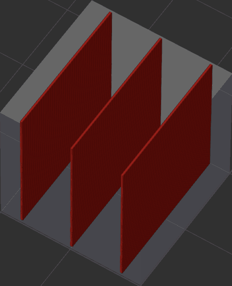
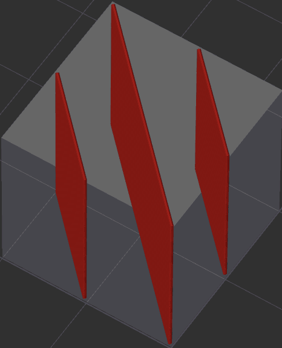
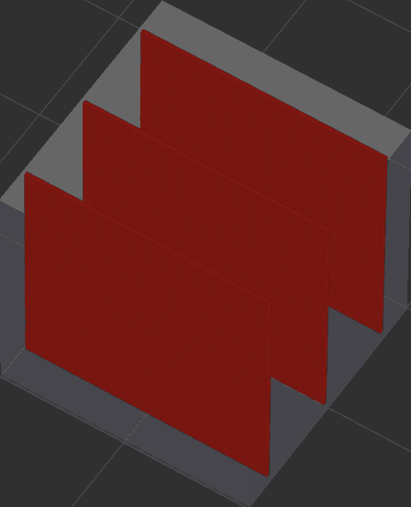
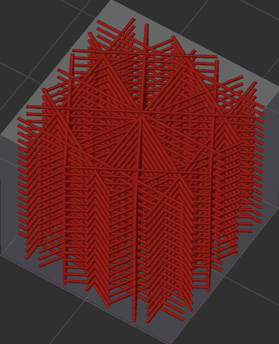
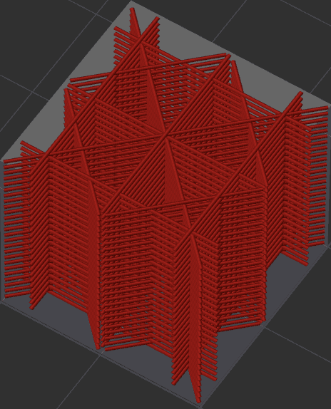
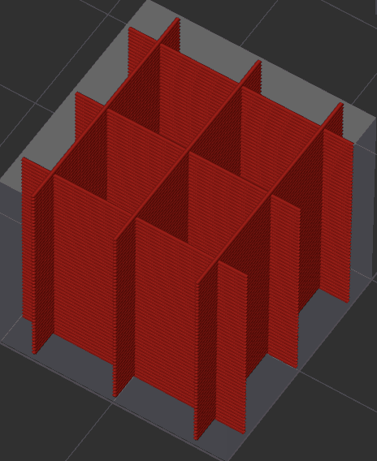
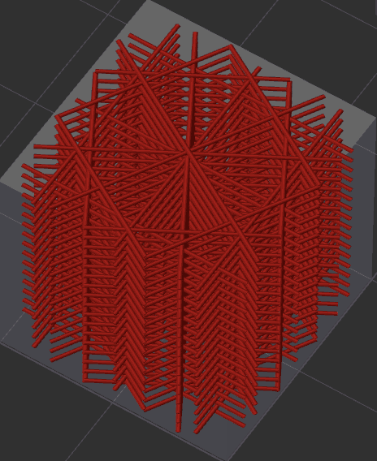
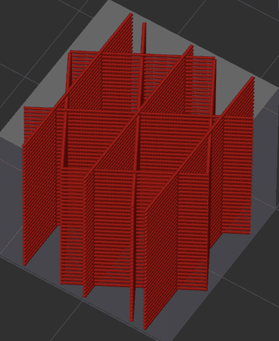
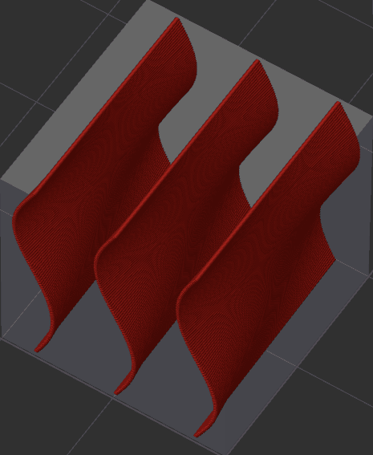

# Infill rotation template metalanguage¶

[Mode](/broken/pages/246b4d07eed07a8ac878abc4613a350fbce2c022): `Advanced`.\
[Variables](/broken/pages/2ce6fff32f5448d0159c2e2dfbcb54f26d3c6918): `sparse_infill_rotate_template`, `solid_infill_rotate_template`.\
[Type](/broken/pages/726477a877bf7a8efe103413c86723285f8ca2eb#text): `Text`.\
[CLI Example](/broken/pages/f439233018f603f29dcf6b1fcc75b0ab21b6fd24#setting-overrides): `--sparse-infill-rotate-template=value` (same pattern for the other variables above).\
This metalanguage provides a way to define the [direction and rotation](/broken/pages/da1f51648c030aebc578bfec4de7c7b47ec7ddd2#direction-and-rotation) of [patterns](/broken/pages/a147f0b85dea1cbf1cf61adb81420a35f687c13f) in 3D printing.

* [Basic instructions](infill-rotation-template-metalanguage.md#basic-instructions)
* [Quick examples](infill-rotation-template-metalanguage.md#quick-examples)
  * [Defined angle](infill-rotation-template-metalanguage.md#defined-angle)
  * [Runtime instructions](infill-rotation-template-metalanguage.md#runtime-instructions)
  * [Joint sign](infill-rotation-template-metalanguage.md#joint-sign)
  * [Counting](infill-rotation-template-metalanguage.md#counting)
  * [Length modifier](infill-rotation-template-metalanguage.md#length-modifier)
* [Description of instructions and examples](infill-rotation-template-metalanguage.md#description-of-instructions-and-examples)
  * [Simple absolute instructions](infill-rotation-template-metalanguage.md#simple-absolute-instructions)
  * [Relative instructions](infill-rotation-template-metalanguage.md#relative-instructions)
  * [Repetitive, adjusting and one-time instructions](infill-rotation-template-metalanguage.md#repetitive-adjusting-and-one-time-instructions)
  * [Range instructions](infill-rotation-template-metalanguage.md#range-instructions)
  * [Constant layer number instructions](infill-rotation-template-metalanguage.md#constant-layer-number-instructions)
* [Complex template examples](infill-rotation-template-metalanguage.md#complex-template-examples)
* [Credits](infill-rotation-template-metalanguage.md#credits)

## Basic instructions[¶](infill-rotation-template-metalanguage.md#basic-instructions) 

## Quick examples[¶](infill-rotation-template-metalanguage.md#quick-examples) 

* `0` - fixed direction at 0° (X-axis)
* `0, 90` - alternate 0° and 90° each layer
* `0, 15, 30` - alternate 0°, 15° and 30° each layer
* `+90` - rotate 90° each layer (sequence 90°, 180°, 270°, 0° ...)
* `+45` - rotate 45° each layer for higher dispersion
* `+30/50%` - linearly rotate by 30° over the next 50% of model height
* `+45/10#` - linearly rotate by 45° across 10 standard layers
* `+15#10` - rotate +15° and keep that angle for 10 layers; repeats every 10 layers
* `B!, +30` - skip the first bottom shell layers from rotation, then rotate 30° per layer
* `0, +30, +90` - use a repeating sequence of 0°, +30°, +90°

`[±]α[*ℤ or !][joint sign, or its combinations][-][ℕ, B or T][length modifier][* or !]` - full length template instruction for the **sparse** infill

`[±]α*` - just setting an initial rotation angle

Note

`[...]` - values in square brackets are optional

### Defined angle[¶](infill-rotation-template-metalanguage.md#defined-angle) 

`[±]α` - command for setting the infill rotation angle (for joint infills over a height range, this is the angle reached at the end of the range):

* `α%` - set the angle α value as a percentage of the full 360 degree rotation.\
  e.g. `100%` means 360°, `50%` = 180°, `25%` = 90°, `75%` = 270°, `12%` = 43.2° and so on.
* `+α` - set positive relative angle CCW
* `-α` - set negative relative angle CW

Note

Relative instructions indicate that the infill direction will change by this angle from one layer to the next.

### Runtime instructions[¶](infill-rotation-template-metalanguage.md#runtime-instructions) 

`[*, *ℤ or !]` - runtime instructions:

* `*` - the mark of "dummy" instruction. It's needed for setting an initial angle. No further action will be taken
* `*ℤ` - repeat the instruction ℤ times
* `!` - the one-time running instruction

### Joint sign[¶](infill-rotation-template-metalanguage.md#joint-sign) 

`[joint sign]` - the symbol which determines the method of connection for turning of the infill:

* `/` - linear displacement of the infill. e.g. `+22.5/50%`.\
  This results in the layers rotating smoothly by 22.5 degrees over half the model's height. Since this is the only instruction, it will repeat until the entire height of the model is filled. An equivalent instruction would be `+6.25%/50%`.\
  
* `#` - infill of multiple layers with vertical displacement at finish angle. e.g. `+22.5#50%`\
  
* `#-` - infill of multiple layers with vertical displacement at initial angle. e.g. `+22.5#-50%`.\
  Here and further, a negative sign before the height value reverses the instruction's action: where a regular instruction begins at angle `α` and ends at `α+22.5`, the reversed one begins at `α+22.5` and ends at `α`.\
  
* `|` - infill of multiple layers with vertical displacement at middle angle. e.g. `+22.5|50%`\
  
* `N` - infill formed by sine function (vertical connection). e.g. `+22.5N50%`.\
  Halving both the angle and the height keeps the same overall rotation of the infill, but increases the frequency of the waves.\
  
* `n` - infill formed by sine function (vertical connection, lazy). e.g. `+22.5n50%`\
  
* `Z` - infill formed by sine function (horizontal connection). e.g. `+22.5Z50%`\
  
* `z` - infill formed by sine function (horizontal connection, lazy). e.g. `+22.5z50%`\
  
* `L` - infill formed by quarter circle (horizontal to vertical connection). e.g. `+22.5L50%`\
  
* `l` - infill formed by quarter circle (vertical to horizontal connection). e.g. `+22.5l50%`\
  
* `U` - infill formed by squared function. e.g. `+22.5U50%`\
  
* `u-` - infill formed by squared function (inverse). e.g. `+22.5u-50%`\
  
* `Q` - infill formed by cubic function. e.g. `+22.5Q50%`\
  
* `q-` - infill formed by cubic function (inverse). e.g. `+22.5q-50%`\
  
* `$` - infill formed by arcsine function. e.g. `+22.5$50%`\
  
* `~` - infill formed with random angle. e.g. `+22.5~50%`\
  
* `^` - infill formed with pseudorandom angle. e.g. `+22.5^50%`\
  

### Counting[¶](infill-rotation-template-metalanguage.md#counting) 

`[-]ℕ` - counting the distance over which the turn will take place:

* `ℕ` - the count will take place by ℕ layers. e.g. `+22.5/50`\
  
* `-ℕ` - indicates that the joint form will be flipped upward. e.g. `+22.5/-50`\
  
* `B` - the count will take place over a number of layers equal to the [Bottom shell layers](/broken/pages/a93444d6bc5d3f832eed7be5e316e5e8f71eee5d#shell-layers) setting
* `T` - the count will take place over a number of layers equal to the [Top shell layers](/broken/pages/a93444d6bc5d3f832eed7be5e316e5e8f71eee5d#shell-layers) setting

### Length modifier[¶](infill-rotation-template-metalanguage.md#length-modifier) 

`ℕ[length modifier]` - the distance over which the specified turn will take place:

* `ℕmm` - the distance in millimeters
* `ℕcm` - the distance in centimeters
* `ℕm` - the distance in meters
* `ℕ'` - the distance in feet
* `ℕ"` - the distance in inches
* `ℕ#` - the height of ℕ layers at the standard layer height
* `ℕ%` - the distance as a percentage of model height

## Description of instructions and examples[¶](infill-rotation-template-metalanguage.md#description-of-instructions-and-examples) 

Each instruction is a combination of symbols and numbers, separated by a comma or a space. For more complex instructions, autoformatting is used to make the template easier to read.

Note

All examples are shown with a 5% density rectilinear infill on a 20x20x20 mm cube with 100 layers of 0.2 mm, without walls or top and bottom shells. The initial angle is 0.

### Simple absolute instructions[¶](infill-rotation-template-metalanguage.md#simple-absolute-instructions) 

They simply define the angle for each layer. Note that when a template is set, the infill [direction](/broken/pages/da1f51648c030aebc578bfec4de7c7b47ec7ddd2#direction) setting is ignored.

* `0`, `15`, `45.5`, `256.5605`... - just fill at the given angle. The initial direction starts at the X-axis, and the acceptable range of values is from 0 to 360
  * `0` as well as `+0`, `-0` or just empty template\
    
  * `45`\
    
  * `0, 30` - is a simple alternation through each layer in the direction of 0 and 30 degrees.\
    
* `0%`, `10%`, `25%`, `100%`... - infill angle as a percentage of a full 360 degree turn. Rotate by 0, 36, 90, and 0 degrees.
  * `25%` - the equivalent of `90` instruction.\
    
* `30, 60, 90, 120, 150, 0` - a more complex command that turns the infill by 30 degrees every layer. At the end of the template, it starts again from the first instruction, and this process continues until the entire height of the model is filled.

### Relative instructions[¶](infill-rotation-template-metalanguage.md#relative-instructions) 

* `+30` - this is a short instruction for counterclockwise rotation. The equivalent of `30, 60, 90, 120, 150, 180, 210, 240, 270, 300, 330, 0` or `30, 60, 90, 120, 150, 0` instruction.\
  
* `-30` - this is the same instruction, but with clockwise rotation. The equivalent of `330, 300, 270, 240, 210, 180, 150, 120, 90, 60, 30, 0` or `330, 300, 270, 240, 210, 0` instruction.
* `+150` - you can use an angle that does not divide 360° evenly for better fill dispersion = `150, 300, 90, 240, 30, 180, 330, 120, 270, 60, 210, 0` ...
* `+45` - The equivalent of `45, 90, 135, 180, 225, 270, 315, 0` or `45, 90, 135, 0` instruction.\
  
* `+90` - The equivalent of `90, 180, 270, 0` or `90, 0` instruction.\
  
* `+15%` - useful for dividing angles on a decimal basis = `54, 108, 162, 216, 270, 324, 18, 72, 126, 180, 234, 288, 342, 36, 90, 144, 198, 252, 306, 0` ...
* `+30, +90` - a complex instruction setting the rotation of each layer in these positions = `30, 120, 150, 240, 270, 0` ...\
  
* `0, +30, +90` - a complex instruction setting the rotation of each layer in these positions = `0, 30, 120` ...\
  

### Repetitive, adjusting and one-time instructions[¶](infill-rotation-template-metalanguage.md#repetitive-adjusting-and-one-time-instructions) 

* `5, 10, +20` - simple instructions without modifiers. Sets the angles in sequence = 5, 10, 30, 5, 10, 30, 5, 10 ...
* `5, 10*, +20` - the `*` sign without a number sets the initial angle without processing a layer. It is useful for setting the orientation of a group of layers, which will be described below. Sets the angles in sequence = 5, 30, 5, 30, 5, 30, 5 ...
* `5, 10!, +20` - the `!` sign indicates that the instruction will be executed only once for the entire height of the model. Sets the angles in sequence = 5, 10, 30, 5, 25, 5, 25, 5 ...
* `5, 10*!, +20` - the combination of `*` and `!` signs is also usable = 5, 30, 5, 25, 5, 25, 5, 25 ...
* `5, 10*3, +20` - if a number is written after the `*` sign, it indicates the number of repetitions of this instruction. Sets the angles in sequence = 5, 10, 10, 10, 30, 5, 10, 10, 10, 30, 5, 10 ...

### Range instructions[¶](infill-rotation-template-metalanguage.md#range-instructions) 

A range instruction groups a set of layers and predetermines the rotation of each layer relative to the others. You can specify how many layers will be rotated by a certain angle, and according to which mathematical law this rotation will be performed. This law is determined by writing a certain symbol and specifying a numeric value after it. The following signs are available that determine the shape of the turn: `/` `#` `#-` `|` `N` `n` `Z` `z` `L` `l` `U` `u` `Q` `q` `$` `~` `^`. For their purpose, see [joint sign](infill-rotation-template-metalanguage.md#joint-sign).

If a length modifier follows the numeric value, the rotation occurs over the described length. The following modifiers are available that determine the range of turn: `mm` `cm` `m` `'` `"` `#` `%`. For their purpose, see [length modifier](infill-rotation-template-metalanguage.md#length-modifier).

If there is a `-` sign before the numeric value, the initial and final fill angles are swapped. This is useful for joining the linear infills in some cases. Range instructions have no effect on absolute rotation angles. It is important to know that this will not be the exact length, but will be tied to the nearest layer from below.

* `+45/100` - rotate linearly by 45 degrees over the next 100 layers. For this model, this instruction is equivalent to `+45/100%` as it contains 100 layers.\
  
* When the height of the instruction is halved, `+45/50` or `+45/50%`, the final angle will be 90, as the turn will occur twice.\
  
* `-50%Z1cm` - rotate the infill 180 degrees CW over one centimeter of height, following a sine function.

### Constant layer number instructions[¶](infill-rotation-template-metalanguage.md#constant-layer-number-instructions) 

The letter signs `T` and `B` take the number of top and bottom shell layers of the model. They are useful for skipping that many layers to align the fill.

* `B!, +30` - skip the first bottom shell layers from rotation, then fill with a 30 degree turn each layer
* `+30/1cm, T` - rotate the infill linearly by 30 degrees over one centimeter, then skip a number of layers equal to the top shell layers without rotation.

## Complex template examples[¶](infill-rotation-template-metalanguage.md#complex-template-examples) 

* `+10L25%, -10l25%, -10L25%, +10l25%` - fill the model with one sine period of 10 degree amplitude\
  
* `+30/-10#` - rotate the infill inverse linearly by 30 degrees over the height of 10 standard layers (with a standard layer height of 0.2 mm, 10 x 0.2 mm = 2 mm).\
  
* `+360~100%` or `+100%~100%` - fill the model with a random infill direction at each layer.\
  

## Credits[¶](infill-rotation-template-metalanguage.md#credits) 

* **Feature author:** [@pi-squared-studio](https://github.com/pi-squared-studio).
