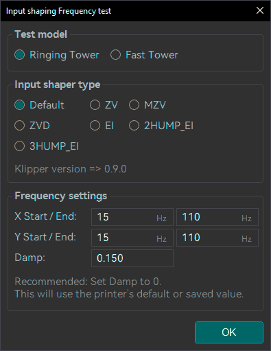
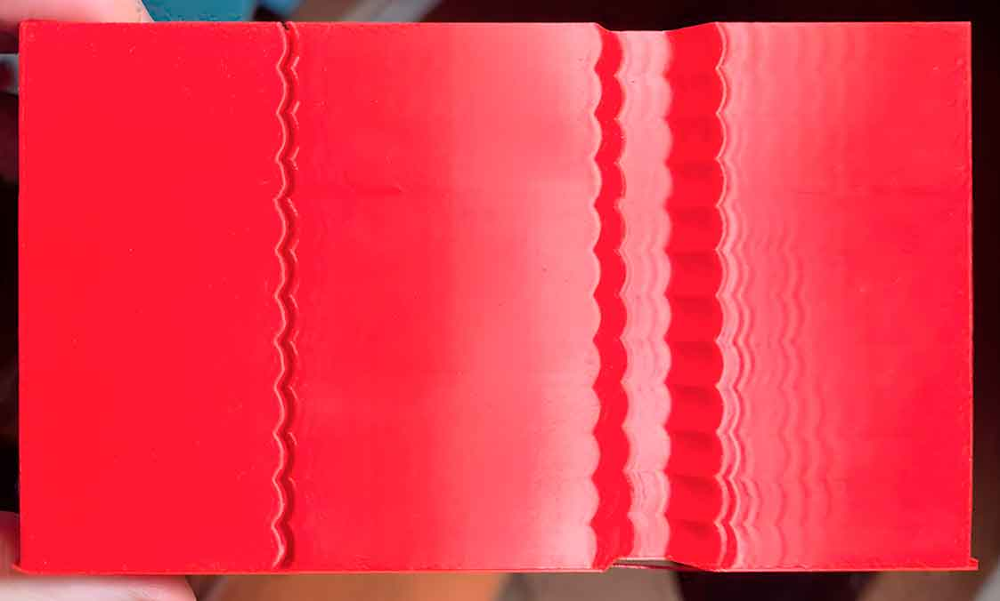
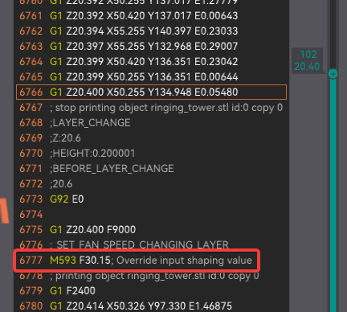
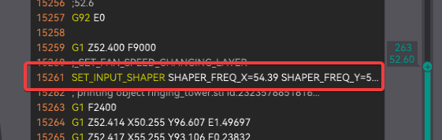
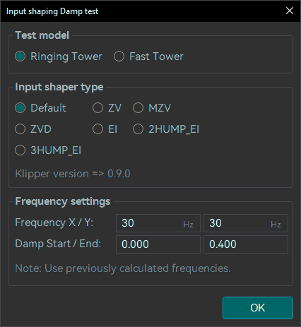
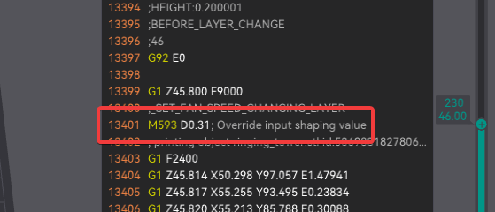
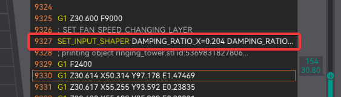

# Input Shaping¶

This Calibration guide will help you to calibrate the [Input Shaping](/broken/pages/053648f94ba5f635d165734b67c47d50256deed6#input-shaping) feature in your printer firmware.

Note

Some Printers have built-in accelerometers that can be used to **automatically** measure the resonant frequencies of the printer.\
If your printer has one, consider using it as it can provide more accurate results in less time and usually is autosaved into the printer firmware.

Tip

Follow the recommended calibration order in the [Calibration Guide](/broken/pages/11c07341f1c2537a4800ccab7e8c9c26d87a5246).

Tip

It's usually recommended to perform Input Shaping calibration once a year or after any mechanical or structural changes such as relocation, changing the support surface, new belts, motors, frame, etc.

* [Calibration](input-shaping.md#calibration)
* [Credits](input-shaping.md#credits)

## Calibration[¶](input-shaping.md#calibration) <a href="#calibration" id="calibration"></a>

Pre-requisites:

* Use an opaque, high-gloss filament to make the ringing more visible.
* In OrcaSlicer, set:
  * Acceleration high enough to trigger ringing (e.g., 20000 mm/s²).
  * Speed high enough to trigger ringing (e.g., 200 mm/s).

Important

It's recommended to use the fastest [acceleration](/broken/pages/8f016c37be2b0b663224cc06049d830a089c70e7), [speed](/broken/pages/e7564d8175752533bd6013e85bc33a5635aa36fb) and [Jerk/Junction Deviation](/broken/pages/7be52dd66f6f98ad86dab218c36e11ddebf56960) your printer can handle without losing steps.\
This test **will set the values to high values** limited by your printer's motion ability and the filament's max volumetric speed (avoid materials below 10 mm³/s).

1. Select the Test Model ´Ringing Tower´ (Recommended) or ´Fast Tower´ (Reduced version useful for printers with high ringing).
2. Select the [Input Shaper Type](/broken/pages/053648f94ba5f635d165734b67c47d50256deed6#input-shaping-type) you want to test. Each firmware has different types available and each type has different performance.
3. Select a range of frequencies to test. The Default 15hz to 110hz range is usually a good start.
4. Select your damping. Usually, a value between 0.1 and 0.2 is a good start but you can change it to 0 and your printer will use the firmware default value (if available).\
   
   1. **Measure the X and Y heights** and read the frequency set at that point in OrcaSlicer.\
      
      * Marlin:\
        
      * Klipper:\
        
   2. If not a clear result, you can measure a X and Y min and max acceptable heights and repeat the test with that min and max value.
5. **Print the Damping test** setting your X and Y frequency to the value you found in the previous step.\
   
   1. Measure the X and Y heights and read the damping set at that point in OrcaSlicer.\
      
      * Marlin:\
        
      * Klipper:\
        
6. **Restore your 3D Printer settings to avoid keep using high acceleration and jerk values.**
7. **Save the settings**
   * Into your printer firmware settings save the values you found (Type, frequency/cies and damp)
   * Save it into Orca's printer profile settings:
     * Motion ability → Resonance Compensation (**Marlin**/**RepRap**):
       1. [Go to Printer settings → Motion ability → Resonance Compensation](/broken/pages/053648f94ba5f635d165734b67c47d50256deed6#resonance-compensation):
       2. Set your Type, Frequencies and Damping values.\
          
     * Machine start G-code:
       *   Klipper:

           * Skeleton:

           ```
           SET_INPUT_SHAPER SHAPER_TYPE=TYPE SHAPER_FREQ_X=#Xfrequency DAMPING_RATIO_X=#XDamping SHAPER_FREQ_Y=#Yfrequency     DAMPING_RATIO_Y=#YDamping
           ```

           * Example:

           ```
           SET_INPUT_SHAPER SHAPER_TYPE=MZV SHAPER_FREQ_X=37.25 DAMPING_RATIO_X=0.16 SHAPER_FREQ_Y=37.5 DAMPING_RATIO_Y=0.06
           ```
       *   Marlin:

           * Skeleton:

           ```
           M593 X F#Xfrequency D#XDamping
           M593 Y F#Yfrequency D#YDamping
           M500
           ```

           * Example

           ```
           M593 X F37.25 D0.16
           M593 Y F37.5 D0.06
           M500
           ```
       *   RepRap:

           * Skeleton: for RepRap 3.3 and later

           ```
           M593 P#Type F#frequency S#Damping
           ```

           * Example RepRap 3.4 and later

           ```
           M593 P"ZVD" F37.25 S0.16
           ```

           * Skeleton: for RepRap 3.2 and earlier

           ```
           M593 F#frequency
           ```

           * Example Legacy (RepRap 3.2 and earlier)

           ```
           M593 F37.25
           ```

## Credits[¶](input-shaping.md#credits) <a href="#credits" id="credits"></a>

* **Input Shaping Calibration:** [@IanAlexis](https://github.com/IanAlexis) and [@RF47](https://github.com/RF47)
* **Klipper testing:** [@ShaneDelmore](https://github.com/ShaneDelmore)
