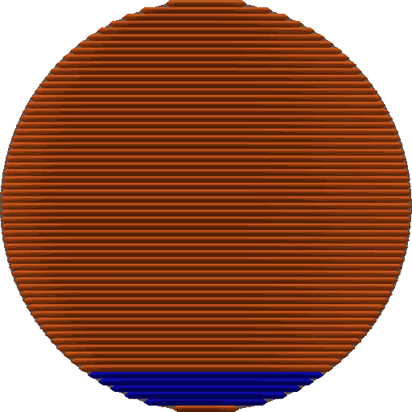

# Overhangs¶

Overhangs are areas of a print that extend outward without full support underneath.\
Low overhang angles can be printed without support, while higher angles may require support, speed reduction, or specific settings to ensure good print quality.

* [Detect overhang wall](overhangs.md#detect-overhang-wall)
* [Unsupported wall last](overhangs.md#unsupported-wall-last)
* [Make overhang printable](overhangs.md#make-overhang-printable)
  * [Maximum angle](overhangs.md#maximum-angle)
  * [Hole area](overhangs.md#hole-area)
* [Extra perimeters on overhangs](overhangs.md#extra-perimeters-on-overhangs)
* [Reverse on even](overhangs.md#reverse-on-even)
  * [Reverse internal only](overhangs.md#reverse-internal-only)
  * [Reverse threshold](overhangs.md#reverse-threshold)

## Detect overhang wall[¶](overhangs.md#detect-overhang-wall) 

[Mode](/broken/pages/246b4d07eed07a8ac878abc4613a350fbce2c022): `Advanced`.\
[Variable](/broken/pages/2ce6fff32f5448d0159c2e2dfbcb54f26d3c6918): `detect_overhang_wall`.\
[Type](/broken/pages/726477a877bf7a8efe103413c86723285f8ca2eb#boolean): `Boolean`.\
[CLI Example](/broken/pages/f439233018f603f29dcf6b1fcc75b0ab21b6fd24#setting-overrides): `--detect-overhang-wall=1`.\
Detects the overhang percentage relative to the line width and uses a different speed to print. Walls with 100% overhang are printed with the bridge settings.

## Unsupported wall last[¶](overhangs.md#unsupported-wall-last) 

[Mode](/broken/pages/246b4d07eed07a8ac878abc4613a350fbce2c022): `Advanced`.\
[Variable](/broken/pages/2ce6fff32f5448d0159c2e2dfbcb54f26d3c6918): `unsupported_wall_last`.\
[Type](/broken/pages/726477a877bf7a8efe103413c86723285f8ca2eb#boolean): `Boolean`.\
[CLI Example](/broken/pages/f439233018f603f29dcf6b1fcc75b0ab21b6fd24#setting-overrides): `--unsupported-wall-last=1`.

Important

NEW FEATURE: **Print unsupported walls last**\
Available in: [Nightly builds](https://github.com/OrcaSlicer/OrcaSlicer/releases/tag/nightly-builds) or Releases greater than **2.4.2**.

Wall loops that lie entirely in mid-air, with nothing under them on the layer below, are printed once something can hold them: they are extruded after the walls that anchor them, innermost first, whatever the [walls printing order](/broken/pages/8737adce37259a727713a40d86d1257eda155156#walls-printing-order) is.

Anchorage spreads outwards, so a loop leaning on a loop that is itself anchored counts as anchored too. What is left over falls into two cases:

* A loop running alongside a supported wall belongs to the same wall stack and keeps its place before the infill, which needs it as an anchor.
* A loop that touches nothing has only the infill to rest on, so it is held back and extruded in a second wall pass after the infill of its layer. This includes loops that only the bridges of the layer can anchor, which wait until those bridges are down.

This works with both the classic and Arachne wall generators, and with either setting of [print infill first](/broken/pages/8737adce37259a727713a40d86d1257eda155156#print-infill-first).

Note

Only available when [Detect overhang wall](overhangs.md#detect-overhang-wall) is enabled. If that condition is not met, this setting will be hidden.

## Make overhang printable[¶](overhangs.md#make-overhang-printable) 

[Mode](/broken/pages/246b4d07eed07a8ac878abc4613a350fbce2c022): `Advanced`.\
[Variable](/broken/pages/2ce6fff32f5448d0159c2e2dfbcb54f26d3c6918): `make_overhang_printable`.\
[Type](/broken/pages/726477a877bf7a8efe103413c86723285f8ca2eb#boolean): `Boolean`.\
[CLI Example](/broken/pages/f439233018f603f29dcf6b1fcc75b0ab21b6fd24#setting-overrides): `--make-overhang-printable=1`.\
This setting will modify the geometry to print overhangs without support material.\
Every overhang exceeding the [maximum angle](overhangs.md#maximum-angle) will be modified to be printable.

### Maximum angle[¶](overhangs.md#maximum-angle) 

[Mode](/broken/pages/246b4d07eed07a8ac878abc4613a350fbce2c022): `Advanced`.\
[Variable](/broken/pages/2ce6fff32f5448d0159c2e2dfbcb54f26d3c6918): `make_overhang_printable_angle`.\
[Type](/broken/pages/726477a877bf7a8efe103413c86723285f8ca2eb#integer-float-percentage): `Float`.\
[CLI Example](/broken/pages/f439233018f603f29dcf6b1fcc75b0ab21b6fd24#setting-overrides): `--make-overhang-printable-angle=1`.\
Maximum angle of overhangs to allow after making steeper overhangs printable.\
90° will not change the model at all and allow any overhang, while 0 will replace all overhangs with conical material.

Tip

Usually, a value between 45° and 60° works well for most printers and models.

### Hole area[¶](overhangs.md#hole-area) 

[Mode](/broken/pages/246b4d07eed07a8ac878abc4613a350fbce2c022): `Advanced`.\
[Variable](/broken/pages/2ce6fff32f5448d0159c2e2dfbcb54f26d3c6918): `make_overhang_printable_hole_size`.\
[Type](/broken/pages/726477a877bf7a8efe103413c86723285f8ca2eb#integer-float-percentage): `Float`.\
[CLI Example](/broken/pages/f439233018f603f29dcf6b1fcc75b0ab21b6fd24#setting-overrides): `--make-overhang-printable-hole-size=1`.\
Maximum area of a hole in the base of the model before it's filled by conical material.\
A value of 0 will fill all the holes in the model base.

## Extra perimeters on overhangs[¶](overhangs.md#extra-perimeters-on-overhangs) 

[Mode](/broken/pages/246b4d07eed07a8ac878abc4613a350fbce2c022): `Advanced`.\
[Variable](/broken/pages/2ce6fff32f5448d0159c2e2dfbcb54f26d3c6918): `extra_perimeters_on_overhangs`.\
[Type](/broken/pages/726477a877bf7a8efe103413c86723285f8ca2eb#boolean): `Boolean`.\
[CLI Example](/broken/pages/f439233018f603f29dcf6b1fcc75b0ab21b6fd24#setting-overrides): `--extra-perimeters-on-overhangs=1`.\
Create additional perimeter (overhang wall) paths over steep overhangs and areas where bridges cannot be anchored.

This option only works when [Detect overhang walls](overhangs.md#detect-overhang-wall) is enabled, even though it stays visible and editable when that option is off.

## Reverse on even[¶](overhangs.md#reverse-on-even) 

[Mode](/broken/pages/246b4d07eed07a8ac878abc4613a350fbce2c022): `Advanced`.\
[Variable](/broken/pages/2ce6fff32f5448d0159c2e2dfbcb54f26d3c6918): `overhang_reverse`.\
[Type](/broken/pages/726477a877bf7a8efe103413c86723285f8ca2eb#boolean): `Boolean`.\
[CLI Example](/broken/pages/f439233018f603f29dcf6b1fcc75b0ab21b6fd24#setting-overrides): `--overhang-reverse=1`.\
Extrude perimeters that have a part over an overhang in the reverse direction on even layers. This alternating pattern can drastically improve steep overhangs thanks to material squishing direction.

This setting can also help reduce part warping due to the reduction of stresses as they are now distributed in alternating directions. Useful for warp-prone materials, like ABS/ASA, and also for elastic filaments, like TPU and Silk PLA.\
It can also help reduce warping on floating regions over supports.

For this setting to be the most effective, it is recommended to set the [Reverse Threshold](overhangs.md#reverse-threshold) to 0 so that all walls print in alternating directions on even layers irrespective of their overhang degree. A disadvantage of this setting is that the outer wall may show a texture due to the alternating extrusion direction.

### Reverse internal only[¶](overhangs.md#reverse-internal-only) 

[Mode](/broken/pages/246b4d07eed07a8ac878abc4613a350fbce2c022): `Advanced`.\
[Variable](/broken/pages/2ce6fff32f5448d0159c2e2dfbcb54f26d3c6918): `overhang_reverse_internal_only`.\
[Type](/broken/pages/726477a877bf7a8efe103413c86723285f8ca2eb#boolean): `Boolean`.\
[CLI Example](/broken/pages/f439233018f603f29dcf6b1fcc75b0ab21b6fd24#setting-overrides): `--overhang-reverse-internal-only=1`.\
A simple way to reduce the texture on the outer wall is to only reverse the internal walls. This will still provide almost all of the benefits of alternating extrusion direction on even layers (if using [inner/outer](/broken/pages/8737adce37259a727713a40d86d1257eda155156#innerouter)), but the outer wall will be printed in the same direction, resulting in a smoother surface finish.

### Reverse threshold[¶](overhangs.md#reverse-threshold) 

[Mode](/broken/pages/246b4d07eed07a8ac878abc4613a350fbce2c022): `Advanced`.\
[Variable](/broken/pages/2ce6fff32f5448d0159c2e2dfbcb54f26d3c6918): `overhang_reverse_threshold`.\
[Type](/broken/pages/726477a877bf7a8efe103413c86723285f8ca2eb#integer-float-percentage): `Float or Percentage`.\
[CLI Example](/broken/pages/f439233018f603f29dcf6b1fcc75b0ab21b6fd24#setting-overrides): `--overhang-reverse-threshold=20%`.\
You can set a threshold for the overhang reversal to be considered useful. Can be set as:

* **0**: Disables the threshold, meaning that all walls will be reversed on even layers.
* **mm**: A fixed distance in millimeters.
* **%**: A percentage of the perimeter width.

When using this setting, the walls will make the reversal texture in the layers where the overhang is above the threshold, and the rest of the walls will be printed in the normal direction. This could result in uneven texture, sometimes considered worse than the full reversal texture, so it is recommended to use this setting only if you are sure that the overhang reversal will not be useful for your model.

Note

Only available when:

* [Detect overhang wall](overhangs.md#detect-overhang-wall) is enabled
* [Reverse on even](overhangs.md#reverse-on-even) is enabled
* [Reverse internal only](overhangs.md#reverse-internal-only) is disabled

If those conditions are not met, this setting will be hidden.
