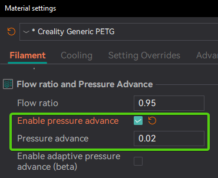

# Pressure Advance¶

[Pressure Advance](/broken/pages/4da0e8a2d1390e2f4166da4f6cca2f83837a3bb6#pressure-advance) calibration helps compensate for the lag in extrusion pressure that occurs when the print head changes speed. Properly calibrated Pressure Advance can significantly improve print quality, especially during rapid acceleration and deceleration.

OrcaSlicer includes three approaches for calibrating the Pressure Advance value. Each method has its own advantages and disadvantages. It is important to note that each method has two versions: one for a direct-drive extruder and one for a Bowden extruder. Make sure to select the appropriate version for your test.

Tip

Follow the recommended calibration order in the [Calibration Guide](/broken/pages/11c07341f1c2537a4800ccab7e8c9c26d87a5246).

Warning

**Marlin Printers:** Linear Advance must be enabled in firmware (M900).\
**Not all printers have it enabled by default.**

Warning

**Bambulab Printers:** make sure you do not select the 'Flow calibration' option. 

* [Calibration](pressure-advance.md#calibration)
  * [Tower method](pressure-advance.md#tower-method)
  * [Pattern method](pressure-advance.md#pattern-method)
  * [Line method](pressure-advance.md#line-method)

## Calibration[¶](pressure-advance.md#calibration) 

You can use different methods to calibrate the Pressure Advance value, each with its own advantages and disadvantages.

The results from these methods should be saved to the material profile.\

Tip

Consider using the [Adaptive Pressure Advance](/broken/pages/4f66a6f5693b4bfc0e71b9323776541409376697) method for more accurate results.\
Especially for high-speed printers.

Note

On a [belt printer](/broken/pages/226f2361e5d5e6ef3f7abf3becc7918d447a2ef7), only the [Tower method](pressure-advance.md#tower-method) is available. The Pattern and Line methods are disabled.

### Tower method[¶](pressure-advance.md#tower-method) 

The tower method may take a bit more time to complete, but it does not rely on the quality of the first layer.

1. Select the printer, filament, and process you would like to use for the test.
2. Examine each corner and seams of the print and mark the height that yields the best overall result.\
   The Pressure Advance value rises progressively from the start value at the bottom of the tower to the end value at the top, one step per millimetre of height. The tower is cut to fit the range you requested, so the top of the tower is the end value and it is never exceeded.
3. In this example a height of 8 mm was selected, so the Pressure Advance value should be calculated as `PressureAdvanceStart + (PressureAdvanceStep x measured)`; example: `0 + (0.002 x 8) = 0.016`.\
   \
   \
   \
   

Tip

@ItsDeidara has created an HTML tool to help with these calculations. Check it out if you find the equations confusing: [Orca-Slicer-Assistant](https://github.com/ItsDeidara/Orca-Slicer-Assistant).

### Pattern method[¶](pressure-advance.md#pattern-method) 

The pattern method is adapted from [Andrew Ellis' pattern method generator](https://ellis3dp.com/Pressure_Linear_Advance_Tool/), which was itself derived from the [Marlin pattern method](https://marlinfw.org/tools/lin_advance/k-factor.html) developed by [Sineos](https://github.com/Sineos/k-factorjs).

The test configuration window allows the user to generate one or more tests in a single project. Multiple tests will be placed on the plate with extra plates added if needed.

* **Single test**:\
  
* **Batch mode testing**: multiple tests on a single plate.\
  

Once a test is generated, one or more small rectangular prisms will be placed on the plate, one for each test case. The prism object serves a few purposes:

* The test pattern itself is added in as custom G-Code at each layer, same as you could do by hand. The rectangular prism provides the layers in which to insert that G-Code. This also means that **you'll see the full test pattern when you move to the Preview pane:**\
  
* The prism acts as a handle, enabling you to move the test pattern wherever you'd like on the plate by moving the prism.
* Each test object is pre-configured with target parameters which are reflected in the object's name. Test parameters may be adjusted for each prism individually via the object list pane:\
  

Next, Ellis' generator provided the ability to adjust specific printer, filament, and print profile settings. You can make these same changes in OrcaSlicer by adjusting the settings in the Prepare pane as you would with any other print. When you initiate the calibration test, Ellis' default settings are applied. A few things to note about these settings:

* Ellis specified line widths as a percent of filament diameter. The Orca pattern method does the same to provide its suggested defaults, making use of Ellis' percentages in combination with your specified nozzle diameter.
* In terms of line width, the pattern only makes use of the `Default` and `First layer` widths.
* In terms of speed, the pattern only uses the `First layer speed -> First layer` and `Other layers speed -> Outer wall` speeds.
* The infill pattern beneath the numbers cannot be changed because it's not actually an infill pattern pulled from the settings. All of the pattern G-Code is custom written, so that "infill" is, effectively, hand-drawn and not processed through the usual channels that would enable Orca to recognize it as infill.

### Line method[¶](pressure-advance.md#line-method) 

The line method is quick and straightforward to test. However, its accuracy depends heavily on the quality of your first layer. It is suggested to turn on bed mesh leveling for this test.

Steps:

1. Select the printer, filament, and process you would like to use for the test.
2. Print the project and check the result. Choose the value corresponding to the most even line and update your Pressure Advance value in the filament settings.
3. In this test, a Pressure Advance value of `0.016` appears to be optimal.\
   \
   
