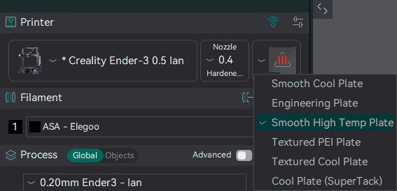
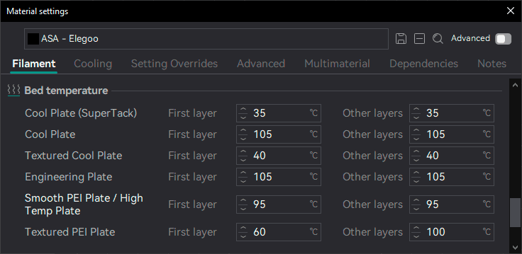

# Printable Space¶

This section defines the printer’s physical build area and how the slicer maps models to it. Configure the bed shape, dimensions and origin so the virtual bed matches your machine; use a circular or rectangular profile for standard beds or supply an STL for custom shapes. Add a texture or model to improve visual alignment in the 3D view.

Specify any excluded (unprintable) regions as a polygon so the arranger avoids them, and any obstacles the toolhead must not hit as collision volumes. Set the printable height to your maximum Z travel, and use Z offset to correct endstop inaccuracies (this value is added to every Z coordinate in exported G‑code). The best object position is a normalized \[0–1] preference used by automatic arranging, and preferred orientation controls automatic Z-axis alignment on import.

* [Printable area (Bed Shape)](printable-space.md#printable-area-bed-shape)
  * [Shape](printable-space.md#shape)
  * [Settings](printable-space.md#settings)
  * [Texture](printable-space.md#texture)
  * [Model](printable-space.md#model)
* [Excluded bed area](printable-space.md#excluded-bed-area)
* [Toolhead collision volumes](printable-space.md#toolhead-collision-volumes)
  * [Volume format](printable-space.md#volume-format)
  * [Collision volume behavior](printable-space.md#collision-volume-behavior)
  * [Extruder collision volumes](printable-space.md#extruder-collision-volumes)
  * [Preview](printable-space.md#preview)
  * [Limitations](printable-space.md#limitations)
* [Printable height](printable-space.md#printable-height)
* [Support multi bed types](printable-space.md#support-multi-bed-types)
* [Best object position](printable-space.md#best-object-position)
* [Z offset](printable-space.md#z-offset)
* [Preferred orientation](printable-space.md#preferred-orientation)

## Printable area (Bed Shape)[¶](printable-space.md#printable-area-bed-shape) <a href="#printable-area-bed-shape" id="printable-area-bed-shape"></a>

Defines the printable area on the print bed.

### Shape[¶](printable-space.md#shape) <a href="#shape" id="shape"></a>

Shape of the printable area on the print bed.

* Rectangular: Standard rectangular print bed.
* Circular: Circular print bed.
* Custom: Custom shape defined by STL file.

### Settings[¶](printable-space.md#settings) <a href="#settings" id="settings"></a>

* Size: Size in X and Y of the rectangular plate.
* Origin: Distance of the 0,0 G-code coordinate from the front left corner of the rectangle.

### Texture[¶](printable-space.md#texture) <a href="#texture" id="texture"></a>

SVG or PNG texture image file to be used as a background for the print bed in the 3D view.

### Model[¶](printable-space.md#model) <a href="#model" id="model"></a>

STL file defining the custom shape of the print bed.

## Excluded bed area[¶](printable-space.md#excluded-bed-area) <a href="#excluded-bed-area" id="excluded-bed-area"></a>

[Mode](/broken/pages/246b4d07eed07a8ac878abc4613a350fbce2c022): `Advanced`.\
[Variable](/broken/pages/2ce6fff32f5448d0159c2e2dfbcb54f26d3c6918): `bed_exclude_area`.\
[Type](/broken/pages/726477a877bf7a8efe103413c86723285f8ca2eb#list-types): `Point list`.\
[CLI Example](/broken/pages/f439233018f603f29dcf6b1fcc75b0ab21b6fd24#setting-overrides): `--bed-exclude-area=100,100`.\
Unprintable area in XY plane. For example, X1 Series printers use the front left corner to cut filament during filament change. The area is expressed as polygon by points in following format: "XxY, XxY, ..."\
It keeps models and printed material out of the area, but the toolhead can still travel through it, as the X1 does to cut the filament. To also keep the toolhead's moves out, set [Toolhead collision volumes](printable-space.md#toolhead-collision-volumes).

## Toolhead collision volumes[¶](printable-space.md#toolhead-collision-volumes) <a href="#toolhead-collision-volumes" id="toolhead-collision-volumes"></a>

[Mode](/broken/pages/246b4d07eed07a8ac878abc4613a350fbce2c022): `Advanced`.\
[Variables](/broken/pages/2ce6fff32f5448d0159c2e2dfbcb54f26d3c6918): `bed_exclude_volumes`, `bed_exclude_volume_mode`, `extruder_bed_exclude_volumes[extruder_idx]`.\
[Type](/broken/pages/726477a877bf7a8efe103413c86723285f8ca2eb): `bed_exclude_volumes` (Text), `bed_exclude_volume_mode` (Choice: shared, toolhead\_offset, per\_extruder), `extruder_bed_exclude_volumes` (Text list).\
[CLI Example](/broken/pages/f439233018f603f29dcf6b1fcc75b0ab21b6fd24#setting-overrides): `--bed-exclude-volumes=value` (`bed_exclude_volumes` shown; other variables above follow their own type).

Important

NEW FEATURE: **Toolhead collision volumes**\
Available in: [Nightly builds](https://github.com/OrcaSlicer/OrcaSlicer/releases/tag/nightly-builds) or Releases greater than **2.4.2**.

Obstacles the toolhead must not hit, such as bed clips, a tool dock, a camera arm or parts of the gantry. Each one is a polygon on the bed that can cover the full printable height or only a range of Z, so a low clip only blocks the first millimeters.

Unlike the [Excluded bed area](printable-space.md#excluded-bed-area), which only keeps material out, collision volumes are also kept clear by the toolhead's moves:

* **Models:** an object that enters a volume, at any height where both exist, is reported as an error. It is checked for every nozzle it prints with.
* **Generated material:** brims and supports are cut back so they don't print inside a volume.
* **Travel:** travel moves are routed around the volumes.
* **G-code check:** after slicing, every move in the final G-code is checked again, and a warning is shown for any move that crosses a volume.

The field is empty by default, and nothing changes until a volume is entered. Collision volumes are added to the Excluded bed area, so a printer can keep its filament cutter area and add collision volumes elsewhere.

### Volume format[¶](printable-space.md#volume-format) <a href="#volume-format" id="volume-format"></a>

Coordinates are in millimeters on the bed, as in the [Excluded bed area](printable-space.md#excluded-bed-area).

* `XxY, XxY, ...` is a polygon that covers the full [Printable height](printable-space.md#printable-height).
* `ZMIN..ZMAX;XxY, XxY, ...` is a polygon that only covers the heights from ZMIN to ZMAX. Either one can be left out: `..10;` covers from the bed up to 10 mm, and `30..;` from 30 mm up to the printable height.
* `|` separates volumes.

For example, a full-height volume in the front left corner and a second one from 8 to 22 mm:

```
20x0,45x0,45x18,20x18|8..22;115x20,145x20,145x48,115x48
```

Z ranges are limited to the Printable height. An invalid definition is reported as an error.

Tip

If you paste a definition in this format into the [Excluded bed area](printable-space.md#excluded-bed-area), Orca offers to add it to the collision volumes instead. The Excluded bed area keeps its previous value.

[Arrange](/broken/pages/0fcd3913806f2ebe7be268c6b82f8de56ec468b6) uses the bounding box of a non-convex volume, so it may keep objects further away than needed.

### Collision volume behavior[¶](printable-space.md#collision-volume-behavior) <a href="#collision-volume-behavior" id="collision-volume-behavior"></a>

Only shown for printers with more than one extruder. Sets how the volumes apply to each nozzle:

* **Shared by all nozzles:** every nozzle uses the same volumes. This is the default.
* **Toolhead-relative (nozzle offsets):** the volumes are entered once, as seen from the main nozzle (usually the first), and each other nozzle uses them shifted by the difference between its [Extruder offset](/broken/pages/54fc4ba47d549303cf6c193b25f9585c9e1bda1e#extruder-offset-position) and the main nozzle's. Every extruder must have an offset. The Excluded bed area isn't shifted.
* **Individual per extruder:** hides the Toolhead collision volumes field and shows [Extruder collision volumes](printable-space.md#extruder-collision-volumes) on each extruder's page instead. When this mode is selected and no extruder has volumes yet, the shared volumes are copied to every extruder.

### Extruder collision volumes[¶](printable-space.md#extruder-collision-volumes) <a href="#extruder-collision-volumes" id="extruder-collision-volumes"></a>

The collision volumes of one extruder, in the **Individual per extruder** behavior. Set them in each extruder's page of the printer settings, with the same [format](printable-space.md#volume-format) as the shared volumes. Leave it empty for an extruder with no collision volumes.

Volumes follow the physical extruder that prints, not the filament.

### Preview[¶](printable-space.md#preview) <a href="#preview" id="preview"></a>

The footprint of each volume is shown on the bed. Volumes that apply only to some nozzles have a thin border in the color of their nozzle.

**View > Show all collision volumes** (`Ctrl + Shift + K` by default, see [Keyboard Shortcuts](/broken/pages/f38b1f04a296fbbc6d07ec335d357a2e836922c3#global)) shows every volume over its full height, even on an empty bed. It only changes the display, not the slicing or the G-code check, and is remembered across printers.

### Limitations[¶](printable-space.md#limitations) <a href="#limitations" id="limitations"></a>

Warning

Collision volumes reduce the risk of a collision, but don't guarantee safe G-code. A warning from the G-code check doesn't fix the move; check the G-code before printing.

* **Firmware macros:** moves made inside a macro called from the G-code (e.g. `PRINT_START` on Klipper) can't be seen or checked.
* **Homing:** after a homing command, the homed axes are unknown until the G-code moves to an explicit position. A move with an unknown Z is checked against every height.
* **Extrusion:** only travel moves are rerouted. Extrusions aren't, and [skirts and draft shields](/broken/pages/c1db5ba9eabdd3f5539eaecc05b5a6c1efdeac1b) aren't rebuilt around the volumes.
* **Spiral Z-hop:** the circle a [Spiral Z-hop](/broken/pages/dc18322a6319f10648e1a1374e7cae7f8bb073ca#z-hop-type) draws isn't taken into account when the travel is routed.

## Printable height[¶](printable-space.md#printable-height) <a href="#printable-height" id="printable-height"></a>

[Mode](/broken/pages/246b4d07eed07a8ac878abc4613a350fbce2c022): `Simple`.\
[Variable](/broken/pages/2ce6fff32f5448d0159c2e2dfbcb54f26d3c6918): `printable_height`.\
[Type](/broken/pages/726477a877bf7a8efe103413c86723285f8ca2eb#integer-float-percentage): `Float`.\
[CLI Example](/broken/pages/f439233018f603f29dcf6b1fcc75b0ab21b6fd24#setting-overrides): `--printable-height=1`.\
This is the maximum printable height which is limited by the height of the build area.

## Support multi bed types[¶](printable-space.md#support-multi-bed-types) <a href="#support-multi-bed-types" id="support-multi-bed-types"></a>

[Mode](/broken/pages/246b4d07eed07a8ac878abc4613a350fbce2c022): `Simple`.\
[Variable](/broken/pages/2ce6fff32f5448d0159c2e2dfbcb54f26d3c6918): `support_multi_bed_types`.\
[Type](/broken/pages/726477a877bf7a8efe103413c86723285f8ca2eb#boolean): `Boolean`.\
[CLI Example](/broken/pages/f439233018f603f29dcf6b1fcc75b0ab21b6fd24#setting-overrides): `--support-multi-bed-types=1`.\
Once enabled, you can select the bed type in the drop-down menu, corresponding bed temperature will be set automatically.



This also enabled you to set each bed type in the [filament settings](/broken/pages/68b6b7d711b5de8eafb31dd2591fd5e4242529b5#bed).



Orca also support `curr_bed_type` variable in custom G-code. For example, the following sample G-codes can detect the selected bed type and adjust the G-code offset accordingly for Klipper:

```
{if curr_bed_type=="Textured PEI Plate"}
  SET_GCODE_OFFSET Z=-0.05
{else}
  SET_GCODE_OFFSET Z=0.0
{endif}
```

Available bed types are:

* Smooth Cool Plate
* Smooth High Temp Plate
* Textured Cool Plate
* Textured PEI Plate
* Engineering Plate
* Cool Plate (SuperTack)

## Best object position[¶](printable-space.md#best-object-position) <a href="#best-object-position" id="best-object-position"></a>

[Mode](/broken/pages/246b4d07eed07a8ac878abc4613a350fbce2c022): `Advanced`.\
[Variable](/broken/pages/2ce6fff32f5448d0159c2e2dfbcb54f26d3c6918): `best_object_pos`.\
[Type](/broken/pages/726477a877bf7a8efe103413c86723285f8ca2eb#point): `Point`.\
[CLI Example](/broken/pages/f439233018f603f29dcf6b1fcc75b0ab21b6fd24#setting-overrides): `--best-object-pos=100,100`.\
Best auto arranging position in range \[0,1] w.r.t. bed shape.

## Z offset[¶](printable-space.md#z-offset) <a href="#z-offset" id="z-offset"></a>

[Mode](/broken/pages/246b4d07eed07a8ac878abc4613a350fbce2c022): `Advanced`.\
[Variable](/broken/pages/2ce6fff32f5448d0159c2e2dfbcb54f26d3c6918): `z_offset`.\
[Type](/broken/pages/726477a877bf7a8efe103413c86723285f8ca2eb#integer-float-percentage): `Float`.\
[CLI Example](/broken/pages/f439233018f603f29dcf6b1fcc75b0ab21b6fd24#setting-overrides): `--z-offset=1`.\
This value will be added (or subtracted) from all the Z coordinates in the output G-code. It is used to compensate for bad Z endstop position: for example, if your endstop zero actually leaves the nozzle 0.3mm far from the print bed, set this to -0.3 (or fix your endstop).

## Preferred orientation[¶](printable-space.md#preferred-orientation) <a href="#preferred-orientation" id="preferred-orientation"></a>

[Mode](/broken/pages/246b4d07eed07a8ac878abc4613a350fbce2c022): `Advanced`.\
[Variable](/broken/pages/2ce6fff32f5448d0159c2e2dfbcb54f26d3c6918): `preferred_orientation`.\
[Type](/broken/pages/726477a877bf7a8efe103413c86723285f8ca2eb#integer-float-percentage): `Float`.\
[CLI Example](/broken/pages/f439233018f603f29dcf6b1fcc75b0ab21b6fd24#setting-overrides): `--preferred-orientation=1`.\
Automatically orient STL files on the Z axis upon initial import.
