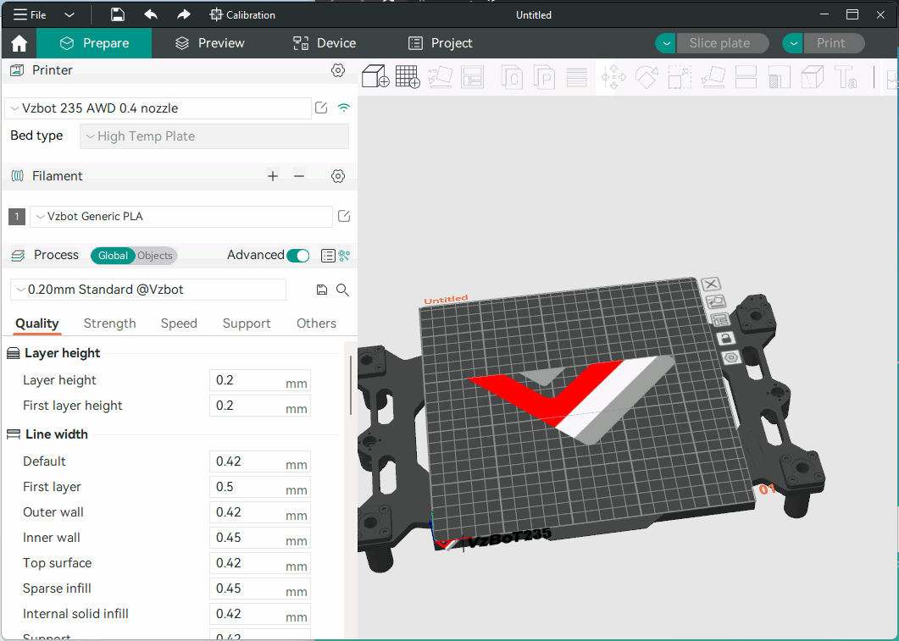
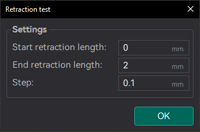
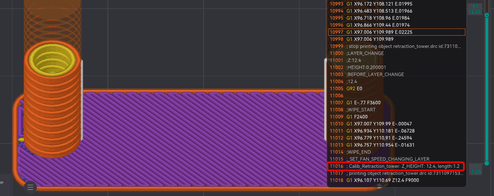

# Retraction test¶

This [Retraction](/broken/pages/75e6952d821ef19c2ad711c5a0448fb610dfb3b0) test generates a retraction tower automatically. The retraction tower is a vertical structure with multiple notches, each printed at a different retraction length. After the print is complete, we can examine each section of the tower to determine the optimal retraction length for the filament. The optimal retraction length is the shortest one that produces the cleanest tower.

Tip

Follow the recommended calibration order in the [Calibration Guide](/broken/pages/11c07341f1c2537a4800ccab7e8c9c26d87a5246).

In the dialog, you can select the start and end retraction length, as well as the retraction length increment step. The default values are 0mm for the start retraction length, 2mm for the end retraction length, and 0.1mm for the step. These values are suitable for most direct drive extruders. However, for Bowden extruders, you may want to increase the start and end retraction lengths to 1mm and 6mm, respectively, and set the step to 0.2mm.

After the print is complete, visually inspect the retraction tower to identify the section with the least stringing and oozing.\
Measure this section's height and search in the gcode preview the `Calib_Retraction_tower` comment to find the corresponding retraction length.

Warning

Use the `Calib_Retraction_tower` comment instead of the `; retract` G-code command. The `; retract` command doesn't always show the actual retraction length, as it doesn't include values like [Retract amount before wipe](/broken/pages/75e6952d821ef19c2ad711c5a0448fb610dfb3b0#retract-amount-before-wipe).

Note

When testing filaments such as PLA or ABS that have minimal oozing, the retraction settings can be highly effective.\
You may find that the retraction tower appears clean right from the start. In such situations, setting the retraction length to 0.2mm - 0.4mm should suffice.\
On the other hand, if there is still a lot of stringing at the top of the tower, it is recommended to dry your filament and ensure that your nozzle is properly installed without any leaks.
