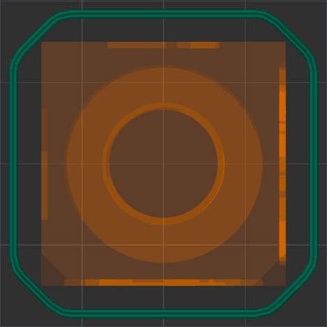

# Skirt¶

A skirt is one or more additional perimeters printed around the model outline on the first layer(s). It helps prime the hotend, stabilize extrusion before the model starts, and can act as a basic wind/draft shield when built taller.

* [Loops](skirt.md#loops)
* [Type](skirt.md#type)
  * [Combined](skirt.md#combined)
  * [Per object](skirt.md#per-object)
* [Minimum extrusion Length](skirt.md#minimum-extrusion-length)
* [Distance](skirt.md#distance)
* [Start point](skirt.md#start-point)
* [Speed](skirt.md#speed)
* [Height](skirt.md#height)
* [Shield](skirt.md#shield)
* [Single loop after first layer](skirt.md#single-loop-after-first-layer)

## Loops[¶](skirt.md#loops) 

[Mode](/broken/pages/246b4d07eed07a8ac878abc4613a350fbce2c022): `Simple`.\
[Variable](/broken/pages/2ce6fff32f5448d0159c2e2dfbcb54f26d3c6918): `skirt_loops`.\
[Type](/broken/pages/726477a877bf7a8efe103413c86723285f8ca2eb#integer-float-percentage): `Integer`.\
[CLI Example](/broken/pages/f439233018f603f29dcf6b1fcc75b0ab21b6fd24#setting-overrides): `--skirt-loops=1`.\
Number of skirt loops to print.\
Usually 2 loops are recommended, but more loops improve priming and give a larger buffer between the nozzle and the part, at the cost of extra filament and time.\
Set to 0 to disable the skirt.

## Type[¶](skirt.md#type) 

[Mode](/broken/pages/246b4d07eed07a8ac878abc4613a350fbce2c022): `Advanced`.\
[Variable](/broken/pages/2ce6fff32f5448d0159c2e2dfbcb54f26d3c6918): `skirt_type`.\
[Type](/broken/pages/726477a877bf7a8efe103413c86723285f8ca2eb#choice): `Choice`.\
[Options](/broken/pages/726477a877bf7a8efe103413c86723285f8ca2eb#choice): `combined, perobject`.\
[CLI Example](/broken/pages/f439233018f603f29dcf6b1fcc75b0ab21b6fd24#setting-overrides): `--skirt-type=combined`.

### Combined[¶](skirt.md#combined) 

A single skirt that surrounds all objects on the bed. Recommended for general use.

### Per object[¶](skirt.md#per-object) 

Each object gets its own skirt printed separately. Objects close enough for their skirts to overlap share a single skirt. Recommended when using [Print sequence by object](/broken/pages/e792de15ca89fe7bca7e8654ec76e5852fdd584b#by-object).

## Minimum extrusion Length[¶](skirt.md#minimum-extrusion-length) 

[Mode](/broken/pages/246b4d07eed07a8ac878abc4613a350fbce2c022): `Advanced`.\
[Variable](/broken/pages/2ce6fff32f5448d0159c2e2dfbcb54f26d3c6918): `min_skirt_length`.\
[Type](/broken/pages/726477a877bf7a8efe103413c86723285f8ca2eb#integer-float-percentage): `Float`.\
[CLI Example](/broken/pages/f439233018f603f29dcf6b1fcc75b0ab21b6fd24#setting-overrides): `--min-skirt-length=1`.\
Minimum filament extrusion length in mm when printing the skirt. Zero means this feature is disabled.\
Using a non-zero value is useful if the printer is set up to print without a prime line.\
The final number of loops is not taken into account when arranging objects or validating the distance between them. Increase the number of loops in that case.

## Distance[¶](skirt.md#distance) 

[Mode](/broken/pages/246b4d07eed07a8ac878abc4613a350fbce2c022): `Advanced`.\
[Variable](/broken/pages/2ce6fff32f5448d0159c2e2dfbcb54f26d3c6918): `skirt_distance`.\
[Type](/broken/pages/726477a877bf7a8efe103413c86723285f8ca2eb#integer-float-percentage): `Float`.\
[CLI Example](/broken/pages/f439233018f603f29dcf6b1fcc75b0ab21b6fd24#setting-overrides): `--skirt-distance=1`.\
Distance from skirt to brim or object.\
Increasing this distance can help avoid collisions with brims or supports, but will increase the footprint of the skirt and filament usage.

## Start point[¶](skirt.md#start-point) 

[Mode](/broken/pages/246b4d07eed07a8ac878abc4613a350fbce2c022): `Advanced`.\
[Variable](/broken/pages/2ce6fff32f5448d0159c2e2dfbcb54f26d3c6918): `skirt_start_angle`.\
[Type](/broken/pages/726477a877bf7a8efe103413c86723285f8ca2eb#integer-float-percentage): `Float`.\
[CLI Example](/broken/pages/f439233018f603f29dcf6b1fcc75b0ab21b6fd24#setting-overrides): `--skirt-start-angle=1`.\
Start angle for the skirt relative to the object center. 0° is the right-most position (along the +X axis), angles increase counter-clockwise.\
Use this to control where the skirt begins to better align with part features or prime locations.

## Speed[¶](skirt.md#speed) 

[Mode](/broken/pages/246b4d07eed07a8ac878abc4613a350fbce2c022): `Advanced`.\
[Variable](/broken/pages/2ce6fff32f5448d0159c2e2dfbcb54f26d3c6918): `skirt_speed`.\
[Type](/broken/pages/726477a877bf7a8efe103413c86723285f8ca2eb#integer-float-percentage): `Float`.\
[CLI Example](/broken/pages/f439233018f603f29dcf6b1fcc75b0ab21b6fd24#setting-overrides): `--skirt-speed=1`.\
Printing speed for the skirt in mm/s. Set to 0 to use the [First layer infill](/broken/pages/1902fd5fb4f97cd776e6116015b89995974ec588#initial-layer-infill) speed on the first layer and the [Support](/broken/pages/e7564d8175752533bd6013e85bc33a5635aa36fb#support) speed on higher layers.\
Slower speeds give a more reliable prime; very fast skirt speeds may not adhere properly and come off, causing problems with the part.

## Height[¶](skirt.md#height) 

[Mode](/broken/pages/246b4d07eed07a8ac878abc4613a350fbce2c022): `Simple`.\
[Variable](/broken/pages/2ce6fff32f5448d0159c2e2dfbcb54f26d3c6918): `skirt_height`.\
[Type](/broken/pages/726477a877bf7a8efe103413c86723285f8ca2eb#integer-float-percentage): `Integer`.\
[CLI Example](/broken/pages/f439233018f603f29dcf6b1fcc75b0ab21b6fd24#setting-overrides): `--skirt-height=1`.\
Number of layers the skirt should be printed for. Usually 1 layer for priming. Increase the height if you want a taller draft shield effect.

## Shield[¶](skirt.md#shield) 

[Mode](/broken/pages/246b4d07eed07a8ac878abc4613a350fbce2c022): `Advanced`.\
[Variable](/broken/pages/2ce6fff32f5448d0159c2e2dfbcb54f26d3c6918): `draft_shield`.\
[Type](/broken/pages/726477a877bf7a8efe103413c86723285f8ca2eb#choice): `Choice`.\
[Options](/broken/pages/726477a877bf7a8efe103413c86723285f8ca2eb#choice): `disabled, enabled`.\
[CLI Example](/broken/pages/f439233018f603f29dcf6b1fcc75b0ab21b6fd24#setting-overrides): `--draft-shield=disabled`.\
When enabled, the skirt is printed as a draft shield: a taller wall surrounding the part to help protect prints (especially ABS/ASA) from drafts and sudden temperature changes.\
This is most useful for open-frame printers without an enclosure.

* Enabled: the shield is as tall as the tallest printed model on the bed.
* Disabled: the skirt uses the [Height](skirt.md#height) value.

Note

The skirt is printed at the [skirt distance](skirt.md#distance) from the brim, or from the object if it has no brim, so the draft shield does not intersect brims.

## Single loop after first layer[¶](skirt.md#single-loop-after-first-layer) 

[Mode](/broken/pages/246b4d07eed07a8ac878abc4613a350fbce2c022): `Advanced`.\
[Variable](/broken/pages/2ce6fff32f5448d0159c2e2dfbcb54f26d3c6918): `single_loop_draft_shield`.\
[Type](/broken/pages/726477a877bf7a8efe103413c86723285f8ca2eb#boolean): `Boolean`.\
[CLI Example](/broken/pages/f439233018f603f29dcf6b1fcc75b0ab21b6fd24#setting-overrides): `--single-loop-draft-shield=1`.\
When enabled, limits the skirt or draft shield to a single wall after the first layer (i.e. only one loop is printed on subsequent layers). This reduces filament and print time but makes the shield less robust and more prone to warping or cracking.
