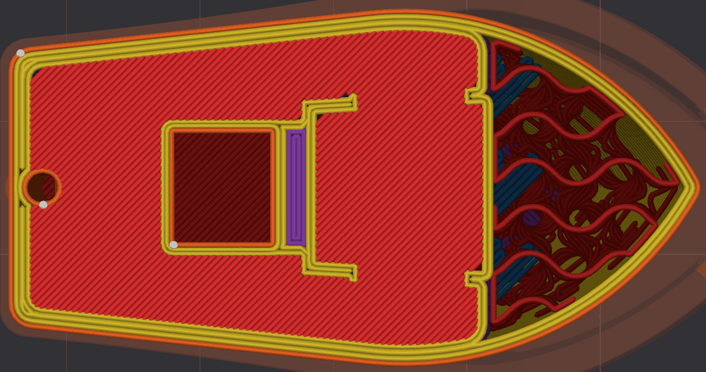
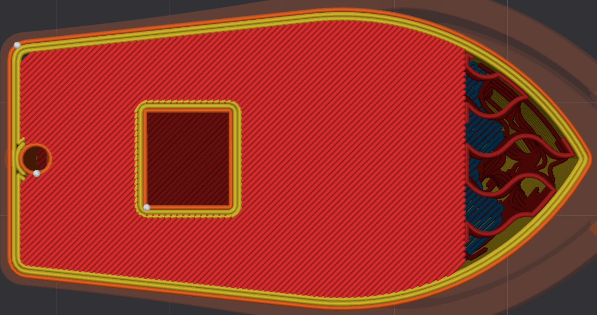
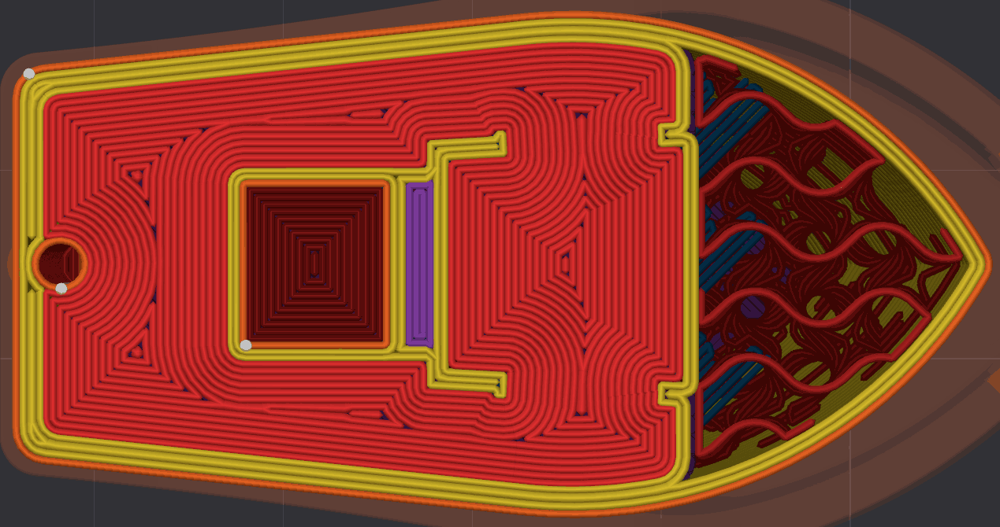
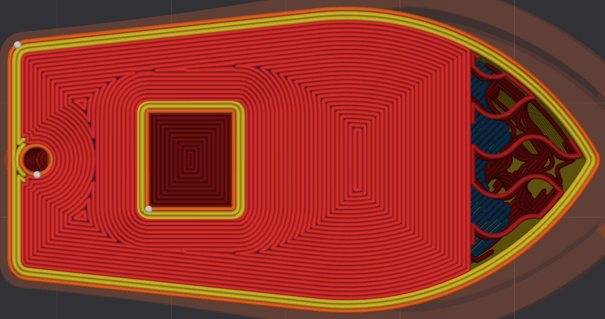
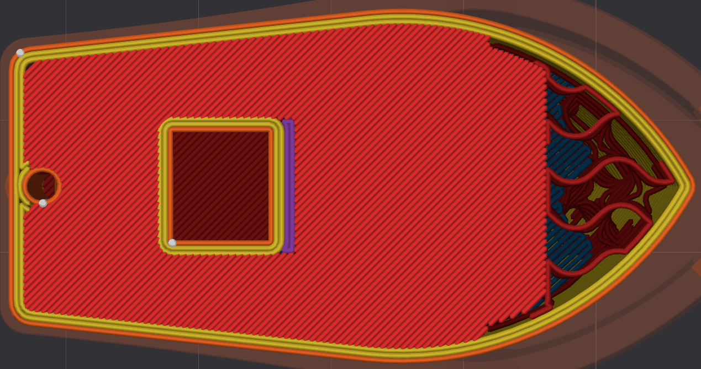
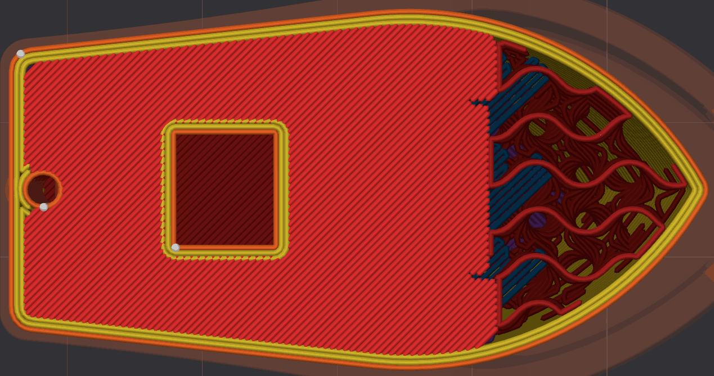
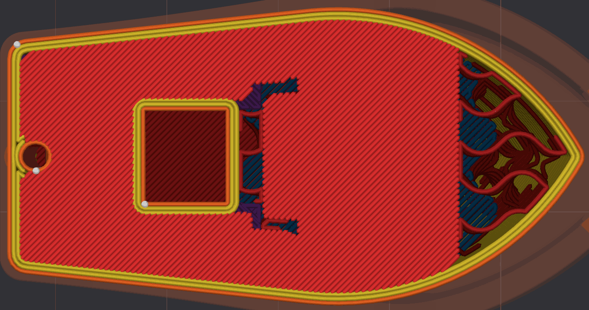
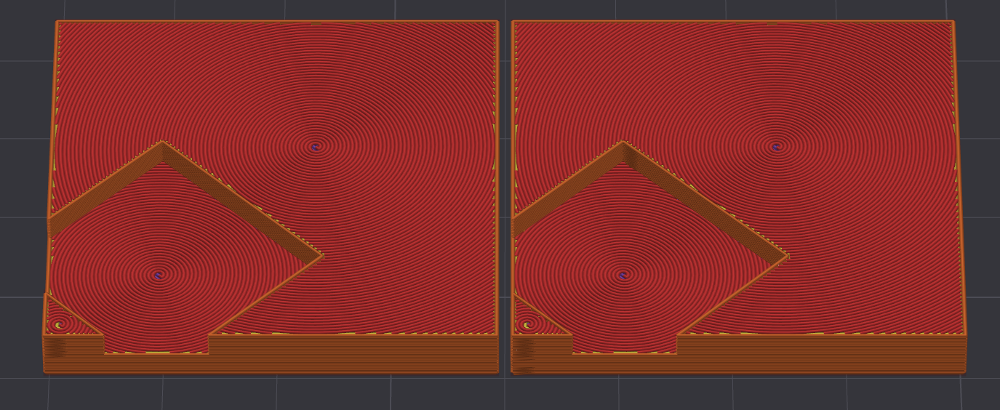
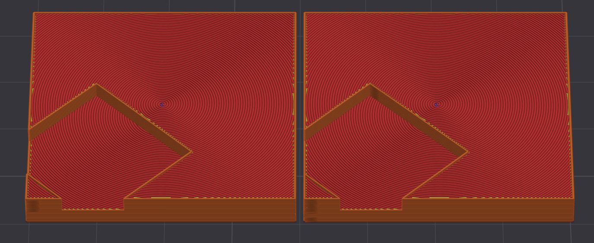
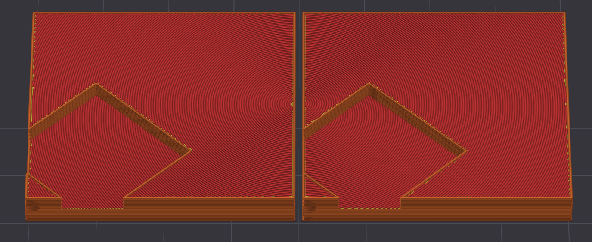

# Top and Bottom Shells¶

Controls how the top and bottom solid layers (shells) are generated.

* [Shell Layers](top-and-bottom-shells.md#shell-layers)
* [Shell Thickness](top-and-bottom-shells.md#shell-thickness)
* [Paint Penetration Layers](top-and-bottom-shells.md#paint-penetration-layers)
* [Surface Density](top-and-bottom-shells.md#surface-density)
* [Infill/Wall Overlap](top-and-bottom-shells.md#infillwall-overlap)
* [Surface Pattern](top-and-bottom-shells.md#surface-pattern)
* [Surface Expansion](top-and-bottom-shells.md#surface-expansion)
  * [Surface Expansion Margin](top-and-bottom-shells.md#surface-expansion-margin)
  * [Surface Expansion Direction](top-and-bottom-shells.md#surface-expansion-direction)
  * [Surface Expansion and Only One Wall](top-and-bottom-shells.md#surface-expansion-and-only-one-wall)
* [Center Surface Pattern On](top-and-bottom-shells.md#center-surface-pattern-on)
* [Fill Order](top-and-bottom-shells.md#fill-order)

## Shell Layers[¶](top-and-bottom-shells.md#shell-layers) 

[Mode](/broken/pages/246b4d07eed07a8ac878abc4613a350fbce2c022): `Simple`.\
[Variables](/broken/pages/2ce6fff32f5448d0159c2e2dfbcb54f26d3c6918): `top_shell_layers`, `bottom_shell_layers`.\
[Type](/broken/pages/726477a877bf7a8efe103413c86723285f8ca2eb#integer-float-percentage): `Integer`.\
[CLI Example](/broken/pages/f439233018f603f29dcf6b1fcc75b0ab21b6fd24#setting-overrides): `--top-shell-layers=1` (same pattern for the other variables above).\
This is the number of solid shell layers, including the surface layer.\
When the thickness calculated from this value is less than [shell thickness](top-and-bottom-shells.md#shell-thickness), the shell layers will be increased.

These layers are printed over the [sparse infill](/broken/pages/da1f51648c030aebc578bfec4de7c7b47ec7ddd2), so increasing **shell layers** will increase overall part strength and top surface quality. It's usually recommended to have at least 3 shell layers for most prints.

## Shell Thickness[¶](top-and-bottom-shells.md#shell-thickness) 

[Mode](/broken/pages/246b4d07eed07a8ac878abc4613a350fbce2c022): `Simple`.\
[Variables](/broken/pages/2ce6fff32f5448d0159c2e2dfbcb54f26d3c6918): `top_shell_thickness`, `bottom_shell_thickness`.\
[Type](/broken/pages/726477a877bf7a8efe103413c86723285f8ca2eb#integer-float-percentage): `Float`.\
[CLI Example](/broken/pages/f439233018f603f29dcf6b1fcc75b0ab21b6fd24#setting-overrides): `--top-shell-thickness=1` (same pattern for the other variables above).\
The number of solid layers is increased during slicing if the thickness calculated from shell layers is thinner than this value. This avoids having too thin a shell when layer height is small.\
0 means this setting is disabled and shell thickness is determined entirely by [shell layers](top-and-bottom-shells.md#shell-layers).

## Paint Penetration Layers[¶](top-and-bottom-shells.md#paint-penetration-layers) 

[Mode](/broken/pages/246b4d07eed07a8ac878abc4613a350fbce2c022): `Advanced`.\
[Variables](/broken/pages/2ce6fff32f5448d0159c2e2dfbcb54f26d3c6918): `top_color_penetration_layers`, `bottom_color_penetration_layers`.\
[Type](/broken/pages/726477a877bf7a8efe103413c86723285f8ca2eb#integer-float-percentage): `Integer`.\
[CLI Example](/broken/pages/f439233018f603f29dcf6b1fcc75b0ab21b6fd24#setting-overrides): `--top-color-penetration-layers=1` (same pattern for the other variables above).

Important

NEW FEATURE: **Paint penetration layers**\
Available in: [Nightly builds](https://github.com/OrcaSlicer/OrcaSlicer/releases/tag/nightly-builds) or Releases greater than **2.4.2**.

When a top or bottom surface is painted with [Color Painting](/broken/pages/ce3f2c39bd778e693abe651878da8af77be3cdc4), its color is also printed in the layers under a painted top surface and over a painted bottom surface, so the filament behind the paint doesn't show through. This is the number of layers that take the color, including the surface layer.\
Each layer further from the surface is colored about two line widths narrower than the one before, so the color tapers into the model instead of reaching its walls.

* **0:** uses the [Shell Layers](top-and-bottom-shells.md#shell-layers) count. This is the default, and how painted surfaces were always printed before this setting existed.
* **Lower values:** keep a thick shell for strength while printing fewer layers in the painted color, saving a filament change and its purge on each layer left out.
* **Higher values:** give a deeper, more saturated color, which helps with translucent or light filaments that let the layers behind them show through.

Warning

Keep the value within the shell, which is the larger of [Shell Layers](top-and-bottom-shells.md#shell-layers) and the layers needed to reach [Shell Thickness](top-and-bottom-shells.md#shell-thickness). A larger value also colors the [sparse infill](/broken/pages/da1f51648c030aebc578bfec4de7c7b47ec7ddd2) under or over the painted area, adding filament changes where they can't be seen.

## Surface Density[¶](top-and-bottom-shells.md#surface-density) 

[Mode](/broken/pages/246b4d07eed07a8ac878abc4613a350fbce2c022): `Simple`.\
[Variables](/broken/pages/2ce6fff32f5448d0159c2e2dfbcb54f26d3c6918): `top_surface_density`, `bottom_surface_density`.\
[Type](/broken/pages/726477a877bf7a8efe103413c86723285f8ca2eb#integer-float-percentage): `Percentage`.\
[CLI Example](/broken/pages/f439233018f603f29dcf6b1fcc75b0ab21b6fd24#setting-overrides): `--top-surface-density=20%` (same pattern for the other variables above).\
This setting controls the density of the top and bottom surfaces. A value of 100% means a solid surface, while lower values create a sparse surface.\
This can be used for aesthetic purposes, improving grip or creating interfaces.

## Infill/Wall Overlap[¶](top-and-bottom-shells.md#infillwall-overlap) 

[Mode](/broken/pages/246b4d07eed07a8ac878abc4613a350fbce2c022): `Advanced`.\
[Variable](/broken/pages/2ce6fff32f5448d0159c2e2dfbcb54f26d3c6918): `top_bottom_infill_wall_overlap`.\
[Type](/broken/pages/726477a877bf7a8efe103413c86723285f8ca2eb#integer-float-percentage): `Percentage`.\
[CLI Example](/broken/pages/f439233018f603f29dcf6b1fcc75b0ab21b6fd24#setting-overrides): `--top-bottom-infill-wall-overlap=20%`.\
The top solid infill area is slightly enlarged to overlap with walls for better bonding and to minimize pinholes where the infill meets the walls.\
A value of 25-30% is a good starting point. The percentage value is approximately relative to the inner wall line width. More precisely, it is relative to half the inner wall line spacing plus half the internal solid infill line spacing with the [Classic](/broken/pages/54a6fe288c2767d758a6868ebef10f327f69163c#classic) wall generator, and to the inner wall line spacing with [Arachne](/broken/pages/54a6fe288c2767d758a6868ebef10f327f69163c#arachne) (the outer wall line spacing in both cases where only one wall is printed).

Tip

Check [Monotonic line](/broken/pages/a147f0b85dea1cbf1cf61adb81420a35f687c13f#monotonic-line) to learn about its overlap differences with [Monotonic](/broken/pages/a147f0b85dea1cbf1cf61adb81420a35f687c13f#monotonic) and [Rectilinear](/broken/pages/a147f0b85dea1cbf1cf61adb81420a35f687c13f#rectilinear).

## Surface Pattern[¶](top-and-bottom-shells.md#surface-pattern) 

[Mode](/broken/pages/246b4d07eed07a8ac878abc4613a350fbce2c022): `Simple`.\
[Variables](/broken/pages/2ce6fff32f5448d0159c2e2dfbcb54f26d3c6918): `top_surface_pattern`, `bottom_surface_pattern`.\
[Type](/broken/pages/726477a877bf7a8efe103413c86723285f8ca2eb#choice): `Choice`.\
[Options](/broken/pages/726477a877bf7a8efe103413c86723285f8ca2eb#choice): `monotonic, monotonicline, rectilinear, alignedrectilinear, concentric, spiralinset, hilbertcurve, archimedeanchords, octagramspiral`.\
[CLI Example](/broken/pages/f439233018f603f29dcf6b1fcc75b0ab21b6fd24#setting-overrides): `--top-surface-pattern=monotonic` (same pattern for the other variables above).\
This setting controls the pattern of the surfaces.\
If [Shell Layers](top-and-bottom-shells.md#shell-layers) is greater than 1, the surface pattern will be applied to the outermost shell layer only and the rest will use [Internal Solid Infill Pattern](/broken/pages/da1f51648c030aebc578bfec4de7c7b47ec7ddd2#internal-solid-infill).

Tip

See [Infill Patterns Wiki List](/broken/pages/a147f0b85dea1cbf1cf61adb81420a35f687c13f) with **detailed specifications**, including their strengths and weaknesses.

The surface patterns are:

* [**Concentric**](/broken/pages/a147f0b85dea1cbf1cf61adb81420a35f687c13f#concentric)
* [**Rectilinear**](/broken/pages/a147f0b85dea1cbf1cf61adb81420a35f687c13f#rectilinear)
* [**Monotonic**](/broken/pages/a147f0b85dea1cbf1cf61adb81420a35f687c13f#monotonic)
* [**Monotonic line**](/broken/pages/a147f0b85dea1cbf1cf61adb81420a35f687c13f#monotonic-line): usually recommended for top surfaces.
* [**Aligned Rectilinear**](/broken/pages/a147f0b85dea1cbf1cf61adb81420a35f687c13f#aligned-rectilinear)
* [**Spiral Inset**](/broken/pages/a147f0b85dea1cbf1cf61adb81420a35f687c13f#spiral-inset)
* [**Hilbert Curve**](/broken/pages/a147f0b85dea1cbf1cf61adb81420a35f687c13f#hilbert-curve)
* [**Archimedean Chords**](/broken/pages/a147f0b85dea1cbf1cf61adb81420a35f687c13f#archimedean-chords)
* [**Octagram Spiral**](/broken/pages/a147f0b85dea1cbf1cf61adb81420a35f687c13f#octagram-spiral)

Tip

Enable [Align directions to model](/broken/pages/def49ed4375ccd47ffeb8694997bbd8dc609e159#align-directions-to-model) to make the top/bottom surface fill direction follow the model's orientation on the build plate.

## Surface Expansion[¶](top-and-bottom-shells.md#surface-expansion) 

[Mode](/broken/pages/246b4d07eed07a8ac878abc4613a350fbce2c022): `Advanced`.\
[Variable](/broken/pages/2ce6fff32f5448d0159c2e2dfbcb54f26d3c6918): `top_surface_expansion`.\
[Type](/broken/pages/726477a877bf7a8efe103413c86723285f8ca2eb#integer-float-percentage): `Float`.\
[CLI Example](/broken/pages/f439233018f603f29dcf6b1fcc75b0ab21b6fd24#setting-overrides): `--top-surface-expansion=1`.

Important

NEW FEATURE: **Top surface expansion** (expansion, margin and direction)\
Available in: [Nightly builds](https://github.com/OrcaSlicer/OrcaSlicer/releases/tag/nightly-builds) or Releases greater than **2.4.2**.

Expands the top surfaces by this distance (in mm) to connect distinct top surfaces and fill the gaps left where a feature rises through them.\
This is useful when the top surface is interrupted by a raised feature, such as text or a boss on a plane, or when overlapping objects would otherwise split it: expanding the surface removes the holes beneath these features, keeps the top-surface pattern uninterrupted, and anchors the solid infill for a cleaner finish when printing on top. It also improves [concentric](/broken/pages/a147f0b85dea1cbf1cf61adb81420a35f687c13f#concentric) top surfaces, whose pattern would otherwise be broken up by those small holes.\
The expansion is applied to the original top surface, before any other processing such as bridging or overhang detection. Set to `0` to disable it.

* **Original**

* **Expanded by 5 mm**

* Improved [concentric](/broken/pages/a147f0b85dea1cbf1cf61adb81420a35f687c13f#concentric) top surface.
  * Before:
  * After:

Note

Surface expansion needs a top solid surface to grow. It does nothing when [Shell Layers](top-and-bottom-shells.md#shell-layers) is `0` (the top surfaces are then treated as internal) or when [Surface Density](top-and-bottom-shells.md#surface-density) is `0%` (the top surface is left unfilled).

### Surface Expansion Margin[¶](top-and-bottom-shells.md#surface-expansion-margin) 

[Mode](/broken/pages/246b4d07eed07a8ac878abc4613a350fbce2c022): `Advanced`.\
[Variable](/broken/pages/2ce6fff32f5448d0159c2e2dfbcb54f26d3c6918): `top_surface_expansion_margin`.\
[Type](/broken/pages/726477a877bf7a8efe103413c86723285f8ca2eb#integer-float-percentage): `Float`.\
[CLI Example](/broken/pages/f439233018f603f29dcf6b1fcc75b0ab21b6fd24#setting-overrides): `--top-surface-expansion-margin=1`.\
Using [Surface Expansion](top-and-bottom-shells.md#surface-expansion) may cause a surface that did not previously touch the model's outer walls to now reach them, which can create contraction marks (such as a hull line) on the outer walls.\
Adding a margin (in mm) keeps the expansion away from the walls where possible, so no hull line is created. The example below uses a 5 mm expansion with a 2 mm margin — compare it with the 5 mm expansion above, which reaches the walls.

The margin is the real clearance left between the expanded top surface and the walls, so it is measured from the band the walls occupy. When [Only one wall](/broken/pages/8737adce37259a727713a40d86d1257eda155156#only-one-wall) on top surfaces is enabled, that band is a single wall, since that is all that remains over a top surface.

### Surface Expansion Direction[¶](top-and-bottom-shells.md#surface-expansion-direction) 

[Mode](/broken/pages/246b4d07eed07a8ac878abc4613a350fbce2c022): `Advanced`.\
[Variable](/broken/pages/2ce6fff32f5448d0159c2e2dfbcb54f26d3c6918): `top_surface_expansion_direction`.\
[Type](/broken/pages/726477a877bf7a8efe103413c86723285f8ca2eb#choice): `Choice`.\
[Options](/broken/pages/726477a877bf7a8efe103413c86723285f8ca2eb#choice): `inward_and_outward, inward, outward`.\
[CLI Example](/broken/pages/f439233018f603f29dcf6b1fcc75b0ab21b6fd24#setting-overrides): `--top-surface-expansion-direction=inward_and_outward`.\
Direction in which the [Surface Expansion](top-and-bottom-shells.md#surface-expansion) grows:

* **Inward:** grows into the holes and gaps left by features rising from the middle of a top surface. 
* **Outward:** grows the outer edge of the surface, connecting surfaces separated by features that can divide a surface, such as a lattice pattern. 
* **Inward and Outward:** does both. This is the default. 

### Surface Expansion and Only One Wall[¶](top-and-bottom-shells.md#surface-expansion-and-only-one-wall) 

[Only one wall](/broken/pages/8737adce37259a727713a40d86d1257eda155156#only-one-wall) on top surfaces keeps a single wall where a top surface is detected. With more than one [wall loop](/broken/pages/9c18c604dcea802bce8c6264ba1f60829f4f8ed5#wall-loops), the remaining inner walls are rerouted around the top surface, which can ring a feature with walls that are not needed, and cut up — or overlap with — an expanded top surface.

When **Surface Expansion** is in use, those inner walls are removed over the top surface instead, so the expanded surface stays continuous and the pattern is not interrupted:

* [**Classic**](/broken/pages/54a6fe288c2767d758a6868ebef10f327f69163c#classic) wall generator: the inner walls running over the top are dropped whole. The space they leave is taken by the expanded top surface, and whatever it does not cover becomes [internal solid infill](/broken/pages/da1f51648c030aebc578bfec4de7c7b47ec7ddd2#internal-solid-infill) with [Ensure vertical shell thickness](/broken/pages/def49ed4375ccd47ffeb8694997bbd8dc609e159#ensure-vertical-shell-thickness) set to **All** (the default), or sparse infill with the other options.
* [**Arachne**](/broken/pages/54a6fe288c2767d758a6868ebef10f327f69163c#arachne) wall generator: the inner walls are cut instead of dropped, so only the part running over the top surface is removed and the rest is kept where the geometry continues upward.

Note

This behavior needs a top fill that can actually take that space. With **Surface Expansion** at `0` or [Surface Density](top-and-bottom-shells.md#surface-density) at `0%`, the inner walls are still rerouted around the top surface, preserving the internal support.

## Center Surface Pattern On[¶](top-and-bottom-shells.md#center-surface-pattern-on) 

[Mode](/broken/pages/246b4d07eed07a8ac878abc4613a350fbce2c022): `Expert`.\
[Variable](/broken/pages/2ce6fff32f5448d0159c2e2dfbcb54f26d3c6918): `center_of_surface_pattern`.\
[Type](/broken/pages/726477a877bf7a8efe103413c86723285f8ca2eb#choice): `Choice`.\
[Options](/broken/pages/726477a877bf7a8efe103413c86723285f8ca2eb#choice): `each_surface, each_model, each_assembly`.\
[CLI Example](/broken/pages/f439233018f603f29dcf6b1fcc75b0ab21b6fd24#setting-overrides): `--center-of-surface-pattern=each_surface`.

Important

NEW FEATURE: **Center surface pattern on**\
Available in: [Nightly builds](https://github.com/OrcaSlicer/OrcaSlicer/releases/tag/nightly-builds) or Releases greater than **2.4.2**.

Chooses where the centering point of centered top/bottom surface patterns ([Archimedean Chords](/broken/pages/a147f0b85dea1cbf1cf61adb81420a35f687c13f#archimedean-chords), [Octagram Spiral](/broken/pages/a147f0b85dea1cbf1cf61adb81420a35f687c13f#octagram-spiral)) is placed.\
By default these patterns are centered individually on each surface, which does not keep the pattern continuous across a whole product — a drawback for some artistic prints where the surfaces should read as one piece. This setting widens the scope of the shared center:

* **Each Surface:** centers the pattern on every individual surface region, so each island is symmetric on its own. This is the default.

* **Each Model:** combines all the surfaces of one model — or each shape in the assembly — under a single center. Parts that touch or overlap share one center; parts detached from the rest each get their own.

* **Each Assembly:** all the surfaces of the assembly fall under a single shared center. Well suited for articulated models that should keep one continuous pattern across their parts.

## Fill Order[¶](top-and-bottom-shells.md#fill-order) 

[Mode](/broken/pages/246b4d07eed07a8ac878abc4613a350fbce2c022): `Advanced`.\
[Variables](/broken/pages/2ce6fff32f5448d0159c2e2dfbcb54f26d3c6918): `top_surface_fill_order`, `bottom_surface_fill_order`.\
[Type](/broken/pages/726477a877bf7a8efe103413c86723285f8ca2eb#choice): `Choice`.\
[Options](/broken/pages/726477a877bf7a8efe103413c86723285f8ca2eb#choice): `default, outward, inward`.\
[CLI Example](/broken/pages/f439233018f603f29dcf6b1fcc75b0ab21b6fd24#setting-overrides): `--top-surface-fill-order=default` (same pattern for the other variables above).

Important

NEW FEATURE: **Fill order**\
Available in: [Nightly builds](https://github.com/OrcaSlicer/OrcaSlicer/releases/tag/nightly-builds) or Releases greater than **2.4.2**.

Direction in which the top and bottom surfaces are filled when using a center-based pattern ([Concentric](/broken/pages/a147f0b85dea1cbf1cf61adb81420a35f687c13f#concentric), [Spiral Inset](/broken/pages/a147f0b85dea1cbf1cf61adb81420a35f687c13f#spiral-inset), [Archimedean Chords](/broken/pages/a147f0b85dea1cbf1cf61adb81420a35f687c13f#archimedean-chords), [Octagram Spiral](/broken/pages/a147f0b85dea1cbf1cf61adb81420a35f687c13f#octagram-spiral)). The spirals/rings are then deposited consistently inward or outward instead of following the default shortest path.

* **Default:** uses shortest-path ordering, which may run in either direction.
* **Outward:** starts at the center of the surface, so any excess material is pushed towards the edge where it is least visible. Preferred for **top** surfaces, as it hides small imperfections better.
* **Inward:** starts at the edge and ends with the tight curves at the center. Preferred for **bottom** surfaces, as starting each surface with the wider outer curves improves first layer adhesion on build plates where the tight curves at the center may not stick.
