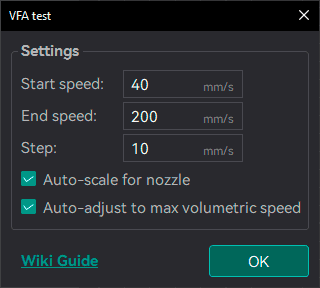
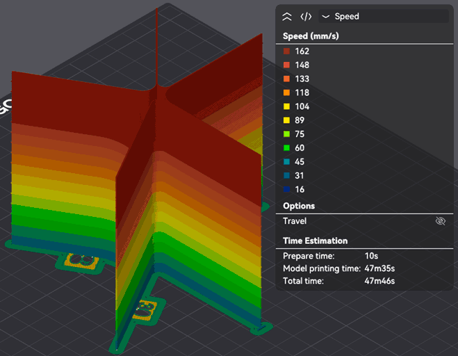
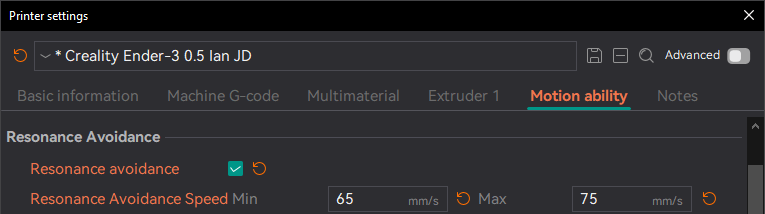

# VFA¶

Vertical Fine Artifacts (VFA) are small surface imperfections that appear on vertical walls, especially near sharp corners or sudden directional changes. These artifacts are typically caused by mechanical vibrations, motor resonance, or rapid directional shifts that impact print quality.

* **Mechanical adjustments**, such as tuning or replacing motors, belts, or pulleys.
* **MRR (Motor Resonance Rippling)** is a common subtype of VFA caused by stepper motors vibrating at resonant frequencies, leading to periodic ripples on the surface.
* [**Jerk/Junction Deviation**](/broken/pages/32e75ac81b67ea0e27c86dc13e73b020011ed424) settings can also contribute to VFA, as they control how the printer handles rapid changes in direction.
* [**Input Shaping**](/broken/pages/7c942f82d3b10b8ff692dcce023e796cd63e4900) can help mitigate VFA by reducing vibrations during printing.

Tip

Follow the recommended calibration order in the [Calibration Guide](/broken/pages/11c07341f1c2537a4800ccab7e8c9c26d87a5246).

## VFA Test[¶](vfa.md#vfa-test) 

The VFA Speed Test in OrcaSlicer helps identify which print speeds trigger MRR artifacts. It prints a vertical tower with walls at various angles while progressively increasing the print speed.

Important

NEW FEATURE: **Nozzle-aware VFA tower with automatic volumetric speed handling** Available in: [Nightly builds](https://github.com/OrcaSlicer/OrcaSlicer/releases/tag/nightly-builds) or Releases greater than **2.4.2**.

1. Set the VFA test parameters in OrcaSlicer:\
   
   * **Speeds**: Define your Speed range you want to test. This has to cover the full range of Outer Wall Speeds used in your prints (e.g., 20 mm/s to 200 mm/s).
   * **Step:**: Define the speed increment between each section of the tower (e.g., 10 mm/s).
   * **Auto-scale for nozzle**: Enabled by default. The reference model is designed around a 0.4 mm nozzle at 0.2 mm layer height. When enabled, the footprint is resized to your nozzle diameter and the layer height is set to half of it, so each speed block stays 25 layers tall and the speed changes stay aligned with the visible blocks whatever nozzle you use. Turn it off only if you want to print the reference model exactly as-is.
   * **Auto-adjust to max volumetric speed**: Enabled by default, and only available when **Auto-scale for nozzle** is on. If the end speed would exceed the filament's maximum volumetric speed, the layer height is automatically lowered — keeping to standard values and staying within the printer's limits — so the tower can still reach the requested speed. If even the smallest layer height is not enough, the end speed is lowered instead and OrcaSlicer asks you to confirm before slicing.
2. Print the VFA test: 
3. Inspect the tower for MRR artifacts. Look for speeds where the surface becomes visibly smoother or rougher. This allows you to pinpoint problematic speed ranges.\
   In this example, you can see how the Speed is Capping at 162 mm/s. 
4. Configure the [Resonance Avoidance Speed Range](/broken/pages/053648f94ba5f635d165734b67c47d50256deed6#resonance-avoidance) in the printer profile to skip speeds that cause visible artifacts. 

Note

With both options disabled, the tower is printed at its original 0.4 mm proportions and the [Max Volumetric Speed](/broken/pages/3c98b517ea8b8a9c2acbf94db99cc63b9a9dd16e) of the filament may cap the tower before it reaches the end speed. In that case, either re-enable the options, use a filament with a higher volumetric speed, or recreate the test with a lower end speed.
