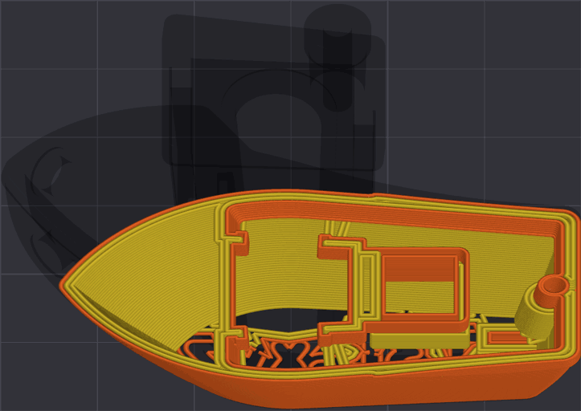

# Walls¶

In 3D printing, "walls" refer to the outer layers of a printed object that provide its shape and structural integrity.\
Adjusting wall settings can significantly affect layer adhesion, strength, appearance and print time of your model.

* [Wall loops](walls.md#wall-loops)
* [Alternate extra wall](walls.md#alternate-extra-wall)
* [Detect thin wall](walls.md#detect-thin-wall)

Tip

**Recommended**

Advanced tips on improving strength.

Video by **Maker's Muse**, with consent.

## Wall loops[¶](walls.md#wall-loops) 

[Mode](/broken/pages/246b4d07eed07a8ac878abc4613a350fbce2c022): `Simple`.\
[Variable](/broken/pages/2ce6fff32f5448d0159c2e2dfbcb54f26d3c6918): `wall_loops`.\
[Type](/broken/pages/726477a877bf7a8efe103413c86723285f8ca2eb#integer-float-percentage): `Integer`.\
[CLI Example](/broken/pages/f439233018f603f29dcf6b1fcc75b0ab21b6fd24#setting-overrides): `--wall-loops=1`.\
"Wall loops" is the number of walls printed on each layer.\
Increasing the wall loops will:

* Enhance:
  * Layer adhesion
  * Strength
  * Rigidity
* Reduce infill ghosting
* Increase print time

## Alternate extra wall[¶](walls.md#alternate-extra-wall) 

[Mode](/broken/pages/246b4d07eed07a8ac878abc4613a350fbce2c022): `Advanced`.\
[Variable](/broken/pages/2ce6fff32f5448d0159c2e2dfbcb54f26d3c6918): `alternate_extra_wall`.\
[Type](/broken/pages/726477a877bf7a8efe103413c86723285f8ca2eb#boolean): `Boolean`.\
[CLI Example](/broken/pages/f439233018f603f29dcf6b1fcc75b0ab21b6fd24#setting-overrides): `--alternate-extra-wall=1`.\
This setting adds an extra wall to every other layer. This way the infill gets wedged vertically between the walls, resulting in stronger prints.\
This option doesn't work well when Ensure vertical shell thickness is set to **All**; when both are enabled, OrcaSlicer offers to change it to **Moderate**.

Warning

It's not recommended to use this option with:

* [Lightning infill](/broken/pages/a147f0b85dea1cbf1cf61adb81420a35f687c13f#lightning) as there is limited infill to anchor the extra perimeters to.
* [**Ensure vertical shell thickness: All**](/broken/pages/def49ed4375ccd47ffeb8694997bbd8dc609e159#ensure-vertical-shell-thickness)

## Detect thin wall[¶](walls.md#detect-thin-wall) 

[Mode](/broken/pages/246b4d07eed07a8ac878abc4613a350fbce2c022): `Advanced`.\
[Variable](/broken/pages/2ce6fff32f5448d0159c2e2dfbcb54f26d3c6918): `detect_thin_wall`.\
[Type](/broken/pages/726477a877bf7a8efe103413c86723285f8ca2eb#boolean): `Boolean`.\
[CLI Example](/broken/pages/f439233018f603f29dcf6b1fcc75b0ab21b6fd24#setting-overrides): `--detect-thin-wall=1`.\
By default, walls are printed as closed loops. When a wall is too thin to contain two line widths, enabling "Detect thin walls" prints it as a single extrusion line.\
Thin walls printed this way may have reduced surface quality and strength because they are not closed loops.

Tip

It is usually recommended to use the [Arachne wall generator](/broken/pages/54a6fe288c2767d758a6868ebef10f327f69163c#arachne), which disables "Detect thin walls" because it uses a different approach to wall generation.

* In small details, it can generate features that wouldn't be possible with traditional wall generation methods.\
   
* In large prints, it can generate defects more easily due to the reduced wall thickness. 
