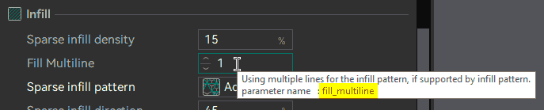

# Placeholders and Expressions¶

OrcaSlicer fills in placeholders when it expands custom G-code and the file name template.

Write a placeholder inside curly braces, for example `{layer_num}`. Every print, filament and printer setting is a placeholder, with its config key as the name. This page lists the other placeholders, which OrcaSlicer sets while it slices.

* [Placeholders by G-code Field](placeholders-and-expressions.md#placeholders-by-g-code-field)
* [Reading the Tables](placeholders-and-expressions.md#reading-the-tables)
* [Expressions and Functions](placeholders-and-expressions.md#expressions-and-functions)
* [Common Errors](placeholders-and-expressions.md#common-errors)
* [Filaments, Extruders and Nozzles](placeholders-and-expressions.md#filaments-extruders-and-nozzles)
* [Temperatures](placeholders-and-expressions.md#temperatures)
* [Dimensions](placeholders-and-expressions.md#dimensions)
* [Print Statistics](placeholders-and-expressions.md#print-statistics)
* [Objects](placeholders-and-expressions.md#objects)
* [Plates](placeholders-and-expressions.md#plates)
* [Presets](placeholders-and-expressions.md#presets)
* [Timestamps](placeholders-and-expressions.md#timestamps)
* [Environment](placeholders-and-expressions.md#environment)
* [Toolhead Position](placeholders-and-expressions.md#toolhead-position)
* [Placeholders for Specific G-code](placeholders-and-expressions.md#placeholders-for-specific-g-code)
  * [Layer Placeholders](placeholders-and-expressions.md#layer-placeholders)
  * [Filament Start and End G-code](placeholders-and-expressions.md#filament-start-and-end-g-code)
  * [Layer Change G-code](placeholders-and-expressions.md#layer-change-g-code)
  * [Timelapse and Clumping Detection G-code](placeholders-and-expressions.md#timelapse-and-clumping-detection-g-code)
  * [Change Filament G-code](placeholders-and-expressions.md#change-filament-g-code)
  * [Change Extrusion Role G-code](placeholders-and-expressions.md#change-extrusion-role-g-code)
  * [Extrusion Roles](placeholders-and-expressions.md#extrusion-roles)
* [File Name Template](placeholders-and-expressions.md#file-name-template)
* [Examples](placeholders-and-expressions.md#examples)

Tip

To find the key of a setting, hover over its label in OrcaSlicer, or read the _Variable_ line in the setting's wiki page.



## Placeholders by G-code Field[¶](placeholders-and-expressions.md#placeholders-by-g-code-field) <a href="#placeholders-by-g-code-field" id="placeholders-by-g-code-field"></a>

Every custom G-code field can use all settings and the placeholders in [Filaments, Extruders and Nozzles](placeholders-and-expressions.md#filaments-extruders-and-nozzles), [Temperatures](placeholders-and-expressions.md#temperatures), [Dimensions](placeholders-and-expressions.md#dimensions), [Print Statistics](placeholders-and-expressions.md#print-statistics), [Objects](placeholders-and-expressions.md#objects), [Plates](placeholders-and-expressions.md#plates), [Presets](placeholders-and-expressions.md#presets), [Timestamps](placeholders-and-expressions.md#timestamps), [Environment](placeholders-and-expressions.md#environment) and [Toolhead Position](placeholders-and-expressions.md#toolhead-position). Some fields also have the extra placeholders in this table.

| Field                        | Key                                                                                                                                                      | Extra placeholders                                                                                                                                                                                 |
| ---------------------------- | -------------------------------------------------------------------------------------------------------------------------------------------------------- | -------------------------------------------------------------------------------------------------------------------------------------------------------------------------------------------------- |
| File header G-code           | `file_start_gcode`                                                                                                                                       | None                                                                                                                                                                                               |
| Start G-code (printer)       | `machine_start_gcode`                                                                                                                                    | None                                                                                                                                                                                               |
| Start G-code (filament)      | `filament_start_gcode`                                                                                                                                   | [Layer Placeholders](placeholders-and-expressions.md#layer-placeholders) and [Filament Start and End G-code](placeholders-and-expressions.md#filament-start-and-end-g-code)                        |
| Before layer change G-code   | `before_layer_change_gcode`                                                                                                                              | [Layer Placeholders](placeholders-and-expressions.md#layer-placeholders)                                                                                                                           |
| Layer change G-code          | `layer_change_gcode`                                                                                                                                     | [Layer Placeholders](placeholders-and-expressions.md#layer-placeholders) and [Layer Change G-code](placeholders-and-expressions.md#layer-change-g-code)                                            |
| Timelapse G-code             | `time_lapse_gcode`                                                                                                                                       | [Layer Placeholders](placeholders-and-expressions.md#layer-placeholders) and [Timelapse and Clumping Detection G-code](placeholders-and-expressions.md#timelapse-and-clumping-detection-g-code)    |
| Clumping detection G-code    | `wrapping_detection_gcode`                                                                                                                               | [Layer Placeholders](placeholders-and-expressions.md#layer-placeholders), `most_used_physical_extruder_id` and `curr_physical_extruder_id`                                                         |
| Change filament G-code       | `change_filament_gcode`                                                                                                                                  | [Layer Placeholders](placeholders-and-expressions.md#layer-placeholders) and [Change Filament G-code](placeholders-and-expressions.md#change-filament-g-code)                                      |
| Change extrusion role G-code | <p><code>change_extrusion_role_gcode</code><br><code>filament_change_extrusion_role_gcode</code><br><code>process_change_extrusion_role_gcode</code></p> | _`filament_change_extrusion_role_gcode` and `process_change_extrusion_role_gcode` added in 2.4.0._ [Change Extrusion Role G-code](placeholders-and-expressions.md#change-extrusion-role-g-code)    |
| Pause G-code                 | `machine_pause_gcode`                                                                                                                                    | None                                                                                                                                                                                               |
| IDEX/IQEX Mode G-codes       | `imex_mode_gcodes`                                                                                                                                       | _Added in 2.5.0._ None. It runs before the printer start G-code. Errors in it are shown under the name `imex_mode_gcode`.                                                                          |
| Custom G-code                | `template_custom_gcode`                                                                                                                                  | None                                                                                                                                                                                               |
| Between Object G-code        | `printing_by_object_gcode`                                                                                                                               | None                                                                                                                                                                                               |
| End G-code (filament)        | `filament_end_gcode`                                                                                                                                     | [Layer Placeholders](placeholders-and-expressions.md#layer-placeholders) and [Filament Start and End G-code](placeholders-and-expressions.md#filament-start-and-end-g-code)                        |
| End G-code (printer)         | `machine_end_gcode`                                                                                                                                      | [Layer Placeholders](placeholders-and-expressions.md#layer-placeholders) and the filament values in [Filament Start and End G-code](placeholders-and-expressions.md#filament-start-and-end-g-code) |
| File name template           | `filename_format`                                                                                                                                        | A different set: all settings, and the placeholders marked _Also works in the file name_. See [File Name Template](placeholders-and-expressions.md#file-name-template).                            |

`machine_pause_gcode` has no extra placeholders. The old `color_change_extruder` placeholder is no longer set, and using it fails.

## Reading the Tables[¶](placeholders-and-expressions.md#reading-the-tables) <a href="#reading-the-tables" id="reading-the-tables"></a>

* The **Type** column gives the unit of each value, for example `float (mm)`. Counts, text and booleans have no unit.
* `[]` after a name marks a list, for example a list with one value per filament. To pick one value, see [Expressions and Functions](placeholders-and-expressions.md#expressions-and-functions).
* For a filament, extruder or nozzle index, the Type column says which of the three it is. Many older names say _extruder_ when they mean a filament, for example `current_extruder`, `previous_extruder` and `is_extruder_used`. Check the Type column.
  * **Filament index**: the position in the filament list, counting from 0.
  * **Extruder index**: the physical extruder or toolhead, counting from 0, as in `current_extruder_id`. `filament_map[]` gives the extruder of each filament.
  * **Nozzle index**: the nozzle. It is the same as the extruder index unless the printer has several nozzles per extruder.
* **Type 1** and **Type 2** prime tower are the two values of the _Wipe tower type_ setting. Type 1 is the Bambu Lab style prime tower. Bambu Lab printers always use Type 1.

## Expressions and Functions[¶](placeholders-and-expressions.md#expressions-and-functions) <a href="#expressions-and-functions" id="expressions-and-functions"></a>

Inside `{ }`, OrcaSlicer evaluates a small expression language. Placeholder names are case sensitive. Use parentheses to group parts of an expression.

The following operators are available:

* Arithmetic `+`, `-`, `*`, `/` and `%` (remainder). For example, `{filament_diameter[0] / 2}` is the radius of the first filament.
* Comparison `==`, `!=`, `<`, `>`, `<=` and `>=`. The result is a boolean.
* Logical `and` / `&&`, `or` / `||` and `not` / `!`.
* Conditional `condition ? a : b`, which gives `a` when `condition` is true and `b` when it is false.
* Text joining with `+`, for example `{"v" + layer_num}`.
* Regular-expression match `text =~ /pattern/`, which is true when the whole text matches the pattern, and `!~`, which is true when it does not match. To find a part of the text, put `.*` before and after the pattern, for example `{if printer_notes =~ /.*BAMBU.*/}bambu{endif}`.

The following functions are available:

| Function                                                                      | Description                                                                                                                                                                     |
| ----------------------------------------------------------------------------- | ------------------------------------------------------------------------------------------------------------------------------------------------------------------------------- |
| `int(x)`                                                                      | `x` without its decimal part. `{int(13.9)}` is `13`.                                                                                                                            |
| <p><code>round(x)</code><br><code>floor(x)</code><br><code>ceil(x)</code></p> | `x` rounded to the nearest, lower or higher whole number.                                                                                                                       |
| <p><code>min(a, b)</code><br><code>max(a, b)</code></p>                       | The smaller or larger of two numbers.                                                                                                                                           |
| `digits(value, width [, decimals])`                                           | `value` aligned right in `width` characters, with an optional fixed number of decimals.                                                                                         |
| `zdigits(value, width [, decimals])`                                          | Like `digits`, but padded with leading zeros. `{zdigits(5, 4)}` is `0005`.                                                                                                      |
| `random(a, b)`                                                                | A random number between `a` and `b`.                                                                                                                                            |
| `interpolate_table(x, (x0, y0), (x1, y1), ...)`                               | The `y` value for `x` on the straight lines between the given points. The x values must increase, and `x` must be between the first and the last x value.                       |
| `one_of(value, a, b, ...)`                                                    | True when the text `value` is equal to one of the listed texts. A listed value can be a `/regex/` pattern, which must match the whole text. `value` must be text, not a number. |
| `regex_replace(text, /pattern/, replacement)`                                 | _Added in 2.5.0._ `text` with every match of `/pattern/` replaced by `replacement`. The replacement can use capture groups (`$1`, `$2`, ...).                                   |
| <p><code>size(list)</code><br><code>empty(list)</code></p>                    | The number of values in a list, and whether the list is empty.                                                                                                                  |
| `is_nil(name)`                                                                | True when the value is not set, for example a filament override that is left empty. For a list, give an index.                                                                  |
| `filament_change(n)`                                                          | From this point in the custom G-code, a list of decimal numbers without an index gives the value for filament `n`.                                                              |

`{if}`, `{elsif}`, `{else}` and `{endif}` choose between blocks of text, for example `{if layer_num == 0}first{else}later{endif}`.

You can store values in variables. `{local name = "part"}{name}` defines a variable and then prints it. A `{local}` variable exists only in the custom G-code where it is defined. A `{global}` variable is also available in the custom G-code that runs later in the same print. A variable can also hold a list. `{local temps = (200, 210)}` makes a list of two values, and `{local zeros = repeat(4, 0)}` makes a list of four zeros.

To pick one value from a list, give its index, counting from 0. For example, `{nozzle_temperature[1]}` is the value for the second filament. Inside `{ }`, a list of decimal numbers without an index gives the value for the current filament. A list of integers, booleans, text or points without an index fails with "Referencing a vector variable when scalar is expected".

OrcaSlicer also accepts an older syntax, `[name]`, which prints one placeholder and does not support expressions. Booleans print as `true` or `false` inside `{ }`, and as `1` or `0` inside `[ ]`.

## Common Errors[¶](placeholders-and-expressions.md#common-errors) <a href="#common-errors" id="common-errors"></a>

When a placeholder in custom G-code fails, the G-code export fails. The message starts with "Failed to generate G-code for invalid custom G-code." For each field that failed, it gives the key of the field and the first error in that field. An error in `filename_format` starts with "Processing of the filename\_format template failed." instead.

| Error                                                                                                                       | Cause                                                                                                                                                                                                                                                                                                                                                                                                       |
| --------------------------------------------------------------------------------------------------------------------------- | ----------------------------------------------------------------------------------------------------------------------------------------------------------------------------------------------------------------------------------------------------------------------------------------------------------------------------------------------------------------------------------------------------------- |
| `Not a variable name` (inside `{ }`) or `Variable does not exist` (inside `[ ]`)                                            | The name is misspelled, the field does not have this placeholder (see [Placeholders by G-code Field](placeholders-and-expressions.md#placeholders-by-g-code-field)), or your version of OrcaSlicer does not have it yet. In `filename_format`, only settings and the placeholders marked _Also works in the file name_ exist, see [File Name Template](placeholders-and-expressions.md#file-name-template). |
| `Referencing a vector variable when scalar is expected`                                                                     | A list of integers, booleans, text or points is used without an index. Add an index, for example `{nozzle_temperature[0]}`.                                                                                                                                                                                                                                                                                 |
| `This value is known only after the G-code is generated. It can be printed, but not used in a calculation or a comparison.` | A value marked _Filled in after generation_ is used in a calculation. See [Print Statistics](placeholders-and-expressions.md#print-statistics).                                                                                                                                                                                                                                                             |

## Filaments, Extruders and Nozzles[¶](placeholders-and-expressions.md#filaments-extruders-and-nozzles) <a href="#filaments-extruders-and-nozzles" id="filaments-extruders-and-nozzles"></a>

| Placeholder                                                                                                                                                                                                                                                      | Type                                  | Description                                                                                                                                                                                                                                                                                                                                    |
| ---------------------------------------------------------------------------------------------------------------------------------------------------------------------------------------------------------------------------------------------------------------- | ------------------------------------- | ---------------------------------------------------------------------------------------------------------------------------------------------------------------------------------------------------------------------------------------------------------------------------------------------------------------------------------------------- |
| <p><code>current_extruder</code><br><code>current_filament_id</code></p>                                                                                                                                                                                         | int (filament index)                  | _`current_filament_id` added in 2.5.0._ Filament printing now. The two names usually give the same value. In the printer end G-code, and in the first filament start G-code on Bambu Lab printers, `current_filament_id` can be different. See [Filament Start and End G-code](placeholders-and-expressions.md#filament-start-and-end-g-code). |
| `current_extruder_id`                                                                                                                                                                                                                                            | int (extruder index)                  | _Added in 2.5.0._ Extruder printing now. In `change_filament_gcode` it is still the outgoing extruder.                                                                                                                                                                                                                                         |
| `current_nozzle_id`                                                                                                                                                                                                                                              | int (nozzle index)                    | _Added in 2.5.0._ Nozzle printing now.                                                                                                                                                                                                                                                                                                         |
| `current_hotend`                                                                                                                                                                                                                                                 | int                                   | _Added in 2.4.0._ On most printers, the extruder printing now. On Bambu Lab printers, the hotend-rack nozzle when the print moves filaments between nozzles, and `-1` otherwise.                                                                                                                                                               |
| `has_single_extruder_multi_material_priming`                                                                                                                                                                                                                     | bool                                  | `true` when the single-extruder multi-material priming area is used.                                                                                                                                                                                                                                                                           |
| <p><code>initial_extruder</code><br><code>initial_tool</code><br><code>initial_filament_id</code></p>                                                                                                                                                            | int (filament index)                  | _`initial_filament_id` added in 2.5.0._ First filament used in the print. All three names give the same value. `initial_extruder` and `initial_tool` also work in the file name.                                                                                                                                                               |
| `initial_nozzle_id`                                                                                                                                                                                                                                              | int (nozzle index)                    | _Added in 2.5.0._ Nozzle of the first filament.                                                                                                                                                                                                                                                                                                |
| <p><code>initial_no_support_extruder</code><br><code>initial_no_support_tool</code><br><code>initial_no_support_filament_id</code></p>                                                                                                                           | int (filament index)                  | _`initial_no_support_filament_id` added in 2.5.0._ First filament that is not a support filament. `initial_no_support_extruder` also works in the file name.                                                                                                                                                                                   |
| `initial_no_support_hotend`                                                                                                                                                                                                                                      | int                                   | _Added in 2.4.0._ Hotend of that filament, with the same rule as `current_hotend`.                                                                                                                                                                                                                                                             |
| `is_extruder_used[]`                                                                                                                                                                                                                                             | bool per filament                     | `true` for each filament that the print uses.                                                                                                                                                                                                                                                                                                  |
| `filament_map[]`                                                                                                                                                                                                                                                 | int per filament (extruder index + 1) | Extruder of each filament, counting from **1**. In `change_filament_gcode`, `filament_map[next_extruder] - 1` is the incoming extruder. Also works in the file name.                                                                                                                                                                           |
| <p><code>first_tools[]</code><br><code>first_filaments[]</code></p>                                                                                                                                                                                              | int per extruder (filament index)     | First filament that each extruder prints, or `-1`. Correct on Bambu Lab and IDEX/IQEX printers. On other printers with several extruders, the values are currently wrong.                                                                                                                                                                      |
| <p><code>first_non_support_tools[]</code><br><code>first_non_support_filaments[]</code><br><code>first_non_support_hotend[]</code></p>                                                                                                                           | int per extruder                      | _`first_non_support_hotend` added in 2.5.0._ Like `first_tools[]`, but without support filaments. `first_non_support_hotend[]` gives the hotend of that filament instead, with the same rule as `current_hotend`. The same limitation applies.                                                                                                 |
| `num_extruders`                                                                                                                                                                                                                                                  | int                                   | Number of physical extruders on the printer, also when the print uses fewer. Also works in the file name.                                                                                                                                                                                                                                      |
| <p><code>nozzle_diameter_at_nozzle_id[]</code><br><code>nozzle_volume_types[]</code></p>                                                                                                                                                                         | <p>float (mm)<br>string</p>           | _Added in 2.5.0._ Diameter and flow type of each nozzle. On printers with one nozzle per extruder, there is one value per extruder.                                                                                                                                                                                                            |
| <p><code>flush_temperatures[]</code><br><code>flush_volumetric_speeds[]</code></p>                                                                                                                                                                               | <p>int (°C)<br>float (mm³/s)</p>      | Purge temperature and purge speed of each filament.                                                                                                                                                                                                                                                                                            |
| `retraction_distance_when_cut`                                                                                                                                                                                                                                   | float (mm)                            | Retraction distance when the filament is cut by the AMS or a filament cutter, for the current filament.                                                                                                                                                                                                                                        |
| `long_retraction_when_cut`                                                                                                                                                                                                                                       | bool                                  | `true` when _Long retraction when cut_ is on for the current filament.                                                                                                                                                                                                                                                                         |
| <p><code>retraction_distance_when_ec</code><br><code>long_retraction_when_ec</code></p>                                                                                                                                                                          | <p>float (mm)<br>bool</p>             | The same two values for an extruder change.                                                                                                                                                                                                                                                                                                    |
| <p><code>is_all_bbl_filament</code><br><code>has_tpu_in_first_layer</code><br><code>enable_high_low_temp_mix</code><br><code>hold_chamber_temp_for_flat_print</code><br><code>max_additional_fan</code><br><code>during_print_exhaust_fan_speed_num[]</code></p> | various                               | Values used by the Bambu Lab start G-code.                                                                                                                                                                                                                                                                                                     |

## Temperatures[¶](placeholders-and-expressions.md#temperatures) <a href="#temperatures" id="temperatures"></a>

| Placeholder                                                                                       | Type                  | Description                                                                                                                                                                                                                                   |
| ------------------------------------------------------------------------------------------------- | --------------------- | --------------------------------------------------------------------------------------------------------------------------------------------------------------------------------------------------------------------------------------------- |
| `bed_temperature[]`                                                                               | int per filament (°C) | Bed temperature of each filament for the current plate type.                                                                                                                                                                                  |
| <p><code>bed_temperature_initial_layer[]</code><br><code>first_layer_bed_temperature[]</code></p> | int per filament (°C) | First-layer bed temperature of each filament for the current plate type.                                                                                                                                                                      |
| `bed_temperature_initial_layer_single`                                                            | int (°C)              | First-layer bed temperature of the filament that prints first (`initial_extruder`). If the bed temperature formula is set to the highest temperature, it is the highest first-layer bed temperature of the filaments used on the first layer. |
| `first_layer_temperature[]`                                                                       | int per filament (°C) | First-layer nozzle temperature of each filament.                                                                                                                                                                                              |
| `chamber_temperature[]`                                                                           | int per filament (°C) | Chamber temperature of each filament. Also works in the file name.                                                                                                                                                                            |
| `chamber_minimal_temperature[]`                                                                   | int per filament (°C) | _Added in 2.4.1._ Minimum chamber temperature of each filament. Also works in the file name.                                                                                                                                                  |
| `overall_chamber_temperature`                                                                     | int (°C)              | Highest `chamber_temperature[]` of the filaments used.                                                                                                                                                                                        |
| `min_vitrification_temperature`                                                                   | int (°C)              | Lowest softening temperature of the filaments used.                                                                                                                                                                                           |

## Dimensions[¶](placeholders-and-expressions.md#dimensions) <a href="#dimensions" id="dimensions"></a>

| Placeholder                                                                     | Type                         | Description                                                                                                                                                                                                       |
| ------------------------------------------------------------------------------- | ---------------------------- | ----------------------------------------------------------------------------------------------------------------------------------------------------------------------------------------------------------------- |
| `first_layer_print_convex_hull`                                                 | array of `[x, y]` pairs (mm) | Convex hull of the first layer, as a polygon.                                                                                                                                                                     |
| `first_layer_print_min`                                                         | float\[2] (mm)               | Smallest X and Y of the first layer.                                                                                                                                                                              |
| `first_layer_print_max`                                                         | float\[2] (mm)               | Largest X and Y of the first layer.                                                                                                                                                                               |
| `first_layer_print_size`                                                        | float\[2] (mm)               | Width and depth of the first layer.                                                                                                                                                                               |
| `first_layer_center_no_wipe_tower`                                              | float\[2] (mm)               | Center of the objects on the first layer, including their brim. Only the first copy of each object counts. The prime tower and the skirt are not included.                                                        |
| `in_head_wrap_detect_zone`                                                      | bool                         | `true` when the objects, seen from above, or the first layer touch the head-wrap detection area.                                                                                                                  |
| `first_layer_height`                                                            | float (mm)                   | Height of the first layer.                                                                                                                                                                                        |
| `print_bed_min`                                                                 | float\[2] (mm)               | Smallest X and Y of the bed.                                                                                                                                                                                      |
| `print_bed_max`                                                                 | float\[2] (mm)               | Largest X and Y of the bed.                                                                                                                                                                                       |
| `print_bed_size`                                                                | float\[2] (mm)               | Width and depth of the bed.                                                                                                                                                                                       |
| `max_print_z`                                                                   | int (mm)                     | Height of the tallest object, rounded up.                                                                                                                                                                         |
| `max_print_height`                                                              | int (mm)                     | Maximum print height of the printer.                                                                                                                                                                              |
| <p><code>adaptive_bed_mesh_min</code><br><code>adaptive_bed_mesh_max</code></p> | float\[2] (mm)               | Corners of the area to probe. See [Adaptive Bed Mesh](/broken/pages/913d5f5fae495f719e1676ebe80ead9cdf3b8e2b#available-g-code-variables-for-adaptive-bed-mesh-command).                                           |
| <p><code>bed_mesh_probe_count</code><br><code>bed_mesh_algo</code></p>          | <p>int[2]<br>string</p>      | Number of probe points and interpolation algorithm for that area.                                                                                                                                                 |
| `has_wipe_tower`                                                                | bool                         | `true` when the print has a prime tower.                                                                                                                                                                          |
| <p><code>wipe_tower_wait_pos_x</code><br><code>wipe_tower_wait_pos_y</code></p> | float (mm)                   | _Added in 2.5.0._ A point just outside the prime tower, where the nozzle can wait while it heats. `wipe_tower_center_pos_x` and `wipe_tower_center_pos_y` hold the same values under the names Bambu Studio uses. |
| `wipe_tower_wait_pos_valid`                                                     | bool                         | _Added in 2.5.0._ `true` when the print has a prime tower and the point above is set. `wipe_tower_center_pos_valid` holds the same value under the name Bambu Studio uses.                                        |

## Print Statistics[¶](placeholders-and-expressions.md#print-statistics) <a href="#print-statistics" id="print-statistics"></a>

Important

NEW FEATURE: **Print statistics in custom G-code** Available in: [Nightly builds](https://github.com/OrcaSlicer/OrcaSlicer/releases/tag/nightly-builds). In 2.5.0-alpha and older, `print_time`, `normal_print_time`, `silent_print_time`, `used_filament`, `total_weight`, `total_cost`, `total_wipe_tower_cost` and `total_wipe_tower_filament` work only in the file name. In custom G-code, they stop slicing with "Not a variable name". The error for calculations is also only in nightly builds. Older versions give a wrong result or a different error.

Some of these values are marked _Filled in after generation_. OrcaSlicer knows them only after the whole G-code is generated. In custom G-code, it first writes a marker, and replaces the marker with the value at the end. In custom G-code, these values have two decimal places. In the file name, they can have more digits.

Because the value is not known yet, you can print it and join it to text, but you cannot calculate with it:

| Works                                | Fails                                 |
| ------------------------------------ | ------------------------------------- |
| `{total_weight}`                     | `{total_weight * 2}`                  |
| `{"Weight: " + total_weight + " g"}` | `{total_weight + 5}`                  |
| `{local w = total_weight}{w}`        | `{if total_weight > 100}heavy{endif}` |
|                                      | `{int(total_weight)}`                 |

An expression in the Fails column stops slicing with "This value is known only after the G-code is generated. It can be printed, but not used in a calculation or a comparison." The same error comes from functions such as `round()`, `min()` and `one_of()`, from regular-expression matches, and from a copy of the value in a variable.

OrcaSlicer reads `+` from left to right, and text joined with a number stays text. So `{"W: " + total_weight + 5}` prints `W: 123.455` for a weight of 123.45 g. It does not add 5.

| Placeholder                                                                                                                         | Type                                              | Description                                                                                                                                                                                                                                                                                                    |
| ----------------------------------------------------------------------------------------------------------------------------------- | ------------------------------------------------- | -------------------------------------------------------------------------------------------------------------------------------------------------------------------------------------------------------------------------------------------------------------------------------------------------------------- |
| <p><code>normal_print_time</code><br><code>print_time</code></p>                                                                    | string                                            | Estimated print time in normal mode, written like `2d3h15m`, `2h15m`, `5m30s` or `45s`. Times of one hour or more are rounded to the minute. Filled in after generation. Also works in the file name.                                                                                                          |
| `silent_print_time`                                                                                                                 | string                                            | Estimated print time in silent mode, in the same format. `0s` unless the G-code flavor is Marlin and _Silent Mode_ is on. Filled in after generation. Also works in the file name.                                                                                                                             |
| `print_time_total_sec`                                                                                                              | float (s)                                         | _Added in 2.5.0._ Estimated print time in normal mode, in seconds. Filled in after generation.                                                                                                                                                                                                                 |
| <p><code>print_time_day</code><br><code>print_time_hour</code><br><code>print_time_minute</code><br><code>print_time_sec</code></p> | <p>int (d)<br>int (h)<br>int (min)<br>int (s)</p> | _`print_time_day`, `print_time_hour` and `print_time_minute` added in 2.5.0._ Days, hours, minutes and seconds of the normal-mode print time. `print_time_sec` is only the seconds, not the total. Filled in after generation.                                                                                 |
| `total_layer_count`                                                                                                                 | int                                               | Number of layers.                                                                                                                                                                                                                                                                                              |
| `total_toolchanges`                                                                                                                 | int                                               | Number of filament changes in the print. The filament selected at print start does not count. With a prime tower, this is the prime tower's count. Without one, OrcaSlicer counts the changes in the planned tool order. It is `0` when printing by object without a prime tower. Also works in the file name. |
| <p><code>used_filament</code><br><code>used_filament_length</code></p>                                                              | float (m)                                         | Length of filament that the whole print uses. Filled in after generation. `used_filament` also works in the file name.                                                                                                                                                                                         |
| `extruded_volume[]`                                                                                                                 | float per filament (mm³)                          | Volume extruded so far with each filament. In custom G-code, this is a running total, so it is `0` in the start G-code. `extruded_volume` also works in the file name, as the total volume.                                                                                                                    |
| `extruded_volume_total`                                                                                                             | float (mm³)                                       | Sum of `extruded_volume[]`. Also a running total. Also works in the file name, as the total of the whole print.                                                                                                                                                                                                |
| `extruded_weight[]`                                                                                                                 | float per filament (g)                            | Weight extruded so far with each filament, from the filament density. Also a running total.                                                                                                                                                                                                                    |
| `extruded_weight_total`                                                                                                             | float (g)                                         | Sum of `extruded_weight[]`. Also a running total. For the weight of the whole print, use `total_weight`. Also works in the file name, as the total of the whole print.                                                                                                                                         |
| `total_weight`                                                                                                                      | float (g)                                         | Filament weight of the whole print. Filled in after generation. Also works in the file name.                                                                                                                                                                                                                   |
| `total_cost`                                                                                                                        | float (currency)                                  | Filament cost plus the printer's time cost (`time_cost` per hour of printing). Filled in after generation. Also works in the file name.                                                                                                                                                                        |
| `total_wipe_tower_cost`                                                                                                             | float (currency)                                  | Filament cost of the prime tower. Filled in after generation. It is currently `0` with the Type 1 prime tower. Also works in the file name.                                                                                                                                                                    |
| `total_wipe_tower_filament`                                                                                                         | float (mm)                                        | Length of filament used for the prime tower. Filled in after generation. It is currently `0` with the Type 1 prime tower. Also works in the file name.                                                                                                                                                         |

## Objects[¶](placeholders-and-expressions.md#objects) <a href="#objects" id="objects"></a>

| Placeholder           | Type              | Description                                                                                                                                                                                       |
| --------------------- | ----------------- | ------------------------------------------------------------------------------------------------------------------------------------------------------------------------------------------------- |
| `num_objects`         | int               | Number of objects on the plate. Copies of an object count in `num_instances`. Also works in the file name.                                                                                        |
| `num_instances`       | int               | Number of printed instances of all objects. Also works in the file name.                                                                                                                          |
| `current_object_idx`  | int               | Position of the object printing now in the print order, counting from 0. Each copy of an object counts. It changes only when printing by object.                                                  |
| `scale[]`             | string per object | Scale of each object as text, for example `x:100% y:50% z:100%`. Also works in the file name.                                                                                                     |
| `input_filename_base` | string            | Name of the first printable object, without the extension. If the object has no name, the name of its source file. Also works in the file name, where it is the project name for a saved project. |
| `input_filename`      | string            | `input_filename_base` followed by `.gcode`. Also works in the file name.                                                                                                                          |
| `first_object_name`   | string            | _Added in 2.4.2._ Name of the first printable object on the plate. Also works in the file name.                                                                                                   |

## Plates[¶](placeholders-and-expressions.md#plates) <a href="#plates" id="plates"></a>

| Placeholder       | Type   | Description                                                                                                                                                                                                  |
| ----------------- | ------ | ------------------------------------------------------------------------------------------------------------------------------------------------------------------------------------------------------------ |
| `plate_name`      | string | Name of the plate. Also works in the file name.                                                                                                                                                              |
| `plate_number`    | string | Number of the plate, counting from 1 and padded to two digits, for example `01`. Also works in the file name.                                                                                                |
| `model_name`      | string | Model name saved in the 3MF project, or empty. Also works in the file name.                                                                                                                                  |
| `imex_mode`       | string | _Added in 2.5.0._ Name of the plate's [IDEX/IQEX](/broken/pages/473fbdd625dcdda3fc4c9b49709f4d0ac88b197d) parallel mode, or `primary` in Primary mode. Empty when the printer is not an IDEX/IQEX printer.   |
| `imex_mode_index` | int    | _Added in 2.5.0._ Index of that mode in the printer's `imex_mode_names`, counting from 0. This is its row in the [Modes](/broken/pages/473fbdd625dcdda3fc4c9b49709f4d0ac88b197d#modes) grid. `0` is Primary. |
| `imex_mode_gcode` | string | _Added in 2.5.0._ The [Mode G-code](/broken/pages/473fbdd625dcdda3fc4c9b49709f4d0ac88b197d#mode-g-code) of that mode, before its placeholders are filled in.                                                 |

## Presets[¶](placeholders-and-expressions.md#presets) <a href="#presets" id="presets"></a>

| Placeholder         | Type                | Description                                                                               |
| ------------------- | ------------------- | ----------------------------------------------------------------------------------------- |
| `print_preset`      | string              | Name of the print preset. Also works in the file name.                                    |
| `filament_preset[]` | string per filament | Name of the preset of each filament. Also works in the file name.                         |
| `filament_type[]`   | string per filament | Material type of each filament, for example `PLA` or `PETG`. Also works in the file name. |
| `printer_preset`    | string              | Name of the printer preset. Also works in the file name.                                  |

## Timestamps[¶](placeholders-and-expressions.md#timestamps) <a href="#timestamps" id="timestamps"></a>

| Placeholder                                                            | Type                       | Description                                                                                             |
| ---------------------------------------------------------------------- | -------------------------- | ------------------------------------------------------------------------------------------------------- |
| `timestamp`                                                            | string (`yyyyMMdd-hhmmss`) | Local time when G-code export started. Also works in the file name, as the time when the name is built. |
| <p><code>year</code><br><code>month</code><br><code>day</code></p>     | int                        | Date of `timestamp`. Also works in the file name.                                                       |
| <p><code>hour</code><br><code>minute</code><br><code>second</code></p> | int                        | Time of day of `timestamp`. Also works in the file name.                                                |

## Environment[¶](placeholders-and-expressions.md#environment) <a href="#environment" id="environment"></a>

| Placeholder | Type   | Description                                                                                              |
| ----------- | ------ | -------------------------------------------------------------------------------------------------------- |
| `user`      | string | User name from the `USER` or `USERNAME` environment variable, or `unknown`. Also works in the file name. |
| `version`   | string | OrcaSlicer version. Also works in the file name.                                                         |

## Toolhead Position[¶](placeholders-and-expressions.md#toolhead-position) <a href="#toolhead-position" id="toolhead-position"></a>

These values describe the toolhead when a custom G-code starts. Only `zhop` is read-only. If your G-code moves the toolhead, update `position[]`, and OrcaSlicer continues from the new position.

`e_position[]` and `e_retracted[]` are correct, and OrcaSlicer reads back your changes, only when _Single Extruder Multi Material_ is off. This setting is on by default. When it is on, do not use these two values.

| Placeholder         | Type                    | Description                                                                         |
| ------------------- | ----------------------- | ----------------------------------------------------------------------------------- |
| `zhop`              | float (mm)              | Z-hop height when the custom G-code starts. Read-only.                              |
| `position[]`        | float\[3] (mm)          | X, Y and Z position of the toolhead when the custom G-code starts.                  |
| `e_position[]`      | float per filament (mm) | Position of the extruder axis. Used only when the G-code uses absolute E distances. |
| `e_retracted[]`     | float per filament (mm) | How far the filament is retracted when the custom G-code starts.                    |
| `e_restart_extra[]` | float per filament (mm) | Extra length to extrude after the next unretraction.                                |

## Placeholders for Specific G-code[¶](placeholders-and-expressions.md#placeholders-for-specific-g-code) <a href="#placeholders-for-specific-g-code" id="placeholders-for-specific-g-code"></a>

OrcaSlicer sets the placeholders in this section only in the G-code that each section names. [Placeholders by G-code Field](placeholders-and-expressions.md#placeholders-by-g-code-field) lists them by field.

Important

NEW FEATURE: **Placeholders on every path** Available in: [Nightly builds](https://github.com/OrcaSlicer/OrcaSlicer/releases/tag/nightly-builds). In 2.5.0-alpha and older, these placeholders are missing, and using one stops slicing with "Not a variable name":

* `max_layer_z` in `layer_change_gcode`.
* `layer_num`, `layer_z` and `max_layer_z` in filament start G-code run by the Type 1 prime tower, and `max_layer_z` and `filament_extruder_id` in its filament end G-code.
* `layer_z` and `max_layer_z` in the first filament start G-code on Bambu Lab printers.
* The [Layer Change G-code](placeholders-and-expressions.md#layer-change-g-code) placeholders on the brim layers of belt printers.
* The timelapse placeholders other than the layer placeholders, except on Bambu Lab printers, printers with several extruders, and bed slingers outside spiral vase mode.

### Layer Placeholders[¶](placeholders-and-expressions.md#layer-placeholders) <a href="#layer-placeholders" id="layer-placeholders"></a>

These placeholders are available in before layer change, layer change, timelapse, clumping detection, change filament, filament start, filament end and printer end G-code.

| Placeholder   | Type       | Description                                                                                                                                                                                                                                     |
| ------------- | ---------- | ----------------------------------------------------------------------------------------------------------------------------------------------------------------------------------------------------------------------------------------------- |
| `layer_num`   | int        | Current layer, counting from 0. `-1` before the first layer, for example in the call of `change_filament_gcode` at print start. `before_layer_change_gcode` and `layer_change_gcode` get the same number, for the layer that is about to print. |
| `layer_z`     | float (mm) | Height of the top of the current layer. In filament start, filament end and printer end G-code, the current height of the nozzle. With the Type 1 prime tower, filament start and end G-code get the height of the prime tower layer instead.   |
| `max_layer_z` | float (mm) | Height of the highest layer printed so far.                                                                                                                                                                                                     |

### Filament Start and End G-code[¶](placeholders-and-expressions.md#filament-start-and-end-g-code) <a href="#filament-start-and-end-g-code" id="filament-start-and-end-g-code"></a>

| Placeholder                                                                               | Type                                              | Description                                                                                                                                                                                                                                                           |
| ----------------------------------------------------------------------------------------- | ------------------------------------------------- | --------------------------------------------------------------------------------------------------------------------------------------------------------------------------------------------------------------------------------------------------------------------- |
| `filament_extruder_id`                                                                    | int                                               | In `filament_start_gcode`, the filament that is loaded. In `filament_end_gcode`, the filament that is unloaded. At a tool change without the Type 1 prime tower, `filament_end_gcode` gets the extruder of that filament instead. Not set in `change_filament_gcode`. |
| <p><code>current_filament_id</code><br><code>current_nozzle_id</code></p>                 | <p>int (filament index)<br>int (nozzle index)</p> | _Added in 2.5.0._ Filament and nozzle that the G-code runs for. Set for most calls, including calls from the Type 1 prime tower.                                                                                                                                      |
| <p><code>retraction_distance_when_cut</code><br><code>long_retraction_when_cut</code></p> | <p>float (mm)<br>bool</p>                         | In `filament_start_gcode`, the values for the filament that is loaded. See [Filaments, Extruders and Nozzles](placeholders-and-expressions.md#filaments-extruders-and-nozzles).                                                                                       |

The filament start G-code for the first filament runs before the first layer, so `layer_num` is `-1` there. On Bambu Lab printers, this filament start G-code runs right after the printer start G-code, for the first filament that is not a support filament.

At the end of the print, `filament_end_gcode` runs once for each filament in the filament list, and then `machine_end_gcode` runs. With single extruder multi-material, it runs only for the current filament. `machine_end_gcode` gets the `filament_extruder_id`, `current_filament_id`, `current_extruder_id` and `current_nozzle_id` of the last of those calls. This is not always the filament that printed last.

### Layer Change G-code[¶](placeholders-and-expressions.md#layer-change-g-code) <a href="#layer-change-g-code" id="layer-change-g-code"></a>

`layer_change_gcode` also has these placeholders:

| Placeholder                                                                   | Type                                              | Description                                                                                                                                                                                                                                                                                                                                    |
| ----------------------------------------------------------------------------- | ------------------------------------------------- | ---------------------------------------------------------------------------------------------------------------------------------------------------------------------------------------------------------------------------------------------------------------------------------------------------------------------------------------------- |
| <p><code>current_filament_id</code><br><code>current_nozzle_id</code></p>     | <p>int (filament index)<br>int (nozzle index)</p> | _Added in 2.5.0._ Filament and nozzle printing when the layer starts.                                                                                                                                                                                                                                                                          |
| `most_used_physical_extruder_id`                                              | int                                               | Physical extruder that is used on the most layers of the print. It has the same value on every layer.                                                                                                                                                                                                                                          |
| <p><code>previous_layer_mass</code><br><code>curr_accumulated_mass</code></p> | float (g)                                         | _Added in 2.5.0._ Weight of the previous layer, and weight of everything printed so far. For printers that limit the Y acceleration by the weight on the bed. With a prime tower, the weight includes the filament of the whole prime tower. `curr_layer_mass` holds the same value as `previous_layer_mass` under the name Bambu Studio uses. |
| `curr_y_acceleration_limit`                                                   | float (mm/s²)                                     | _Added in 2.5.0._ Y acceleration allowed for that weight.                                                                                                                                                                                                                                                                                      |

### Timelapse and Clumping Detection G-code[¶](placeholders-and-expressions.md#timelapse-and-clumping-detection-g-code) <a href="#timelapse-and-clumping-detection-g-code" id="timelapse-and-clumping-detection-g-code"></a>

| Placeholder                                                         | Type     | Description                                                                                                                     |
| ------------------------------------------------------------------- | -------- | ------------------------------------------------------------------------------------------------------------------------------- |
| `most_used_physical_extruder_id`                                    | int      | Physical extruder that is used on the most layers of the print. Available in `time_lapse_gcode` and `wrapping_detection_gcode`. |
| `curr_physical_extruder_id`                                         | int      | Physical extruder that is active when the G-code runs. Available in `time_lapse_gcode` and `wrapping_detection_gcode`.          |
| <p><code>timelapse_pos_x</code><br><code>timelapse_pos_y</code></p> | int (mm) | X and Y position chosen for the snapshot, rounded to whole millimeters. Only in `time_lapse_gcode`.                             |
| `has_timelapse_safe_pos`                                            | bool     | `true` when a safe snapshot position was found. Only in `time_lapse_gcode`.                                                     |
| `timelapse_inline_photo`                                            | bool     | _Added in 2.5.0._ `true` when the snapshot is taken without moving to a chosen position. Only in `time_lapse_gcode`.            |
| `farthest_point_timelapse_enabled`                                  | bool     | _Added in 2.5.0._ `true` when the farthest-point timelapse is on for this layer. Only in `time_lapse_gcode`.                    |
| `clear_to_x0`                                                       | bool     | _Added in 2.5.0._ `true` when the nozzle can travel to X = 0 without crossing the print. Only in `time_lapse_gcode`.            |

### Change Filament G-code[¶](placeholders-and-expressions.md#change-filament-g-code) <a href="#change-filament-g-code" id="change-filament-g-code"></a>

These placeholders are set in `change_filament_gcode`.

On most printers that are not Bambu Lab printers, `change_filament_gcode` also runs once at the start of the print, when the first filament is selected. This call does not happen on Bambu Lab printers or when the print uses only the first filament. In that call, `layer_num` is `-1` and `toolchange_count` is `1`. `previous_extruder`, `current_filament_id` and `current_hotend` are `-1`, unless the printer start G-code selects a tool with a `T` command. To skip that call, test `layer_num >= 0`.

With _Enable tower interface features_ turned on, a tool change at a prime tower interface layer uses the interface print temperature for the incoming filament. In `change_filament_gcode`, `new_filament_temp` and the incoming filament's value in `temperature[]` and `first_layer_temperature[]` are that temperature. With the Type 2 prime tower, the same is true for `nozzle_temperature[]` and `nozzle_temperature_initial_layer[]`, and for these values in `filament_start_gcode`.

| Placeholder                                                                                                               | Type                                      | Description                                                                                                                                                                                                                                                                                                           |
| ------------------------------------------------------------------------------------------------------------------------- | ----------------------------------------- | --------------------------------------------------------------------------------------------------------------------------------------------------------------------------------------------------------------------------------------------------------------------------------------------------------------------- |
| <p><code>previous_extruder</code><br><code>next_extruder</code></p>                                                       | int (filament index)                      | Filament that is unloaded, and filament that is loaded.                                                                                                                                                                                                                                                               |
| <p><code>current_filament_id</code><br><code>next_filament_id</code></p>                                                  | int (filament index)                      | _Added in 2.5.0._ The same values as `previous_extruder` / `next_extruder`.                                                                                                                                                                                                                                           |
| <p><code>current_hotend</code><br><code>next_hotend</code></p>                                                            | int                                       | _Added in 2.4.0._ On most printers, the outgoing and incoming extruder. On Bambu Lab printers, the hotend-rack nozzle when the print moves filaments between nozzles, and `-1` otherwise.                                                                                                                             |
| <p><code>current_nozzle_id</code><br><code>next_nozzle_id</code></p>                                                      | int (nozzle index)                        | _Added in 2.5.0._ Outgoing and incoming nozzle.                                                                                                                                                                                                                                                                       |
| <p><code>old_extruder_variant</code><br><code>new_extruder_variant</code></p>                                             | string                                    | _Added in 2.5.0._ Extruder variant of the outgoing and incoming extruder, for example `Direct Drive Standard`.                                                                                                                                                                                                        |
| `toolchange_z`                                                                                                            | float (mm)                                | Print height of the layer where the change happens. With the Type 1 prime tower, the height of the prime tower layer. It does not include the Z-hop.                                                                                                                                                                  |
| `outer_wall_volumetric_speed`                                                                                             | float (mm³/s)                             | Outer wall volumetric speed of the new filament, limited to its maximum volumetric speed.                                                                                                                                                                                                                             |
| `relative_e_axis`                                                                                                         | bool                                      | `true` when OrcaSlicer uses relative E distances.                                                                                                                                                                                                                                                                     |
| `toolchange_count`                                                                                                        | int                                       | Number of tool changes so far, including this one. When `change_filament_gcode` runs at print start, that call counts as `1`, so the first real change is `2` and the last one is `total_toolchanges + 1`. Without that call, for example on Bambu Lab printers, the first real change is `1`.                        |
| `fan_speed`                                                                                                               | int                                       | Old placeholder, kept so that old G-code still works. Always `0`.                                                                                                                                                                                                                                                     |
| `filament_retract_length_nc`                                                                                              | float (mm)                                | _Added in 2.5.0._ Nozzle-change retraction length of the outgoing filament, or `0` if there is none.                                                                                                                                                                                                                  |
| `new_extruder_retracted_length`                                                                                           | float (mm)                                | _Added in 2.5.0._ How far the filament in the incoming extruder is retracted now.                                                                                                                                                                                                                                     |
| <p><code>old_retract_length</code><br><code>new_retract_length</code></p>                                                 | float (mm)                                | Retraction length of the outgoing and incoming filament.                                                                                                                                                                                                                                                              |
| <p><code>old_retract_length_toolchange</code><br><code>new_retract_length_toolchange</code></p>                           | float (mm)                                | Tool change retraction length of the outgoing and incoming filament.                                                                                                                                                                                                                                                  |
| <p><code>old_filament_temp</code><br><code>new_filament_temp</code></p>                                                   | int (°C)                                  | Nozzle temperature of the outgoing and incoming filament.                                                                                                                                                                                                                                                             |
| <p><code>old_filament_e_feedrate</code><br><code>new_filament_e_feedrate</code></p>                                       | int (mm/min)                              | Extrusion feedrate of the outgoing and incoming filament, from its volumetric speed limit.                                                                                                                                                                                                                            |
| <p><code>x_after_toolchange</code><br><code>y_after_toolchange</code><br><code>z_after_toolchange</code></p>              | float (mm)                                | The nozzle position before the change, or the start point on the Type 1 prime tower. Changing them has no effect. To tell OrcaSlicer that the nozzle moved, update `position[]`.                                                                                                                                      |
| <p><code>first_flush_volume</code><br><code>second_flush_volume</code></p>                                                | float (mm of filament)                    | First and second half of the planned purge length.                                                                                                                                                                                                                                                                    |
| `flush_length`                                                                                                            | float (mm of filament)                    | Total purge length for the tool change.                                                                                                                                                                                                                                                                               |
| `flush_length_1` … `flush_length_4`                                                                                       | float (mm of filament)                    | Parts of the purge. Unused parts are `0`.                                                                                                                                                                                                                                                                             |
| `wipe_avoid_perimeter`                                                                                                    | bool                                      | `true` when the travel avoids the prime tower for this change. Only set by the Type 1 prime tower, and `false` otherwise.                                                                                                                                                                                             |
| `wipe_avoid_pos_x`                                                                                                        | float (mm)                                | X position of the line that the travel avoids around the prime tower. Only used by the Type 1 prime tower.                                                                                                                                                                                                            |
| `is_prime_tower_interface`                                                                                                | bool                                      | With the Type 1 prime tower, `true` when this change prints a prime tower interface layer.                                                                                                                                                                                                                            |
| <p><code>filament_tower_interface_purge_volume</code><br><code>filament_tower_interface_print_temp</code></p>             | <p>float (mm of filament)<br>int (°C)</p> | Interface purge length and interface print temperature of the new filament.                                                                                                                                                                                                                                           |
| `filament_cooling_before_tower[]`                                                                                         | float per filament (°C)                   | _Added in 2.4.0._ How much the temperature drops before the nozzle enters the prime tower. Only set by the Type 1 prime tower, and `0` on the first layer and on interface layers.                                                                                                                                    |
| <p><code>wipe_tower_wait_pos_x</code><br><code>wipe_tower_wait_pos_y</code><br><code>wipe_tower_wait_pos_valid</code></p> | <p>float (mm)<br>float (mm)<br>bool</p>   | _Added in 2.5.0._ The same point as in [Dimensions](placeholders-and-expressions.md#dimensions). With the Type 1 prime tower, the point is next to where this tool change starts. Bambu Studio's names, `wipe_tower_center_pos_x`, `wipe_tower_center_pos_y` and `wipe_tower_center_pos_valid`, hold the same values. |
| <p><code>travel_point_1_x</code><br><code>travel_point_1_y</code></p>                                                     | float (mm)                                | First point of the travel path that the Bambu Lab filament cutter uses. Fixed default values on other printers.                                                                                                                                                                                                       |
| <p><code>travel_point_2_x</code><br><code>travel_point_2_y</code></p>                                                     | float (mm)                                | Second point of that travel path.                                                                                                                                                                                                                                                                                     |
| <p><code>travel_point_3_x</code><br><code>travel_point_3_y</code></p>                                                     | float (mm)                                | Third point of that travel path.                                                                                                                                                                                                                                                                                      |

### Change Extrusion Role G-code[¶](placeholders-and-expressions.md#change-extrusion-role-g-code) <a href="#change-extrusion-role-g-code" id="change-extrusion-role-g-code"></a>

These placeholders are available in `change_extrusion_role_gcode`, `filament_change_extrusion_role_gcode` and `process_change_extrusion_role_gcode`.

| Placeholder           | Type       | Description                                                                                                                       |
| --------------------- | ---------- | --------------------------------------------------------------------------------------------------------------------------------- |
| `extrusion_role`      | string     | The [extrusion role](placeholders-and-expressions.md#extrusion-roles) that OrcaSlicer is about to print, for example `Perimeter`. |
| `last_extrusion_role` | string     | The previous [extrusion role](placeholders-and-expressions.md#extrusion-roles).                                                   |
| `layer_num`           | int        | Current layer, counting from **1** in this G-code.                                                                                |
| `layer_z`             | float (mm) | Height of the current layer.                                                                                                      |

### Extrusion Roles[¶](placeholders-and-expressions.md#extrusion-roles) <a href="#extrusion-roles" id="extrusion-roles"></a>

`extrusion_role` and `last_extrusion_role` have one of these values. Compare them as text, for example `{if extrusion_role == "Perimeter"}...{endif}`.

| Value                      | Description                         |
| -------------------------- | ----------------------------------- |
| `Perimeter`                | Inner wall.                         |
| `ExternalPerimeter`        | Outer wall.                         |
| `OverhangPerimeter`        | Overhang wall.                      |
| `InternalInfill`           | Sparse infill.                      |
| `SolidInfill`              | Internal solid infill.              |
| `TopSolidInfill`           | Top surface.                        |
| `BottomSurface`            | Bottom surface.                     |
| `Ironing`                  | Ironing.                            |
| `BridgeInfill`             | Bridge, including internal bridges. |
| `GapFill`                  | Gap infill.                         |
| `Skirt`                    | Skirt.                              |
| `Brim`                     | Brim.                               |
| `SupportMaterial`          | Support.                            |
| `SupportMaterialInterface` | Support interface.                  |
| `SupportTransition`        | Support transition.                 |
| `WipeTower`                | Prime tower.                        |
| `Mixed`                    | Several roles, or any other role.   |

## File Name Template[¶](placeholders-and-expressions.md#file-name-template) <a href="#file-name-template" id="file-name-template"></a>

The file name template, `filename_format`, has its own set of placeholders. It can use all settings, and the placeholders marked _Also works in the file name_ in the tables above. Any other placeholder makes the file name fail with "Processing of the filename\_format template failed."

In the file name:

* Print statistics are always the final values. If the name is needed before the G-code exists, OrcaSlicer fills them in after export.
* `extruded_volume`, `extruded_volume_total` and `extruded_weight_total` are totals for the whole print. `extruded_volume` is one value, not a list.
* `extruded_volume_total`, `extruded_weight_total` and `initial_extruder` work since 2.4.0, and `initial_no_support_extruder` works since 2.5.0.

These placeholders work only in the file name:

| Placeholder     | Type   | Description                                                                                    |
| --------------- | ------ | ---------------------------------------------------------------------------------------------- |
| `filament_name` | string | _Added in 2.4.0._ Preset name of the lowest-numbered filament that the plate uses, cut at `@`. |
| `num_filaments` | int    | Number of extruders. It is the same as `num_extruders`.                                        |

## Examples[¶](placeholders-and-expressions.md#examples) <a href="#examples" id="examples"></a>

### Start Macro with Temperatures[¶](placeholders-and-expressions.md#start-macro-with-temperatures) <a href="#start-macro-with-temperatures" id="start-macro-with-temperatures"></a>

In the printer start G-code, pass the first-layer temperatures to a Klipper macro. `first_layer_temperature[]` has one value per filament, so the index `initial_extruder` picks the filament that prints first.

```
PRINT_START BED={bed_temperature_initial_layer_single} EXTRUDER={first_layer_temperature[initial_extruder]}
```

### Layer Progress[¶](placeholders-and-expressions.md#layer-progress) <a href="#layer-progress" id="layer-progress"></a>

In the layer change G-code, show the layer on the printer screen. `layer_num` counts from 0, so add 1.

```
M117 Layer {layer_num + 1} of {total_layer_count}
```

### Real Tool Changes Only[¶](placeholders-and-expressions.md#real-tool-changes-only) <a href="#real-tool-changes-only" id="real-tool-changes-only"></a>

In the change filament G-code, skip the call at print start. `layer_num` is `-1` before the first layer.

```
{if layer_num >= 0}
; From filament {previous_extruder + 1} to filament {next_extruder + 1}
M109 S{new_filament_temp}
{endif}
```

### Settings for One Extrusion Role[¶](placeholders-and-expressions.md#settings-for-one-extrusion-role) <a href="#settings-for-one-extrusion-role" id="settings-for-one-extrusion-role"></a>

In the change extrusion role G-code, use a lower acceleration for outer walls.

```
{if extrusion_role == "ExternalPerimeter"}
M204 S1000
{else}
M204 S3000
{endif}
```

### Value from a Table[¶](placeholders-and-expressions.md#value-from-a-table) <a href="#value-from-a-table" id="value-from-a-table"></a>

Choose a purge length from the nozzle diameter, and store it in a variable. This example uses relative E distances.

```
{local purge = interpolate_table(nozzle_diameter[0], (0.2, 10), (0.4, 20), (0.8, 40))}
G1 E{purge} F300
```

### Print Summary in the File Header[¶](placeholders-and-expressions.md#print-summary-in-the-file-header) <a href="#print-summary-in-the-file-header" id="print-summary-in-the-file-header"></a>

In the file header G-code, write the print time and the filament use. This works only in [nightly builds](https://github.com/OrcaSlicer/OrcaSlicer/releases/tag/nightly-builds), see [Print Statistics](placeholders-and-expressions.md#print-statistics).

```
; Print time: {print_time}
; Filament: {used_filament} m, {total_weight} g
```

### File Name[¶](placeholders-and-expressions.md#file-name) <a href="#file-name" id="file-name"></a>

This is the default file name template. To add the plate number, add `_plate{plate_number}` before `.gcode`.

```
{input_filename_base}_{filament_type[initial_tool]}_{print_time}.gcode
```
