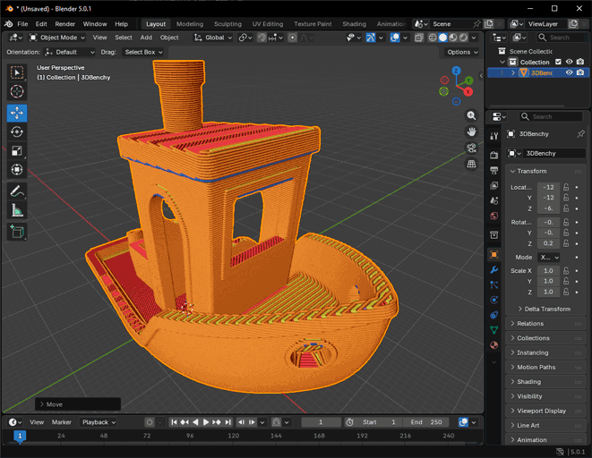

# Import and Export¶

OrcaSlicer offers various export options to import and export 3D models, projects and configurations.

* [Model](import-and-export.md#model)
  * [Import Model](import-and-export.md#import-model)
  * [Export Model](import-and-export.md#export-model)
* [Project](import-and-export.md#project)
  * [Import Project](import-and-export.md#import-project)
  * [Export Project](import-and-export.md#export-project)
* [Sliced](import-and-export.md#sliced)
  * [Export Sliced](import-and-export.md#export-sliced)
  * [Export Statistics](import-and-export.md#export-statistics)
  * [Import Sliced](import-and-export.md#import-sliced)
* [Presets](import-and-export.md#presets)
  * [Export Preset Bundle](import-and-export.md#export-preset-bundle)
  * [Import Preset Bundle](import-and-export.md#import-preset-bundle)
* [Supported File Formats](import-and-export.md#supported-file-formats)
  * [STL](import-and-export.md#stl)
  * [3MF](import-and-export.md#3mf)
  * [STEP](import-and-export.md#step)
    * [Importing STEP files](import-and-export.md#importing-step-files)
      * [Parameters](import-and-export.md#parameters)
      * [Split compound and compsolid into multiple objects](import-and-export.md#split-compound-and-compsolid-into-multiple-objects)
      * [Don't show again](import-and-export.md#dont-show-again)
  * [DRC](import-and-export.md#drc)
    * [Draco Compression](import-and-export.md#draco-compression)
      * [Draco Quantization Bits](import-and-export.md#draco-quantization-bits)
  * [OBJ](import-and-export.md#obj)
  * [AMF](import-and-export.md#amf)
  * [SVG](import-and-export.md#svg)
  * [ZIP](import-and-export.md#zip)

## Model[¶](import-and-export.md#model) <a href="#model" id="model"></a>

Models are the basic objects that you work with in OrcaSlicer. They represent the basic feature that you want to slice and print.

### Import Model[¶](import-and-export.md#import-model) <a href="#import-model" id="import-model"></a>

You can import 3D models from [different file formats](import-and-export.md#supported-file-formats) into OrcaSlicer using one of the following methods:

* **File Menu:** Go to `File` > `Import` and select the desired 3D model file.
* [**Prepare Toolbar Add Button**](/broken/pages/c73aa4736aca910a7a3339d50214ef1d0bdd9ea8#add-objects)**:** Click on the `Add` button in the toolbar to open the file dialog and select your 3D model file.
* **Drag and Drop:** Simply drag and drop the 3D model file into the OrcaSlicer window.

### Export Model[¶](import-and-export.md#export-model) <a href="#export-model" id="export-model"></a>

Use the `Export Model` (under `File` > `Export` > `...`) option to export 3D models or assemblies in various file formats. This is useful for sharing specific models or assemblies without including the entire project.

The available export formats are:

* [**STL**](import-and-export.md#stl)**:** Export the current model as an STL file.
* [**DRC**](import-and-export.md#drc)**:** Export the current model as a Draco-compressed file.
* [**Generic 3MF**](import-and-export.md#3mf)**:** Export the current model as a generic 3MF file without printer, material, or process information.

## Project[¶](import-and-export.md#project) <a href="#project" id="project"></a>

Projects are a convenient way to save and manage your work in OrcaSlicer, allowing you to keep in a single file all the objects, print settings, and configurations related to a specific project.

### Import Project[¶](import-and-export.md#import-project) <a href="#import-project" id="import-project"></a>

Use the `Import Project` (under `File` > `Open Project...`) option to open a previously saved project file. This will load all the objects, print settings, and configurations associated with that project, allowing you to continue working on it or review its details.

### Export Project[¶](import-and-export.md#export-project) <a href="#export-project" id="export-project"></a>

Use the `Export Project` (under `File` > `Save Project...`) option to save your entire project, including all objects, print settings, and configurations, into a single file that can be easily shared or backed up.

This is very useful for saving your work in progress or sharing your project with others while preserving all the details and settings.

## Sliced[¶](import-and-export.md#sliced) <a href="#sliced" id="sliced"></a>

After slicing a model, you can export the sliced result for printing.

### Export Sliced[¶](import-and-export.md#export-sliced) <a href="#export-sliced" id="export-sliced"></a>

* **G-code:** Export the sliced model as a G-code file that can be directly sent to a 3D printer for printing.
* **Gcode.3MF:** Export the sliced model as a Gcode.3MF file that includes the resulting G-code file along with printer, material, and process information. This is useful for sharing the sliced model with all the necessary information for printing.
* **Toolpaths as OBJ:** Export the sliced model 3D preview as an OBJ file.



### Export Statistics[¶](import-and-export.md#export-statistics) <a href="#export-statistics" id="export-statistics"></a>

With **Export statistics with G-code** enabled in the Preferences (`Developer` > `Settings`), exporting a G-code file also writes `<name>.statistics.json` next to it, and an exported sliced 3MF file holds them inside, as `Metadata/plate_N.statistics.json` next to each plate's G-code. The CLI writes the same files with [`--export-statistics`](/broken/pages/207a72e3c325b6315929c4ce8e7ce061a1611fca#output-logging).

The file holds the estimates the preview shows, for scripts and spreadsheets that compare prints or settings. Times are in seconds, in the normal time mode, lengths in mm, volumes in mm³ and weights in g, as its `units` say.

`version` goes up only when a key is removed, renamed or changes meaning. New keys can appear without it, so a script should check `version` and ignore the keys it doesn't know.

* `summary`: the whole plate.
  * `time`: the estimated print time, and `prepare_time` the part of it the start G-code takes.
  * `travel_time` and `travel_distance`.
  * `layer_count`.
  * `volume`, `weight` and `filament_cost` of all the filament the plate uses, the flush included, as in the preview's filament table. The cost of the print time is not included.
  * `filament_changes`.
  * `filaments`: one entry per filament used, with its `id` (from 1), `length`, `volume`, `weight` and `cost`, and the `volume` and `weight` it uses for the `model`, `support`, `prime_tower` and `flush`.
  * `features`: the `time`, `volume` and `weight` of each feature, by its name in the preview's legend, such as `Outer wall`, `Sparse infill`, or `Custom` for the start and end G-code. Features and layers count only what is extruded, so they leave the flush out.
* `layers`: one entry per layer, from the first: its `z`, the `time` of all its moves, its `travel_time`, `volume` and `weight`, and its `features` as in the summary. The first layer also holds the start G-code, and the last one the end G-code.
* `objects`: one entry per object instance, with its `name`, its `instance` number among the object's copies (from 0), and the `volume` and `weight` of its extrusions and of its supports (`support_volume`, `support_weight`). The skirt, brim, prime tower and custom G-code belong to no object.

An example, with its layers and features cut short:

```
{
  "version": 1,
  "generator": "OrcaSlicer 2.5.0",
  "units": { "time": "s", "length": "mm", "volume": "mm3", "weight": "g" },
  "summary": {
    "time": 14626.632,
    "prepare_time": 442.673,
    "travel_time": 1638.822,
    "travel_distance": 195218.36,
    "layer_count": 500,
    "volume": 150322.628,
    "weight": 150.3226,
    "filament_cost": 3.01,
    "filament_changes": 0,
    "filaments": [
      {
        "id": 1, "length": 62496.89, "volume": 150322.628, "weight": 150.3226, "cost": 3.01,
        "model": { "volume": 150322.628, "weight": 150.3226 },
        "support": { "volume": 0, "weight": 0 },
        "prime_tower": { "volume": 0, "weight": 0 },
        "flush": { "volume": 0, "weight": 0 }
      }
    ],
    "features": {
      "Sparse infill": { "time": 12845.096, "volume": 150058.732, "weight": 150.0587 },
      "Custom": { "time": 37.785, "volume": 263.887, "weight": 0.2639 }
    }
  },
  "layers": [
    {
      "z": 0.4,
      "time": 28.296,
      "travel_time": 2.468,
      "volume": 299.97,
      "weight": 0.3,
      "features": {
        "Sparse infill": { "time": 25.651, "volume": 299.97, "weight": 0.3 }
      }
    }
  ],
  "objects": [
    { "name": "Cube", "instance": 0, "volume": 150058.742, "weight": 150.0587, "support_volume": 0, "support_weight": 0 }
  ]
}
```

### Import Sliced[¶](import-and-export.md#import-sliced) <a href="#import-sliced" id="import-sliced"></a>

OrcaSlicer also allows you to import sliced files in G-code. This can help you visualize the toolpaths of a G-code file, which can be useful for analyzing the slicing results or for comparing different slicing configurations.

Tip

G-code files will only contain the toolpaths and will not include any printer, material, or process information.\
If you want to import a sliced file with all the necessary information for printing, it's recommended to use the Gcode.3MF format.

## Presets[¶](import-and-export.md#presets) <a href="#presets" id="presets"></a>

Presets are a convenient way to save and manage specific settings and configurations in OrcaSlicer, allowing you to easily apply them to different models or projects.

### Export Preset Bundle[¶](import-and-export.md#export-preset-bundle) <a href="#export-preset-bundle" id="export-preset-bundle"></a>

This tool allows you to export a bundle of presets that you can use to share specific settings and configurations with others or to back up your presets for future use.

* **Printer config bundle:** Export Printer and all the filament and process presets that belongs to the printer in a `.orca_printer` format.
* **Filament bundle:** Export user's filamnets presets set in a `.orca_filaments` format.
* **Printer presets:** Export user's printer presets set in a `.zip` file.
* **Filament presets:** Export user's filament presets set in a `.zip` file.
* **Process presets:** Export user's process presets set in a `.zip` file.

### Import Preset Bundle[¶](import-and-export.md#import-preset-bundle) <a href="#import-preset-bundle" id="import-preset-bundle"></a>

To import a preset bundle, use the `Import Configs` (under `File` > `Import` > `Preset Configs`) option and select the desired preset bundle file. This will import the presets contained in the bundle and make them available for use in your projects.

## Supported File Formats[¶](import-and-export.md#supported-file-formats) <a href="#supported-file-formats" id="supported-file-formats"></a>

OrcaSlicer supports the following 3D model file formats for import:

### STL[¶](import-and-export.md#stl) <a href="#stl" id="stl"></a>

[STL](https://en.wikipedia.org/wiki/STL_\(file_format\)) is a widely used file format for 3D printing that represents the surface geometry of a 3D object using triangular facets.

Note

This is the basic file format used for the slicing process in OrcaSlicer. Any other supported file formats (e.g., STEP, 3MF, OBJ) are converted to STL during the import process.

It's main advantage is its simplicity and wide compatibility with various 3D modeling software and slicers. However, STL files can have limitations in terms of mesh quality and may not capture intricate details accurately.\
If the original model was designed in a Mesh-based software, such as Blender or ZBrush, the STL file will likely be a good representation of the original design.\
However, if the original model was created in a CAD software, such as SolidWorks or Fusion 360, the STL file may not capture all the details and features of the original design accurately and will depend on the CAD's export settings.

### 3MF[¶](import-and-export.md#3mf) <a href="#id-3mf" id="id-3mf"></a>

3MF is a modern file format designed for 3D printing that provides a more efficient and comprehensive way to represent 3D models, including support for colors, materials, and multiple objects within a single file.

Some 3MF files may contain Printer, Material, and Process information that can be used to automatically configure print settings in OrcaSlicer.\
When importing a 3MF file, OrcaSlicer will attempt to extract this information and apply it to the imported model.\
If the 3MF information is not compatible with OrcaSlicer, it will be ignored and the model will be imported with default settings.

Tip

You can open 3MF files as a ZIP archive to inspect the included information and files.

### STEP[¶](import-and-export.md#step) <a href="#step" id="step"></a>

[STEP](https://en.wikipedia.org/wiki/ISO_10303-21) is a comprehensive file format that represents 3D models using a more detailed and accurate representation of the original design. It is commonly used in engineering and manufacturing applications.

#### Importing STEP files[¶](import-and-export.md#importing-step-files) <a href="#importing-step-files" id="importing-step-files"></a>

This setting determines how STEP files are converted into STL files and is displayed during the STEP file import process.


**Parameters**[**¶**](import-and-export.md#parameters)

The transformation uses [Linear Deflection and Angular Deflection](https://dev.opencascade.org/doc/overview/html/occt_user_guides__mesh.html) parameters to control the mesh quality. A finer mesh will result in a more accurate representation of the original surface, but it will also increase the file size and processing time.


* **Linear Deflection:** Specifies the maximum distance allowed between the original surface and its polygonal approximation. Lower values produce a mesh that more accurately follows the original curvature.
* **Angular Deflection:** Defines the maximum allowable angle difference between the actual surface and its tessellated counterpart. Smaller angular deflection values yield a more precise mesh.

**Split compound and compsolid into multiple objects**[**¶**](import-and-export.md#split-compound-and-compsolid-into-multiple-objects)

Enabling this option will split the imported 3D file into separate [parts of the same object](/broken/pages/a8af0b8ce0249203e2777bb45c50be863fbaa112#split-to-parts). This is especially useful for adjusting individual part positions, tweaking print settings, or optimizing the model through simplification while maintaining the original design [assembly](/broken/pages/291821b8f203441b2f074c0c889337350f133f58).

Each solid becomes a part, and so does each shell outside a solid, as found in surface models. Faces that belong to no shell stay together as one part.


**Don't show again**[**¶**](import-and-export.md#dont-show-again)

This option will hide the STL transformation dialog when opening a STEP file. To restore the dialog, go to "Preferences" (Ctrl + P) > "Show the STEP mesh parameter setting dialog".


### DRC[¶](import-and-export.md#drc) <a href="#drc" id="drc"></a>

[Draco (DRC)](https://github.com/google/draco) is a compression library developed by Google that is designed to compress and decompress 3D geometric meshes.\
Its main advantage is its ability to significantly reduce the file size of 3D models while maintaining a high level of visual fidelity.

#### Draco Compression[¶](import-and-export.md#draco-compression) <a href="#draco-compression" id="draco-compression"></a>

Draco uses several compression techniques to achieve high compression ratios, like file compression (used at maximum level in OrcaSlicer), duplicated vertex removal, and Quantization Bits.

**Draco Quantization Bits**[**¶**](import-and-export.md#draco-quantization-bits)

This technique reduces the precision of the vertex attributes (such as position, normal, and texture coordinates) to further decrease the file size.\
By default, OrcaSlicer disables quantization by setting the quantization bits to 0, which means that the original precision of the vertex attributes is preserved. This will create a almost Lossless compression (\~15% of the original size) but it can be adjusted to achieve a smaller file size at the cost of some loss in visual fidelity.

Using a quantization bit value of 25 will result in a even smaller file size (around 5% of the original size) while still maintaining a good level of visual fidelity and dimensional accuracy for most models. Using a quantization bit value of 16 or lower may result in a significant loss of visual fidelity, especially for models with fine details. For some artistic models where precision is not important, lower values can be used to achieve a very small file size (around 1% of the original size).

### OBJ[¶](import-and-export.md#obj) <a href="#obj" id="obj"></a>

Similar to STL, OBJ is a widely used file format for 3D models that represents the geometry of a 3D object using vertices, edges, and faces. It also supports texture mapping and material properties.

### AMF[¶](import-and-export.md#amf) <a href="#amf" id="amf"></a>

AMF (Additive Manufacturing File Format) is an XML-based file format designed for 3D printing that provides a more flexible and comprehensive way to represent 3D models, including support for colors, materials, and multiple objects within a single file.

### SVG[¶](import-and-export.md#svg) <a href="#svg" id="svg"></a>

SVG (Scalable Vector Graphics) is a file format used for 2D vector graphics. It can be imported into OrcaSlicer to create 3D models by extruding the 2D shapes defined in the SVG file.

### ZIP[¶](import-and-export.md#zip) <a href="#zip" id="zip"></a>

OrcaSlicer also supports importing ZIP files that contain one of the supported 3D model file formats (e.g., STL, 3MF, OBJ). When you import a ZIP file, OrcaSlicer will extract the contents and look for supported 3D model files to import.
