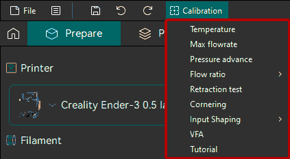
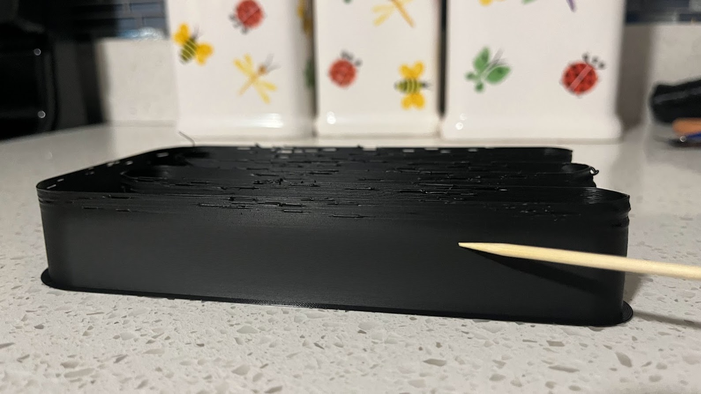
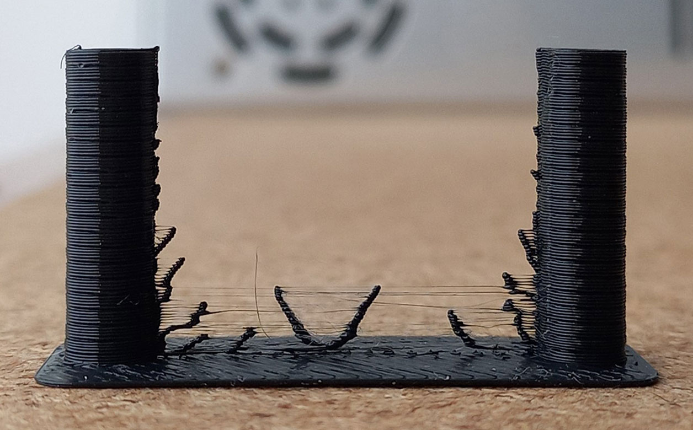
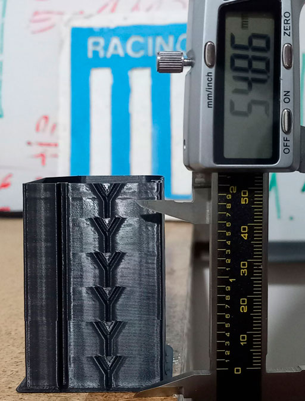
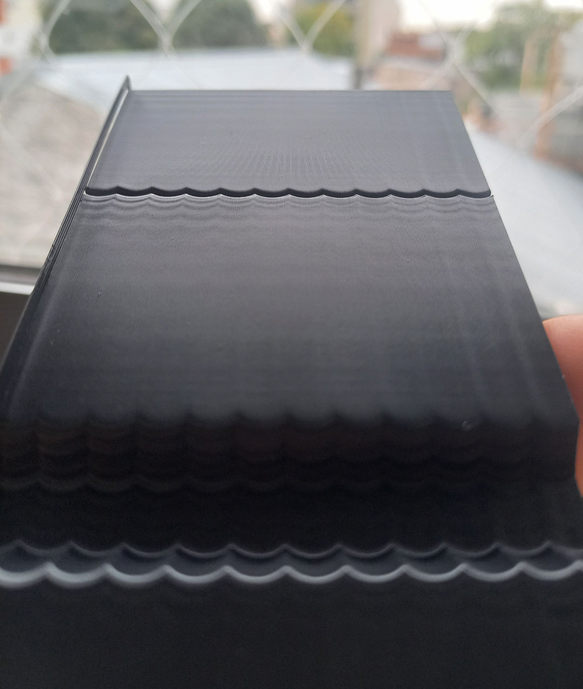
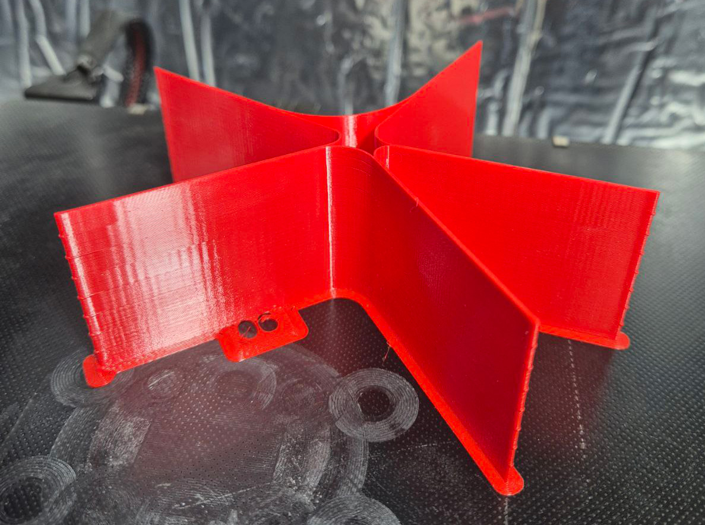

# Calibration Guide¶

This guide offers a structured and comprehensive overview of the calibration process for OrcaSlicer.

It covers key aspects such as flow ratio, pressure advance, temperature towers, retraction tests, and advanced calibration techniques. Each section includes step-by-step instructions and visuals to help you better understand and carry out each calibration effectively.

To access the calibration features, you can find them in the **Calibration** section of the OrcaSlicer interface.

Important

After completing the calibration process, remember to create a new project in order to exit the calibration mode.

Tip

**Recommended**

Filament Calibration Masterclass

Video by **Factorian Designs**, with consent.

The calibrations are split into two groups. Follow them in the order shown, as each test builds on the results of the ones before it.

Note

These tests assume the extruder itself is already calibrated in the printer firmware (E-steps or rotation distance). Most modern printers ship with this set correctly. Small differences between filaments are corrected later in the [Flow Ratio](/broken/pages/de2365cb9daaa98d9ad3608097376a29f2371e9c) step.

## Filament Calibration[¶](calibration-guide.md#filament-calibration) 

Repeat these tests for each new filament.

1.  [**Temperature**](/broken/pages/997c84d925b5c4e01d5d5c3bb47c84d949b256d0)**:** Start by calibrating the nozzle temperature. This is crucial as it affects the viscosity of the filament, which in turn influences how well it flows through the nozzle and adheres to the print bed, so every following test depends on it. The test is quick, easy to read and works with any material on any printer. It is especially important for materials with a narrow temperature range. 

    
2.  [**Max Volumetric Speed**](/broken/pages/3c98b517ea8b8a9c2acbf94db99cc63b9a9dd16e)**:** With the temperature set, find the maximum volumetric speed the hotend can reach with this filament. This sets a safe limit so the following tests don't under-extrude or clog the nozzle. Some manufacturers overstate this value, so don't rely on the one on the spool. Use a value 10–20% below the result as a safety margin. 

    
3.  [**Pressure Advance**](/broken/pages/98e0a11e8871bb509a2675168d1a37d297df9e2e)**:** Calibrate the pressure advance settings to improve print quality and reduce artifacts caused by pressure fluctuations in the nozzle. It is done before Flow Ratio because it is the value most often wrong (or never calibrated at all), while the flow ratio in most filament profiles is already close. A tuned pressure advance also gives cleaner line ends and corners, which makes the Flow Ratio test easier to read. 

    
4.  [**Flow Ratio**](/broken/pages/de2365cb9daaa98d9ad3608097376a29f2371e9c)**:** Calibrate the flow ratio to ensure that the correct amount of filament is being extruded. This is important for achieving accurate dimensions and good layer adhesion. The test starts from the flow ratio of the selected filament profile, so it is usually a small correction. 

    
5.  [**Retraction**](/broken/pages/e6b6ad6b99eb71f43300b2ccaf614ef88bf90bb4)**:** Calibrate the retraction settings to minimize stringing and improve print quality. The default values usually work well, but if you calibrate them, do it after Pressure Advance and Flow Ratio, as both change the pressure in the nozzle. Retraction doesn't depend on the advanced tests below, so it is part of the filament calibration. 

    

Tip

Pressure advance and flow ratio affect each other slightly, so either can be calibrated first. If the flow ratio changed a lot in the Flow Ratio step, run a quick Pressure Advance test again.

## Advanced Calibration[¶](calibration-guide.md#advanced-calibration) 

These tests are optional. Most of them tune the printer rather than the filament, so they only need to be repeated after hardware changes. Do them after the filament calibration, as a badly tuned filament affects their results.

1.  [**Cornering**](/broken/pages/32e75ac81b67ea0e27c86dc13e73b020011ed424)**:** Calibrate the Jerk/Junction Deviation settings to improve print quality and reduce artifacts caused by sharp corners and changes in direction. It is mainly used to raise cornering speed. Most printers don't need it, as their firmware already limits cornering: above that limit (especially in Klipper) a higher value doesn't make real prints any faster, and OrcaSlicer has no way to check it. 

    
2.  [**Input Shaping**](/broken/pages/7c942f82d3b10b8ff692dcce023e796cd63e4900)**:** Reduce ringing and improve print quality by compensating for mechanical vibrations in the printer. Most recent printers have their own automatic input shaping calibration, which is usually more accurate than this manual test, so use it when available. 

    
3.  [**VFA**](/broken/pages/ccf0c15f3bed88abec16bacceff4810aac275310)**:** A VFA speed test is available to find resonance speeds. Do it after Input Shaping to find the Vertical Fine Artifacts that input shaping didn't remove. 

    
4.  [**Adaptive Pressure Advance**](/broken/pages/4f66a6f5693b4bfc0e71b9323776541409376697)**:** Adjusts the pressure advance value for different flow rates and accelerations. It needs a calibrated Pressure Advance and Flow Ratio, and its tests [should not go above the acceleration limit found with Input Shaping](/broken/pages/4f66a6f5693b4bfc0e71b9323776541409376697#defining-the-calibration-sets). 

    

***

[**Tolerance**](/broken/pages/20e96d7df15e0cf130869274e5a183150ebc8413)**:** Calibrate the tolerances of your printer to ensure that it can accurately reproduce the dimensions of the model being printed. This is important for achieving a good fit between parts and for ensuring that the final print meets the desired specifications. Do it last, as the result depends on every calibration above. 

***

_Credits:_

* _The Flow test and retraction test is inspired by_ [_SuperSlicer_](https://github.com/supermerill/SuperSlicer)_._
* _The PA Line method is inspired by_ [_K-factor Calibration Pattern_](https://marlinfw.org/tools/lin_advance/k-factor.html)_._
* _The PA Tower method is inspired by_ [_Klipper_](https://www.klipper3d.org/Pressure_Advance.html)_._
* _The temp tower model is remixed from_ [_Smart compact temperature calibration tower_](https://www.thingiverse.com/thing:2729076)_._
* _The max flowrate test was inspired by Stefan (CNC Kitchen), and the model used in the test is a remix of his_ [_Extrusion Test Structure_](https://www.printables.com/model/342075-extrusion-test-structure)_._
* _ZV Input Shaping is inspired by_ [_Marlin Input Shaping_](https://marlinfw.org/docs/features/input_shaping.html) _and_ [_Ringing Tower 3D STL_](https://marlinfw.org/assets/stl/ringing_tower.stl)_._
