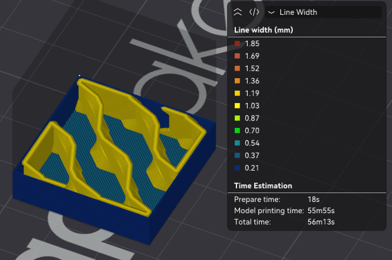
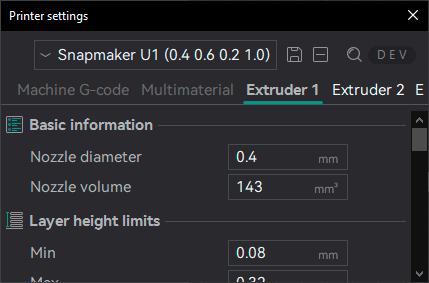
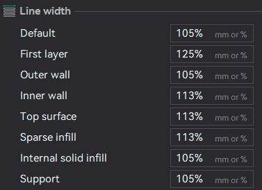

# Mixed Nozzle Sizes¶

Since v2.2.0-beta, OrcaSlicer allows you to use different nozzle sizes in the same print.\
This feature is extremely useful with the growing popularity of multi-nozzle printers, enabling faster and stronger prints while improving quality.

## Setup[¶](mixed-nozzle-sizes.md#setup) 

### Machine[¶](mixed-nozzle-sizes.md#machine) 

To use mixed nozzle sizes, you need to set each extruder's nozzle diameter in the [Machine settings / Extruder \[Number\] / Basic Information](/broken/pages/b4a1878b1930f2f9acba7ffc549726d0c18d690a#nozzle-diameter) section.

For example:

* Extruder 1: `0.4mm` Standard nozzle
* Extruder 2: `0.6mm` Big nozzle for faster surface printing
* Extruder 3: `0.2mm` Small nozzle for fine details at Walls
* Extruder 4: `1.0mm` Extra-large nozzle for very fast infill

### Process[¶](mixed-nozzle-sizes.md#process) 

For MultiNozzle processes, you need to make the profile Nozzle agnostic by setting each [line width](/broken/pages/071d8306b1e38aa4aa5bb68076bb78ad0e540b0f) to a percentage of the nozzle diameter.\
This allows the slicer to automatically adjust the line width for each extruder based on its nozzle size, ensuring consistent print quality across different nozzle sizes.

A quick way to make the profile Nozzle agnostic is to divide each line width by the nozzle diameter and set it as a percentage.\
For example, if the line width is set to `0.4mm` and the nozzle diameter is `0.4mm`, you would set the line width to `100%` of the nozzle diameter.\
If the line width is set to `0.48mm` and the nozzle diameter is `0.4mm`, you would set the line width to `120%` of the nozzle diameter.

### Material[¶](mixed-nozzle-sizes.md#material) 

Pressure advance changes with different nozzle sizes, so you may need to calibrate it for each extruder and create a Filament profile for each material and nozzle size combination. Most of the other settings can be shared between the different nozzle sizes, but you may want to create separate profiles if you want to use different line widths or other settings for each nozzle size.

Note

On printers with more than one extruder of a different type, such as the X2D (Bowden and Direct Drive), the material settings will have tabs with different configuration groups for each type.

## Selecting Nozzle Sizes[¶](mixed-nozzle-sizes.md#selecting-nozzle-sizes) 

To assign specific nozzle sizes to different features of the print, you can use the [Filament for Features](/broken/pages/0fb69f9af45dbc29c813e3960073a6847ae0d19d) settings or the [Color Painting Tool](/broken/pages/ce3f2c39bd778e693abe651878da8af77be3cdc4).
