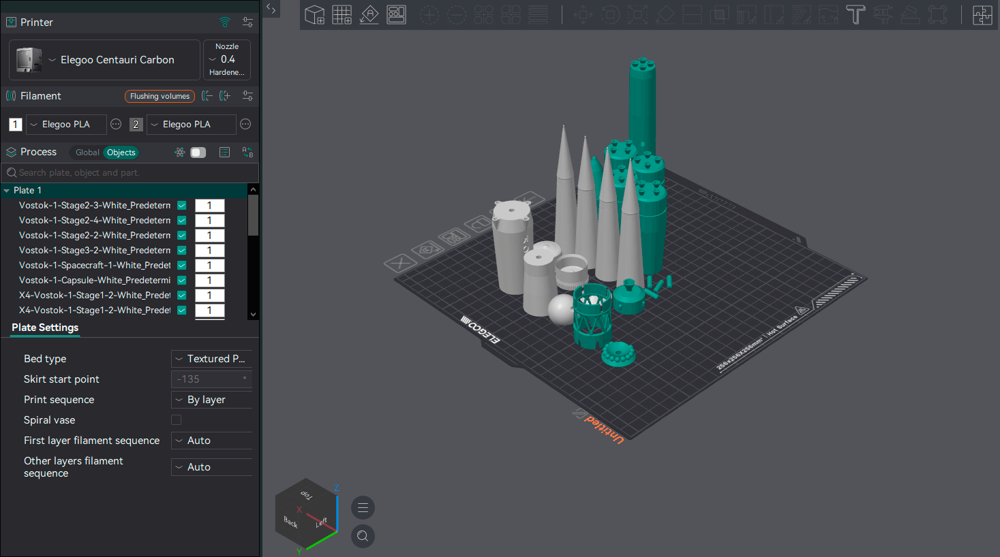
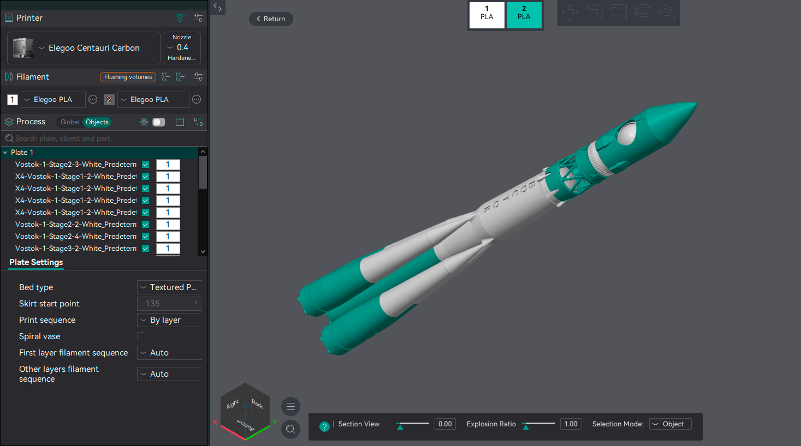

# Assembly Tools¶

There are two assembly tools in OrcaSlicer, one for generating assemblies on the bed from multiple imported [objects](/broken/pages/a8af0b8ce0249203e2777bb45c50be863fbaa112) and another for viewing an imported assembly that has been disassembled on the bed to optimize printing.

## Assemble[¶](assembly-tools.md#assemble) 

Use the Assemble tool to create a bed assembly from multiple objects.

Tip

Is recommended to merge the objects into one before using this function.\
This way the assembly will be considered as parts after they are merged, and can be adjusted freely on the z-axis.\
If the objects are not merged, the assembly will be considered as separate objects and each part must have a face that touches the heatbed.

### Point and Point Assembly[¶](assembly-tools.md#point-and-point-assembly) 

Use the Point and Point Assembly tool to create assembly instructions by selecting points on your 3D model.\
Press and hold the `Shift` key while clicking on the model to select assembly points.

### Face and Face Assembly[¶](assembly-tools.md#face-and-face-assembly) 

Use the Face and Face Assembly tool to create assembly instructions by selecting faces on your 3D model.\
After selecting both faces to be joined, you can select the alignment method:

* **Parallel**: Aligns the faces so that they are parallel to each other.
* **Center coincidence**: Aligns the centers of the faces.
* **Flip by Face 2**: Flips the orientation of object 2 based on the normal of face 2.

## Assembly View[¶](assembly-tools.md#assembly-view) 

When importing a STEP Assembly file, you can use the Assembly View to see the hierarchical structure of the assembly.\
It's recommended to [split compound and compsolid into multiple objects](/broken/pages/f2c68b382bf7caa0d1c1d0addfed2d60d9583c14#split-compound-and-compsolid-into-multiple-objects) when importing and then [Split](/broken/pages/a8af0b8ce0249203e2777bb45c50be863fbaa112#split-to-objects) for better manipulation.\
This way you can Auto arrange all objects and still keep the assembly structure in the Assembly View.

