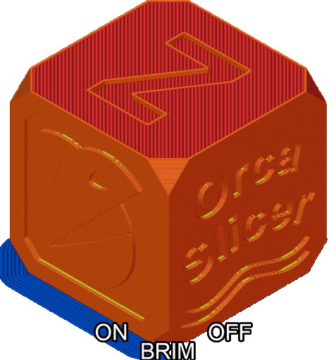

# Brim¶

Brim is a flat layer printed around a model's base to improve adhesion to the print bed. It is useful for models with small footprints or those prone to warping.

* [Type](brim.md#type)
  * [Auto](brim.md#auto)
  * [Painted](brim.md#painted)
  * [Outer](brim.md#outer)
  * [Inner](brim.md#inner)
  * [Outer and Inner](brim.md#outer-and-inner)
  * [Mouse Ears](brim.md#mouse-ears)
    * [Ear max angle](brim.md#ear-max-angle)
    * [Ear detection radius](brim.md#ear-detection-radius)
  * [No-brim](brim.md#no-brim)
  * [Leading edge only](brim.md#leading-edge-only)
* [Brim ears outer only](brim.md#brim-ears-outer-only)
* [Width](brim.md#width)
* [Leading length](brim.md#leading-length)
* [Extra width](brim.md#extra-width)
* [Brim-Object Gap](brim.md#brim-object-gap)
  * [Brim Flow Ratio](brim.md#brim-flow-ratio)
  * [Brim use EFC outline](brim.md#brim-use-efc-outline)
* [Combine brims](brim.md#combine-brims)
  * [Combined](brim.md#combined)
  * [Uncombined](brim.md#uncombined)
* [Brim on belt printers](brim.md#brim-on-belt-printers)

## Type[¶](brim.md#type) 

[Mode](/broken/pages/246b4d07eed07a8ac878abc4613a350fbce2c022): `Simple`.\
[Variable](/broken/pages/2ce6fff32f5448d0159c2e2dfbcb54f26d3c6918): `brim_type`.\
[Type](/broken/pages/726477a877bf7a8efe103413c86723285f8ca2eb#choice): `Choice`.\
[Options](/broken/pages/726477a877bf7a8efe103413c86723285f8ca2eb#choice): `auto_brim, brim_ears, painted, outer_only, inner_only, outer_and_inner, no_brim, leading_edge_only`.\
[CLI Example](/broken/pages/f439233018f603f29dcf6b1fcc75b0ab21b6fd24#setting-overrides): `--brim-type=auto_brim`.\
Controls how the brim is generated on a model's outer and/or inner sides.

### Auto[¶](brim.md#auto) 

The Auto brim feature computes an optimal brim width by evaluating material properties, part geometry, printing speed, and thermal characteristics.

* Model geometry
  * Uses the model's height and the shape of its first layer.
  * Height-to-area ratio: computed from the model's height and the second moment of area of its first layer.
* Printing speed
  * Higher maximum printing speeds generally increase the recommended brim width.
* Thermal length
  * Defined as the diagonal of the model's base.
  * Reference thermal lengths (material-specific):
    * ABS, PA-CF, PET-CF: 100
    * PC: 40
    * TPU: 1000
* Material adhesion coefficient
  * Default: 1
  * PETG/PCTG: 2
  * TPU: 0.5

The computed brim width is capped at 18 mm and at 1.5× the thermal length. If the final width is under 5 mm and also less than 1.5× the thermal length, no brim will be generated (width = 0).

### Painted[¶](brim.md#painted) 

Generates a brim only on areas that [have been painted in the Prepare tab](/broken/pages/acc6ead86619bb7197ee8838cfe76c9f0fbdca82).

### Outer[¶](brim.md#outer) 

Creates a brim around the model's outer perimeter.\
Easier to remove than an inner brim, but may affect the model's appearance if not removed cleanly.

### Inner[¶](brim.md#inner) 

Creates a brim around inner perimeters.\
It is more difficult to remove and less effective than an outer brim, and it may obscure fine inner details, but it can hide the brim removal seam.

### Outer and Inner[¶](brim.md#outer-and-inner) 

Creates a brim around both the outer and inner perimeters of the model.\
This approach combines the **disadvantages** of both brim types: it is more difficult to remove and may obscure fine details, but it improves overall adhesion.

Tip

Consider using a [raft](/broken/pages/95f71e091ed1cc246f563f406e1b5624bec1bd46) on complex models/materials.

### Mouse Ears[¶](brim.md#mouse-ears) 

Mouse ears are small, local brim extensions (typically placed near corners and sharp features) that improve bed adhesion and reduce warping while using less material than a full brim.\
The geometry analysis routine selects candidate locations based on the configured angle threshold and detection radius.

#### Ear max angle[¶](brim.md#ear-max-angle) 

[Mode](/broken/pages/246b4d07eed07a8ac878abc4613a350fbce2c022): `Advanced`.\
[Variable](/broken/pages/2ce6fff32f5448d0159c2e2dfbcb54f26d3c6918): `brim_ears_max_angle`.\
[Type](/broken/pages/726477a877bf7a8efe103413c86723285f8ca2eb#integer-float-percentage): `Float`.\
[CLI Example](/broken/pages/f439233018f603f29dcf6b1fcc75b0ab21b6fd24#setting-overrides): `--brim-ears-max-angle=1`.\
Angle threshold (degrees) used to decide where mouse ears may be placed:

* 0° — disabled; no mouse ears are generated.
* Between 0° and 180° — ears are created at features with local angles sharper (smaller) than the threshold.
* 180° — ears are allowed on almost any non-straight feature.

#### Ear detection radius[¶](brim.md#ear-detection-radius) 

[Mode](/broken/pages/246b4d07eed07a8ac878abc4613a350fbce2c022): `Advanced`.\
[Variable](/broken/pages/2ce6fff32f5448d0159c2e2dfbcb54f26d3c6918): `brim_ears_detection_length`.\
[Type](/broken/pages/726477a877bf7a8efe103413c86723285f8ca2eb#integer-float-percentage): `Float`.\
[CLI Example](/broken/pages/f439233018f603f29dcf6b1fcc75b0ab21b6fd24#setting-overrides): `--brim-ears-detection-length=1`.\
The geometry is decimated before sharp angles are detected.\
This parameter sets the minimum deviation length used for the decimation.\
Set to 0 to disable.

### No-brim[¶](brim.md#no-brim) 

No brim is printed around the model. The brims of neighboring objects are still kept one brim line away from it, so they don't touch it.\
Useful as a per-object setting to skip the brim on parts that don't need one. The other brim settings are disabled while it is selected.

### Leading edge only[¶](brim.md#leading-edge-only) 

Important

NEW FEATURE: **Leading edge only brim for belt printers**\
Available in: [Nightly builds](https://github.com/OrcaSlicer/OrcaSlicer/releases/tag/nightly-builds) or Releases greater than **2.4.2**.

Available only on [belt printers](/broken/pages/226f2361e5d5e6ef3f7abf3becc7918d447a2ef7). Generates a brim at and ahead of the object's first contact with the belt, without extending along the rest of the object.

Use it with [Leading length](brim.md#leading-length) to anchor the leading edge without printing a brim along the entire part. The extension gives the brim material more time to adhere to the belt before the object begins printing. On printers without a belt, this type is printed as an [Outer](brim.md#outer) brim.

## Brim ears outer only[¶](brim.md#brim-ears-outer-only) 

[Mode](/broken/pages/246b4d07eed07a8ac878abc4613a350fbce2c022): `Advanced`.\
[Variable](/broken/pages/2ce6fff32f5448d0159c2e2dfbcb54f26d3c6918): `brim_ears_outer_only`.\
[Type](/broken/pages/726477a877bf7a8efe103413c86723285f8ca2eb#boolean): `Boolean`.\
[CLI Example](/broken/pages/f439233018f603f29dcf6b1fcc75b0ab21b6fd24#setting-overrides): `--brim-ears-outer-only=1`.

Important

NEW FEATURE: **Limit automatic and painted brim ears to outer contours**\
Available in: [Nightly builds](https://github.com/OrcaSlicer/OrcaSlicer/releases/tag/nightly-builds) or Releases greater than **2.4.2**.

When enabled, brim ears are generated only on the model's outer contour. Ears that would otherwise be placed in holes or other enclosed sections are excluded.

This setting is available for both the **Mouse Ears** and **Painted** brim types. In Mouse Ears mode, it filters automatically detected ears. In Painted mode, it filters painted ears when the model is sliced.

## Width[¶](brim.md#width) 

[Mode](/broken/pages/246b4d07eed07a8ac878abc4613a350fbce2c022): `Simple`.\
[Variable](/broken/pages/2ce6fff32f5448d0159c2e2dfbcb54f26d3c6918): `brim_width`.\
[Type](/broken/pages/726477a877bf7a8efe103413c86723285f8ca2eb#integer-float-percentage): `Float`.\
[CLI Example](/broken/pages/f439233018f603f29dcf6b1fcc75b0ab21b6fd24#setting-overrides): `--brim-width=1`.\
Distance between the model and the outermost brim line.\
Increasing this value widens the brim, which can improve adhesion but increases material usage.

On a [belt printer](brim.md#brim-on-belt-printers), the width is measured on the belt surface and applies to every brim type.

When **Brim type** is set to **Mouse ear**, this setting is labeled **Brim ear radius** _(Nightly builds and releases greater than 2.4.2)_. Its value sets the radius of each automatically generated ear. When **Brim type** is set to **Painted**, the size of brim ears is controlled in the [Brim ears Painting tool](/broken/pages/acc6ead86619bb7197ee8838cfe76c9f0fbdca82).

## Leading length[¶](brim.md#leading-length) 

[Mode](/broken/pages/246b4d07eed07a8ac878abc4613a350fbce2c022): `Advanced`.\
[Variable](/broken/pages/2ce6fff32f5448d0159c2e2dfbcb54f26d3c6918): `leading_brim_length`.\
[Type](/broken/pages/726477a877bf7a8efe103413c86723285f8ca2eb#integer-float-percentage): `Float`.\
[CLI Example](/broken/pages/f439233018f603f29dcf6b1fcc75b0ab21b6fd24#setting-overrides): `--leading-brim-length=1`.

Important

NEW FEATURE: **Leading brim length for belt printers**\
Available in: [Nightly builds](https://github.com/OrcaSlicer/OrcaSlicer/releases/tag/nightly-builds) or Releases greater than **2.4.2**.

Available only on belt printers. Extends the brim along the belt ahead of every leading edge of the object's contact area. This includes the object's first contact with the belt and any separate island that contacts the belt later in the print.

This extension, called an apron, is printed before the object's leading edge, providing an anchor already attached to the belt.

The length is measured on the belt surface and is added to the [Width](brim.md#width): the brim extends `Brim-object gap + Leading length + Width` ahead of the object. Set the [Brim-Object Gap](brim.md#brim-object-gap) to 0 so the apron touches the edge it anchors.

Note

On a tilted belt, each layer contributes one strip of the brim. The resulting sheet's thickness is determined by flow rather than layer height. Use the [Brim Flow Ratio](brim.md#brim-flow-ratio) to adjust this thickness.

Warning

[Auto arrange](/broken/pages/0fcd3913806f2ebe7be268c6b82f8de56ec468b6) does not reserve space for the leading brim. Leave enough room between objects along the belt for this extension.

Set to 0 to disable.

## Extra width[¶](brim.md#extra-width) 

[Mode](/broken/pages/246b4d07eed07a8ac878abc4613a350fbce2c022): `Advanced`.\
[Variable](/broken/pages/2ce6fff32f5448d0159c2e2dfbcb54f26d3c6918): `extra_brim_width`.\
[Type](/broken/pages/726477a877bf7a8efe103413c86723285f8ca2eb#integer-float-percentage): `Float`.\
[CLI Example](/broken/pages/f439233018f603f29dcf6b1fcc75b0ab21b6fd24#setting-overrides): `--extra-brim-width=1`.

Important

NEW FEATURE: **Extra brim width for belt printers**\
Available in: [Nightly builds](https://github.com/OrcaSlicer/OrcaSlicer/releases/tag/nightly-builds) or Releases greater than **2.4.2**.

Available only on belt printers. Widens the brim across the belt without extending it farther ahead of or behind the object. Use it when a part needs more adhesion along its length than the [Width](brim.md#width) setting alone provides.

The value is measured on the belt surface and is added to the [Width](brim.md#width): the brim extends `Brim-object gap + Width + Extra width` to each side of the object. To extend the brim ahead of the object instead, use [Leading length](brim.md#leading-length).

Set to 0 to disable.

## Brim-Object Gap[¶](brim.md#brim-object-gap) 

[Mode](/broken/pages/246b4d07eed07a8ac878abc4613a350fbce2c022): `Advanced`.\
[Variable](/broken/pages/2ce6fff32f5448d0159c2e2dfbcb54f26d3c6918): `brim_object_gap`.\
[Type](/broken/pages/726477a877bf7a8efe103413c86723285f8ca2eb#integer-float-percentage): `Float`.\
[CLI Example](/broken/pages/f439233018f603f29dcf6b1fcc75b0ab21b6fd24#setting-overrides): `--brim-object-gap=1`.\
Gap between the innermost brim line and the object.\
Increasing the gap makes the brim easier to remove but reduces its adhesion benefit; very large gaps may eliminate contact and negate the brim's purpose.

### Brim Flow Ratio[¶](brim.md#brim-flow-ratio) 

[Mode](/broken/pages/246b4d07eed07a8ac878abc4613a350fbce2c022): `Advanced`.\
[Variable](/broken/pages/2ce6fff32f5448d0159c2e2dfbcb54f26d3c6918): `brim_flow_ratio`.\
[Type](/broken/pages/726477a877bf7a8efe103413c86723285f8ca2eb#integer-float-percentage): `Float`.\
[CLI Example](/broken/pages/f439233018f603f29dcf6b1fcc75b0ab21b6fd24#setting-overrides): `--brim-flow-ratio=1`.\
This factor affects the amount of material for [brims](brim.md#brim). Setting this value slightly above 1.0 can help the brim hold the print on the plate, but it can also make brims harder to remove. The actual brim [flow](/broken/pages/8737adce37259a727713a40d86d1257eda155156#surface-flow-ratio) used is calculated by multiplying this value by the [filament flow ratio](/broken/pages/4da0e8a2d1390e2f4166da4f6cca2f83837a3bb6#flow-ratio), and if set, the object's flow ratio.

Note

The resulting value will not be affected by the [first-layer flow ratio](/broken/pages/8737adce37259a727713a40d86d1257eda155156#surface-flow-ratio).

### Brim use EFC outline[¶](brim.md#brim-use-efc-outline) 

[Mode](/broken/pages/246b4d07eed07a8ac878abc4613a350fbce2c022): `Advanced`.\
[Variable](/broken/pages/2ce6fff32f5448d0159c2e2dfbcb54f26d3c6918): `brim_use_efc_outline`.\
[Type](/broken/pages/726477a877bf7a8efe103413c86723285f8ca2eb#boolean): `Boolean`.\
[CLI Example](/broken/pages/f439233018f603f29dcf6b1fcc75b0ab21b6fd24#setting-overrides): `--brim-use-efc-outline=1`.\
When enabled, the brim is aligned with the first-layer perimeter geometry after [Elephant Foot Compensation](/broken/pages/c70b83c3a32422c9168494b30baab0b5314ff4ad#elephant-foot-compensation) is applied.\
This option is intended for cases where [Elephant Foot Compensation](/broken/pages/c70b83c3a32422c9168494b30baab0b5314ff4ad#elephant-foot-compensation) significantly alters the first-layer footprint.

If your current setup already works well, enabling it may be unnecessary and can cause the brim to fuse with upper layers.

## Combine brims[¶](brim.md#combine-brims) 

[Mode](/broken/pages/246b4d07eed07a8ac878abc4613a350fbce2c022): `Advanced`.\
[Variable](/broken/pages/2ce6fff32f5448d0159c2e2dfbcb54f26d3c6918): `combine_brims`.\
[Type](/broken/pages/726477a877bf7a8efe103413c86723285f8ca2eb#boolean): `Boolean`.\
[CLI Example](/broken/pages/f439233018f603f29dcf6b1fcc75b0ab21b6fd24#setting-overrides): `--combine-brims=1`.\
Combine adjacent brims into a single continuous brim when they touch.

* Disable: Each object's brim is generated and printed separately; each brim is completed before its object is printed.
* Enable: Brims that touch are merged and printed together as longer continuous loops, which can improve adhesion for small or closely spaced objects.

### Combined[¶](brim.md#combined) 

### Uncombined[¶](brim.md#uncombined) 

## Brim on belt printers[¶](brim.md#brim-on-belt-printers) 

Important

NEW FEATURE: **Belt printer brim**\
Available in: [Nightly builds](https://github.com/OrcaSlicer/OrcaSlicer/releases/tag/nightly-builds) or Releases greater than **2.4.2**.

On a [belt printer](/broken/pages/226f2361e5d5e6ef3f7abf3becc7918d447a2ef7), an object touches the belt along a narrow strip in each layer, so the entire brim cannot be printed in the first layer. Instead, the brim is printed on the tilted belt surface one strip at a time, across all layers that reach the belt.

This changes how the settings on this page behave:

* [Outer](brim.md#outer), [Inner](brim.md#inner), [Outer and Inner](brim.md#outer-and-inner) and [Leading edge only](brim.md#leading-edge-only) work as described.
* [Auto](brim.md#auto), [Mouse Ears](brim.md#mouse-ears) and [Painted](brim.md#painted) are printed as an Outer brim using the [Width](brim.md#width) setting.
* [Leading length](brim.md#leading-length) and [Extra width](brim.md#extra-width) become available.
* [Brim use EFC outline](brim.md#brim-use-efc-outline) and [Combine brims](brim.md#combine-brims) are disabled because both apply only to a flat first layer.
* A brim cannot be combined with [Spiral vase](/broken/pages/e792de15ca89fe7bca7e8654ec76e5852fdd584b#spiral-vase).

A brim is only generated when the [belt tilt](/broken/pages/00dcd987ac21f7e44ecf650ee21f58b8c880cf8a#belt-tilt) is between 1° and 85°.
