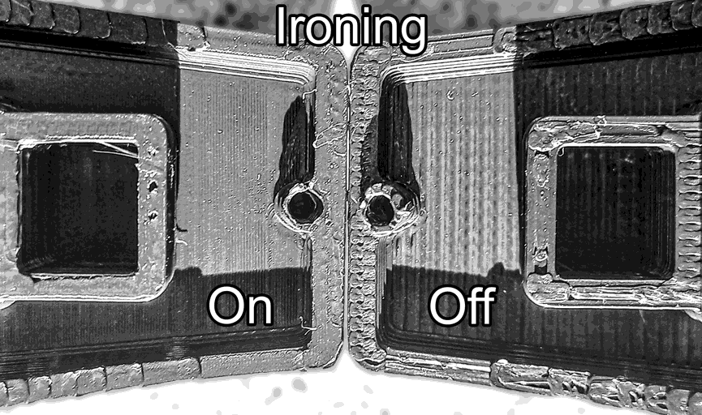

# Ironing¶

Ironing is a process used to improve the surface finish of 3D prints by smoothing out the top layers. This is achieved by printing a second time at the same height, but with a very [low flow rate](ironing.md#flow) and a specific [pattern](ironing.md#pattern). The result is a smoother surface that can enhance the aesthetic quality of the print at the cost of increased print time.

Tip

For multi-material prints, consider using [Material Setting Overrides](/broken/pages/81491811ca710a7d7f259cedc43d59f3fb1d8de0#ironing) to customize ironing settings for each material.

Important

Ironing can cause filament to move very slowly through the hotend, which increases the risk of heat creep and potential clogging. Monitor your printer during ironing and ensure your hotend cooling is adequate to prevent jams.

## Type[¶](ironing.md#type) 

[Mode](/broken/pages/246b4d07eed07a8ac878abc4613a350fbce2c022): `Advanced`.\
[Variable](/broken/pages/2ce6fff32f5448d0159c2e2dfbcb54f26d3c6918): `ironing_type`.\
[Type](/broken/pages/726477a877bf7a8efe103413c86723285f8ca2eb#choice): `Choice`.\
[Options](/broken/pages/726477a877bf7a8efe103413c86723285f8ca2eb#choice): `no ironing, top, topmost, solid`.\
[CLI Example](/broken/pages/f439233018f603f29dcf6b1fcc75b0ab21b6fd24#setting-overrides): `--ironing-type="no ironing"`.\
This setting controls which layers are ironed.

* **All top surfaces**: All [top surfaces](/broken/pages/a93444d6bc5d3f832eed7be5e316e5e8f71eee5d) will be ironed. This is the most common setting and is used to smooth out the top layers of the print.\
  
* **Topmost surface only**: Only the last [top layer](/broken/pages/a93444d6bc5d3f832eed7be5e316e5e8f71eee5d) of each object will be ironed. This is useful for prints where only the last layer needs to be smoothed.\
  
* **All solid layers**: All solid layers, including [internal solid infill](/broken/pages/da1f51648c030aebc578bfec4de7c7b47ec7ddd2#internal-solid-infill) and [top layers](/broken/pages/a93444d6bc5d3f832eed7be5e316e5e8f71eee5d), will be ironed. This can be useful for prints that require a very smooth finish on all solid surfaces but may increase print time significantly.\
  

## Pattern[¶](ironing.md#pattern) 

[Mode](/broken/pages/246b4d07eed07a8ac878abc4613a350fbce2c022): `Advanced`.\
[Variable](/broken/pages/2ce6fff32f5448d0159c2e2dfbcb54f26d3c6918): `ironing_pattern`.\
[Type](/broken/pages/726477a877bf7a8efe103413c86723285f8ca2eb#choice): `Choice`.\
[Options](/broken/pages/726477a877bf7a8efe103413c86723285f8ca2eb#choice): `rectilinear, concentric`.\
[CLI Example](/broken/pages/f439233018f603f29dcf6b1fcc75b0ab21b6fd24#setting-overrides): `--ironing-pattern=rectilinear`.\
The pattern that will be used when ironing. Usually, the best pattern is the one with the most efficient coverage of the surface.

Tip

See [Infill Patterns Wiki List](/broken/pages/a147f0b85dea1cbf1cf61adb81420a35f687c13f) with **detailed specifications**, including their strengths and weaknesses.

The ironing patterns are:

* [**Concentric**](/broken/pages/a147f0b85dea1cbf1cf61adb81420a35f687c13f#concentric)
* [**Rectilinear**](/broken/pages/a147f0b85dea1cbf1cf61adb81420a35f687c13f#rectilinear)

## Flow[¶](ironing.md#flow) 

[Mode](/broken/pages/246b4d07eed07a8ac878abc4613a350fbce2c022): `Advanced`.\
[Variable](/broken/pages/2ce6fff32f5448d0159c2e2dfbcb54f26d3c6918): `ironing_flow`.\
[Type](/broken/pages/726477a877bf7a8efe103413c86723285f8ca2eb#integer-float-percentage): `Percentage`.\
[CLI Example](/broken/pages/f439233018f603f29dcf6b1fcc75b0ab21b6fd24#setting-overrides): `--ironing-flow=20%`.\
The amount of material to extrude during ironing.\
It is a percentage of the flow of a normal layer height. A lower value will result in a smoother finish but may not cover the surface completely. A higher value may cover the surface better but can lead to over-extrusion or a rougher finish.

A lower layer height may require higher flow due to less volumetric extrusion per distance.

## Line spacing[¶](ironing.md#line-spacing) 

[Mode](/broken/pages/246b4d07eed07a8ac878abc4613a350fbce2c022): `Advanced`.\
[Variable](/broken/pages/2ce6fff32f5448d0159c2e2dfbcb54f26d3c6918): `ironing_spacing`.\
[Type](/broken/pages/726477a877bf7a8efe103413c86723285f8ca2eb#integer-float-percentage): `Float`.\
[CLI Example](/broken/pages/f439233018f603f29dcf6b1fcc75b0ab21b6fd24#setting-overrides): `--ironing-spacing=1`.\
The distance between the lines of ironing.\
It's recommended to set this value to be equal to or less than the nozzle diameter for optimal coverage and surface finish.

## Inset[¶](ironing.md#inset) 

[Mode](/broken/pages/246b4d07eed07a8ac878abc4613a350fbce2c022): `Advanced`.\
[Variable](/broken/pages/2ce6fff32f5448d0159c2e2dfbcb54f26d3c6918): `ironing_inset`.\
[Type](/broken/pages/726477a877bf7a8efe103413c86723285f8ca2eb#integer-float-percentage): `Float`.\
[CLI Example](/broken/pages/f439233018f603f29dcf6b1fcc75b0ab21b6fd24#setting-overrides): `--ironing-inset=1`.\
The distance to keep from the edges, which can help prevent over-extrusion at the edges of the surface being ironed.

If this value is set to 0, an inset of half the nozzle diameter is used, so the [ironing pattern](ironing.md#pattern) stays slightly inside the outer boundaries of the top surface being ironed.

## Angle Offset[¶](ironing.md#angle-offset) 

[Mode](/broken/pages/246b4d07eed07a8ac878abc4613a350fbce2c022): `Advanced`.\
[Variable](/broken/pages/2ce6fff32f5448d0159c2e2dfbcb54f26d3c6918): `ironing_angle`.\
[Type](/broken/pages/726477a877bf7a8efe103413c86723285f8ca2eb#integer-float-percentage): `Float`.\
[CLI Example](/broken/pages/f439233018f603f29dcf6b1fcc75b0ab21b6fd24#setting-overrides): `--ironing-angle=1`.\
The angle of ironing lines offset relative to the top surface solid infill direction.\
This option can only be edited when the ironing [Pattern](ironing.md#pattern) is Rectilinear.

Commonly used ironing angle offsets are 0°, 45°, and 90°, each producing a [different surface finish](https://github.com/OrcaSlicer/OrcaSlicer/issues/10834#issuecomment-3322628589) which will depend on your printer nozzle.

Tip

Enable [Align directions to model](/broken/pages/def49ed4375ccd47ffeb8694997bbd8dc609e159#align-directions-to-model) to make the ironing direction follow the model's orientation on the build plate.

## Fixed Angle[¶](ironing.md#fixed-angle) 

[Mode](/broken/pages/246b4d07eed07a8ac878abc4613a350fbce2c022): `Advanced`.\
[Variable](/broken/pages/2ce6fff32f5448d0159c2e2dfbcb54f26d3c6918): `ironing_angle_fixed`.\
[Type](/broken/pages/726477a877bf7a8efe103413c86723285f8ca2eb#boolean): `Boolean`.\
[CLI Example](/broken/pages/f439233018f603f29dcf6b1fcc75b0ab21b6fd24#setting-overrides): `--ironing-angle-fixed=1`.\
Use a fixed absolute angle for ironing that is not offset from the top surface infill direction. This results in an ironing finish that does not have alternating line directions and may result in a more uniform surface finish and reduced tiger striping effect when reflecting light.

When enabled, the [Angle Offset](ironing.md#angle-offset) value is used as the absolute ironing angle. Choose an angle that is well offset from all the affected top surface solid infill directions.

Suggested fixed ironing angles are 0° and 90° if you are using the default solid infill direction of 45°.

This option can only be edited when the ironing [Pattern](ironing.md#pattern) is Rectilinear.

## Speed[¶](ironing.md#speed) 

See [Speed settings for other layers](/broken/pages/e7564d8175752533bd6013e85bc33a5635aa36fb#ironing-speed) for more information about ironing speed.
