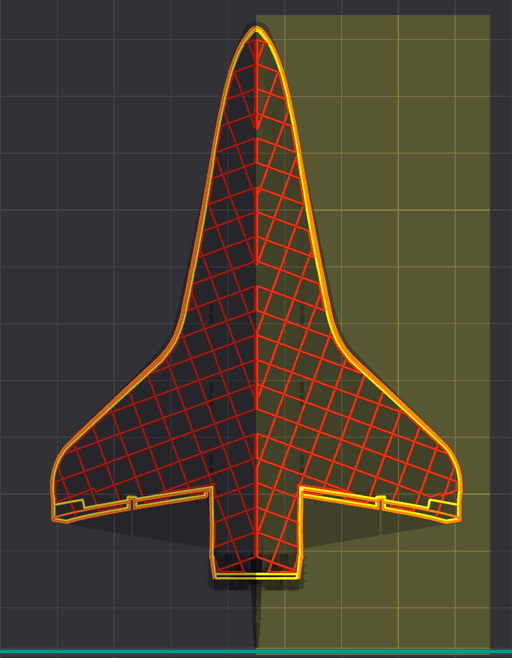
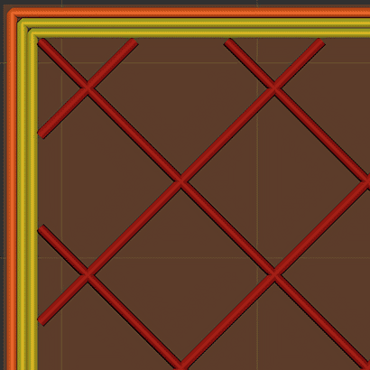
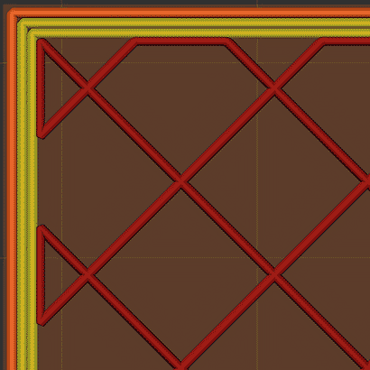
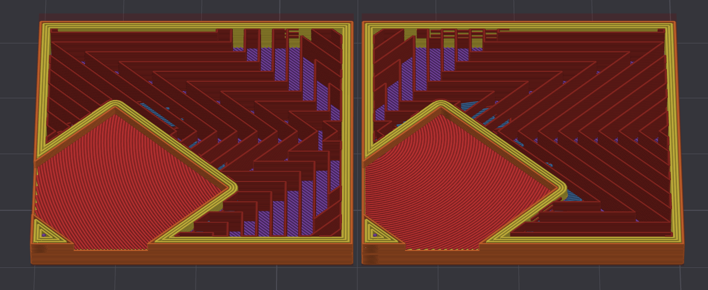
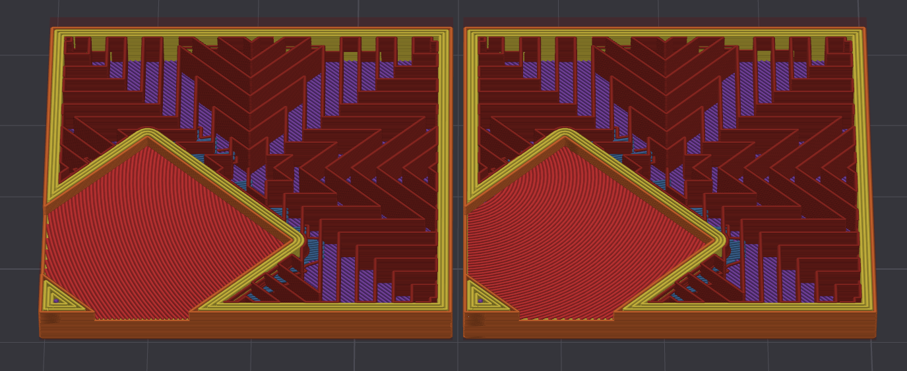

# Infill¶

Infill is the internal structure of a 3D print, providing strength and support. It can be adjusted to balance material usage, print time, and part strength.

* [Sparse infill density](infill.md#sparse-infill-density)
* [Fill Multiline](infill.md#fill-multiline)
  * [Use cases](infill.md#use-cases)
  * [Print time](infill.md#print-time)
  * [Strategy](infill.md#strategy)
    * [Classic Strategy](infill.md#classic-strategy)
    * [Non-Crossing Strategy](infill.md#non-crossing-strategy)
* [Direction and Rotation](infill.md#direction-and-rotation)
  * [Direction](infill.md#direction)
  * [Rotation](infill.md#rotation)
  * [Symmetric infill Y axis](infill.md#symmetric-infill-y-axis)
* [Infill Wall Overlap](infill.md#infill-wall-overlap)
* [Apply gap fill](infill.md#apply-gap-fill)
* [Filter out tiny gaps](infill.md#filter-out-tiny-gaps)
* [Anchor](infill.md#anchor)
* [Internal Solid Infill](infill.md#internal-solid-infill)
* [Extra Solid Infill](infill.md#extra-solid-infill)
  * [Interval Pattern](infill.md#interval-pattern)
  * [Explicit Layer List](infill.md#explicit-layer-list)
* [Sparse Infill Pattern](infill.md#sparse-infill-pattern)
* [Sparse Infill Smooth Factor](infill.md#sparse-infill-smooth-factor)
  * [How rounded corners are printed](infill.md#how-rounded-corners-are-printed)
  * [Print time and material](infill.md#print-time-and-material)
  * [Best smooth factor for speed](infill.md#best-smooth-factor-for-speed)
  * [Supported patterns](infill.md#supported-patterns)
  * [Corners left sharp](infill.md#corners-left-sharp)
* [Top-Bottom Direction](infill.md#top-bottom-direction)
* [Separated Infills](infill.md#separated-infills)
* [Credits](infill.md#credits)

## Sparse infill density[¶](infill.md#sparse-infill-density) <a href="#sparse-infill-density" id="sparse-infill-density"></a>

[Mode](/broken/pages/246b4d07eed07a8ac878abc4613a350fbce2c022): `Simple`.\
[Variable](/broken/pages/2ce6fff32f5448d0159c2e2dfbcb54f26d3c6918): `sparse_infill_density`.\
[Type](/broken/pages/726477a877bf7a8efe103413c86723285f8ca2eb#integer-float-percentage): `Percentage`.\
[CLI Example](/broken/pages/f439233018f603f29dcf6b1fcc75b0ab21b6fd24#setting-overrides): `--sparse-infill-density=20%`.\
Infill density determines the amount of material used to fill the interior of a 3D print. It is usually expressed as a percentage, with 100% being completely solid.

* Higher density increases
  * Strength
  * Material usage
  * Print time.

Note

Density is usually calculated as a percentage of the total infill volume, not the total print volume.\
Nevertheless, **not all patterns interpret density the same way**, so the actual material usage may vary.\
You can see each pattern's material usage in the [Patterns section](/broken/pages/a147f0b85dea1cbf1cf61adb81420a35f687c13f).

## Fill Multiline[¶](infill.md#fill-multiline) <a href="#fill-multiline" id="fill-multiline"></a>

[Mode](/broken/pages/246b4d07eed07a8ac878abc4613a350fbce2c022): `Simple`.\
[Variable](/broken/pages/2ce6fff32f5448d0159c2e2dfbcb54f26d3c6918): `fill_multiline`.\
[Type](/broken/pages/726477a877bf7a8efe103413c86723285f8ca2eb#integer-float-percentage): `Integer`.\
[CLI Example](/broken/pages/f439233018f603f29dcf6b1fcc75b0ab21b6fd24#setting-overrides): `--fill-multiline=1`.\
This setting allows the selected [infill pattern](infill.md#sparse-infill-pattern) to be generated using up to 10 parallel extrusion lines per path, while preserving both the defined [infill density](infill.md#sparse-infill-density) and the overall material usage.

To check which patterns support multiline infill, see the Patterns Quick Reference table in the [Infill Patterns Wiki List](/broken/pages/2fed2f43dfffa2f90e83616f022224d11e2999b6) or each pattern's specifics in the [Patterns section](/broken/pages/a147f0b85dea1cbf1cf61adb81420a35f687c13f).


Note

Orca's approach is different from other slicers that simply multiply the number of lines and material usage, generating a denser infill than expected.\
Orca Slicer keeps the cross-section constant for the set density.

| Infill Density % | Infill Lines | Orca Density | Other Slicers Density |
| ---------------- | ------------ | ------------ | --------------------- |
| 10%              | 2            | 10%          | 20%                   |
| 25%              | 2            | 25%          | 50%                   |
| 40%              | 2            | 40%          | 80%                   |
| 10%              | 3            | 10%          | 30%                   |
| 25%              | 3            | 25%          | 75%                   |
| 40%              | 3            | 40%          | 100%                  |
| 10%              | 5            | 10%          | 50%                   |
| 25%              | 5            | 25%          | 100%                  |
| 40%              | 5            | 40%          | 100%                  |

### Use cases[¶](infill.md#use-cases) <a href="#use-cases" id="use-cases"></a>

* Increasing the number of lines (e.g., 2 or 3) can **improve part strength** and **print speed** without increasing material usage.
* **Fire-retardant applications:** Some flame-resistant materials (like PolyMax PC-FR) require a minimum printed wall/infill thickness—often 1.5–3 mm—to comply with standards. Since infill contributes to overall part thickness, using multiple lines helps achieve the necessary thickness without switching to a large nozzle or printing with 100% infill. This is especially useful for high-temperature materials like PC, which are prone to warping when fully solid.
* Creating **aesthetic** infill patterns (like [Grid](/broken/pages/a147f0b85dea1cbf1cf61adb81420a35f687c13f#grid) or [Honeycomb](/broken/pages/a147f0b85dea1cbf1cf61adb81420a35f687c13f#honeycomb)) with multiple line widths—without relying on CAD modeling or being limited to a single extrusion width.
* Increasing stability for weak infill patterns like [Lightning](/broken/pages/a147f0b85dea1cbf1cf61adb81420a35f687c13f#lightning).
* Printing gears and other mechanisms, because multiline infill transfers torque better.


### Print time[¶](infill.md#print-time) <a href="#print-time" id="print-time"></a>

With more lines, the pattern is laid out that many times larger and each of its lines is printed as that many parallel lines, so the same density prints the same length of line. That length has fewer corners and gentler curves, where the nozzle has to slow down, and the lines of a group end next to each other, where they are joined instead of traveling between them.

In the [infill analysis](/broken/pages/a147f0b85dea1cbf1cf61adb81420a35f687c13f#multiline), more lines usually printed faster:

* Curved and angular patterns gain the most: [Gyroid](/broken/pages/a147f0b85dea1cbf1cf61adb81420a35f687c13f#gyroid), [TPMS-D](/broken/pages/a147f0b85dea1cbf1cf61adb81420a35f687c13f#tpms-d), [TPMS-FK](/broken/pages/a147f0b85dea1cbf1cf61adb81420a35f687c13f#tpms-fk), [Honeycomb](/broken/pages/a147f0b85dea1cbf1cf61adb81420a35f687c13f#honeycomb), [3D Honeycomb](/broken/pages/a147f0b85dea1cbf1cf61adb81420a35f687c13f#3d-honeycomb) and [Hilbert Curve](/broken/pages/a147f0b85dea1cbf1cf61adb81420a35f687c13f#hilbert-curve) printed 15-21% faster with 2 lines and 23-32% faster with 3.
* The other patterns whose lines do not cross printed 3-26% faster.
* Patterns whose lines cross take longer: the [Non-Crossing](infill.md#non-crossing-strategy) paths of [Grid](/broken/pages/a147f0b85dea1cbf1cf61adb81420a35f687c13f#grid), [Triangles](/broken/pages/a147f0b85dea1cbf1cf61adb81420a35f687c13f#triangles), [Tri-hexagon](/broken/pages/a147f0b85dea1cbf1cf61adb81420a35f687c13f#tri-hexagon), [Cubic](/broken/pages/a147f0b85dea1cbf1cf61adb81420a35f687c13f#cubic), [Adaptive Cubic](/broken/pages/a147f0b85dea1cbf1cf61adb81420a35f687c13f#adaptive-cubic) and [Support Cubic](/broken/pages/a147f0b85dea1cbf1cf61adb81420a35f687c13f#support-cubic) turn at every crossing instead of running straight across, and [Quarter Cubic](/broken/pages/a147f0b85dea1cbf1cf61adb81420a35f687c13f#quarter-cubic) prints [closed loops](infill.md#classic-strategy). They took 19-80% longer than with 1 line, and [Concentric](/broken/pages/a147f0b85dea1cbf1cf61adb81420a35f687c13f#concentric) 16-22% longer.

Each pattern's 2 and 3 lines entries in the [Patterns section](/broken/pages/a147f0b85dea1cbf1cf61adb81420a35f687c13f) show its own print time over a single line.

Tip

Three other settings cut the time of the sparse infill, with or without multiline:

* [Reduce Infill Retraction](/broken/pages/0af98e38fec56fc5c304620f4275365dea6ded9c#reduce-infill-retraction) skips the retraction, wipe and Z-hop of travels that stay inside the infill, where oozing can't be seen. Each skipped retraction saves tens of milliseconds, which add up over the thousands of infill travels of a large print.
* [Infill Combination](/broken/pages/def49ed4375ccd47ffeb8694997bbd8dc609e159#infill-combination) prints the sparse infill of several layers as one thicker layer, while the walls keep the original layer height. Fewer, thicker layers mean fewer infill moves for the same volume.
* [Sparse Infill Smooth Factor](infill.md#sparse-infill-smooth-factor) rounds the corners of the sparse infill path, so the toolhead keeps more of its speed through the turns. At `100%` it shortened the infill print time of the patterns that support it by 4-25% (see [how much for each pattern](infill.md#print-time-and-material)), at the cost of a larger G-code file, which its [vertex budget](infill.md#how-rounded-corners-are-printed) keeps in check.

### Strategy[¶](infill.md#strategy) <a href="#strategy" id="strategy"></a>

The way multiple lines are generated depends on the selected infill pattern.\
The following describes possible strategies for infill generation.

#### Classic Strategy[¶](infill.md#classic-strategy) <a href="#classic-strategy" id="classic-strategy"></a>

For most self-intersecting infills (e.g. [Quarter Cubic](/broken/pages/a147f0b85dea1cbf1cf61adb81420a35f687c13f#quarter-cubic)) multiline will generate closed loops to avoid overlapping lines. This may lead to some increased print time.

In this example of a pattern of crossing lines and the [Gyroid](/broken/pages/a147f0b85dea1cbf1cf61adb81420a35f687c13f#gyroid) pattern, you can see (in purple) the closed loops generated to avoid overlapping lines.


#### Non-Crossing Strategy[¶](infill.md#non-crossing-strategy) <a href="#non-crossing-strategy" id="non-crossing-strategy"></a>

[Grid](/broken/pages/a147f0b85dea1cbf1cf61adb81420a35f687c13f#grid), [Triangles](/broken/pages/a147f0b85dea1cbf1cf61adb81420a35f687c13f#triangles), [Tri-hexagon](/broken/pages/a147f0b85dea1cbf1cf61adb81420a35f687c13f#tri-hexagon), [Cubic](/broken/pages/a147f0b85dea1cbf1cf61adb81420a35f687c13f#cubic), [Adaptive Cubic](/broken/pages/a147f0b85dea1cbf1cf61adb81420a35f687c13f#adaptive-cubic) & [Support Cubic](/broken/pages/a147f0b85dea1cbf1cf61adb81420a35f687c13f#support-cubic) patterns use a Non-crossing multiline strategy. For these infill patterns, an alternative approach is used, generating trapezoidal trajectories designed to avoid self-intersections of the infill lines. In each layer, the pattern rotates to ensure isotropic strength.\
This strategy improves printing times by avoiding closed loops in favor of continuous printing paths.\
[3D Honeycomb](/broken/pages/a147f0b85dea1cbf1cf61adb81420a35f687c13f#3d-honeycomb) is also non-crossing: it draws its multiline copies itself as parallel waves that never cross.

Important

NEW FEATURE: **Non-Crossing Cubic, Adaptive Cubic and Support Cubic**\
Available in: [Nightly builds](https://github.com/OrcaSlicer/OrcaSlicer/releases/tag/nightly-builds) or Releases greater than **2.4.2**.

* [Cubic](/broken/pages/a147f0b85dea1cbf1cf61adb81420a35f687c13f#cubic) paths follow the same lines as its single-line pattern, so they still shift with the layer height: most layers look like [Tri-hexagon](/broken/pages/a147f0b85dea1cbf1cf61adb81420a35f687c13f#tri-hexagon), and the layers where the three line directions meet look like [Triangles](/broken/pages/a147f0b85dea1cbf1cf61adb81420a35f687c13f#triangles).
* [Adaptive Cubic](/broken/pages/a147f0b85dea1cbf1cf61adb81420a35f687c13f#adaptive-cubic) and [Support Cubic](/broken/pages/a147f0b85dea1cbf1cf61adb81420a35f687c13f#support-cubic) paths follow their lines of every cube size. Where a finer line ends on a coarser one, its path stops against the path of the coarser line.


## Direction and Rotation[¶](infill.md#direction-and-rotation) <a href="#direction-and-rotation" id="direction-and-rotation"></a>

These settings control the orientation of the sparse and solid infill lines to optimize strength and material usage.

### Direction[¶](infill.md#direction) <a href="#direction" id="direction"></a>

[Mode](/broken/pages/246b4d07eed07a8ac878abc4613a350fbce2c022): `Advanced`.\
[Variables](/broken/pages/2ce6fff32f5448d0159c2e2dfbcb54f26d3c6918): `infill_direction`, `solid_infill_direction`.\
[Type](/broken/pages/726477a877bf7a8efe103413c86723285f8ca2eb#integer-float-percentage): `Float`.\
[CLI Example](/broken/pages/f439233018f603f29dcf6b1fcc75b0ab21b6fd24#setting-overrides): `--infill-direction=1` (same pattern for the other variables above).\
Controls the direction of the infill lines to optimize or strengthen the print.

[Adaptive Cubic](/broken/pages/a147f0b85dea1cbf1cf61adb81420a35f687c13f#adaptive-cubic) and [Support Cubic](/broken/pages/a147f0b85dea1cbf1cf61adb81420a35f687c13f#support-cubic) do not support rotation, so the sparse infill direction and the sparse infill [rotation template](infill.md#rotation) are disabled for them. The solid infill direction and rotation template are not affected.


Tip

Enable [Align directions to model](/broken/pages/def49ed4375ccd47ffeb8694997bbd8dc609e159#align-directions-to-model) to make this direction follow the model's orientation on the build plate.

### Rotation[¶](infill.md#rotation) <a href="#rotation" id="rotation"></a>

This parameter sets the sparse (or solid) infill direction for each layer according to the specified template. When a template is set, the matching [Direction](infill.md#direction) setting is ignored.\
The template is a comma-separated list of angles in degrees.

For example:

```
0,90
```


The first layer uses 0°, the second uses 90°, and the pattern repeats for subsequent layers.

Other examples:

```
0,45,90
```

```
0,60,120,180
```

Note

If there are more layers than angles, the sequence repeats.

Tip

You can use [Template Metalanguage for infill rotation](/broken/pages/5c09387685d83d496ae7c97cac69f9143f3a9dfa) to create more complex patterns.

Important

Not all sparse [patterns](/broken/pages/a147f0b85dea1cbf1cf61adb81420a35f687c13f) support rotation.

### Symmetric infill Y axis[¶](infill.md#symmetric-infill-y-axis) <a href="#symmetric-infill-y-axis" id="symmetric-infill-y-axis"></a>

[Mode](/broken/pages/246b4d07eed07a8ac878abc4613a350fbce2c022): `Advanced`.\
[Variable](/broken/pages/2ce6fff32f5448d0159c2e2dfbcb54f26d3c6918): `symmetric_infill_y_axis`.\
[Type](/broken/pages/726477a877bf7a8efe103413c86723285f8ca2eb#boolean): `Boolean`.\
[CLI Example](/broken/pages/f439233018f603f29dcf6b1fcc75b0ab21b6fd24#setting-overrides): `--symmetric-infill-y-axis=1`.\
When enabled, the infill pattern is mirrored about an axis parallel to the Y axis that passes through the center of the object. This can help achieve more uniform strength distribution in certain geometries.

Important

This setting is only available for the [Zig Zag](/broken/pages/a147f0b85dea1cbf1cf61adb81420a35f687c13f#zig-zag), [Cross Zag](/broken/pages/a147f0b85dea1cbf1cf61adb81420a35f687c13f#cross-zag) and [Locked Zag](/broken/pages/a147f0b85dea1cbf1cf61adb81420a35f687c13f#locked-zag) patterns.

You can apply this setting with multiple objects or using modifiers to control infill orientation for different parts of your print.\
For example, you might want to mirror the infill pattern of symmetric components, like airplane wings or boat hulls, to enhance their structural integrity without needing a 45° rotation.



## Infill Wall Overlap[¶](infill.md#infill-wall-overlap) <a href="#infill-wall-overlap" id="infill-wall-overlap"></a>

[Mode](/broken/pages/246b4d07eed07a8ac878abc4613a350fbce2c022): `Advanced`.\
[Variable](/broken/pages/2ce6fff32f5448d0159c2e2dfbcb54f26d3c6918): `infill_wall_overlap`.\
[Type](/broken/pages/726477a877bf7a8efe103413c86723285f8ca2eb#integer-float-percentage): `Percentage`.\
[CLI Example](/broken/pages/f439233018f603f29dcf6b1fcc75b0ab21b6fd24#setting-overrides): `--infill-wall-overlap=20%`.\
Infill area is enlarged slightly to overlap with wall for better bonding. The percentage value is approximately relative to the inner wall line width. More precisely, it is relative to half the inner wall line spacing plus half the internal solid infill line spacing with the [Classic](/broken/pages/54a6fe288c2767d758a6868ebef10f327f69163c#classic) wall generator, and to the inner wall line spacing with [Arachne](/broken/pages/54a6fe288c2767d758a6868ebef10f327f69163c#arachne) (the outer wall line spacing in both cases where only one wall is printed). Set this value to \~10-15% to minimize potential over-extrusion and accumulation of material resulting in rough surfaces.

* **Infill Wall Overlap Off**


* **Infill Wall Overlap On**


## Apply gap fill[¶](infill.md#apply-gap-fill) <a href="#apply-gap-fill" id="apply-gap-fill"></a>

[Mode](/broken/pages/246b4d07eed07a8ac878abc4613a350fbce2c022): `Advanced`.\
[Variable](/broken/pages/2ce6fff32f5448d0159c2e2dfbcb54f26d3c6918): `gap_fill_target`.\
[Type](/broken/pages/726477a877bf7a8efe103413c86723285f8ca2eb#choice): `Choice`.\
[Options](/broken/pages/726477a877bf7a8efe103413c86723285f8ca2eb#choice): `everywhere, topbottom, nowhere`.\
[CLI Example](/broken/pages/f439233018f603f29dcf6b1fcc75b0ab21b6fd24#setting-overrides): `--gap-fill-target=everywhere`.\
Enables gap fill for the selected solid surfaces.\
The minimum gap length that will be filled can be controlled with the [Filter out tiny gaps](infill.md#filter-out-tiny-gaps) option.

1. **Everywhere:** Applies gap fill to top, bottom and internal solid surfaces for maximum strength.
2. **Top and bottom surfaces:** Applies gap fill to top and bottom surfaces only, balancing print speed, reducing potential over-extrusion in the solid infill and making sure the top and bottom surfaces have no pinhole gaps.
3. **Nowhere:** Disables gap fill for all solid infill areas.

Note that if using the [classic perimeter generator](/broken/pages/54a6fe288c2767d758a6868ebef10f327f69163c#classic), gap fill may also be generated between perimeters, if a full width line cannot fit between them. That perimeter gap fill is not controlled by this setting.

If you would like all gap fill, including the classic perimeter generated one, removed, set the Filter out tiny gaps value to a large number, like 999999.

However, this is not advised, as gap fill between perimeters contributes to the model's strength. For models where excessive gap fill is generated between perimeters, a better option would be to switch to the [Arachne wall generator](/broken/pages/54a6fe288c2767d758a6868ebef10f327f69163c#arachne) and use this option to control whether the cosmetic top and bottom surface gap fill is generated.

## Filter out tiny gaps[¶](infill.md#filter-out-tiny-gaps) <a href="#filter-out-tiny-gaps" id="filter-out-tiny-gaps"></a>

[Mode](/broken/pages/246b4d07eed07a8ac878abc4613a350fbce2c022): `Advanced`.\
[Variable](/broken/pages/2ce6fff32f5448d0159c2e2dfbcb54f26d3c6918): `filter_out_gap_fill`.\
[Type](/broken/pages/726477a877bf7a8efe103413c86723285f8ca2eb#integer-float-percentage): `Float`.\
[CLI Example](/broken/pages/f439233018f603f29dcf6b1fcc75b0ab21b6fd24#setting-overrides): `--filter-out-gap-fill=1`.\
Don't print gap fill with a length smaller than the specified threshold (in mm).\
This setting applies to top, bottom and solid infill and, if using the [classic perimeter generator](/broken/pages/54a6fe288c2767d758a6868ebef10f327f69163c#classic), to wall gap fill.

## Anchor[¶](infill.md#anchor) <a href="#anchor" id="anchor"></a>

[Mode](/broken/pages/246b4d07eed07a8ac878abc4613a350fbce2c022): `Advanced`.\
[Variables](/broken/pages/2ce6fff32f5448d0159c2e2dfbcb54f26d3c6918): `infill_anchor_max`, `infill_anchor`.\
[Type](/broken/pages/726477a877bf7a8efe103413c86723285f8ca2eb#integer-float-percentage): `Float or Percentage`.\
[CLI Example](/broken/pages/f439233018f603f29dcf6b1fcc75b0ab21b6fd24#setting-overrides): `--infill-anchor-max=20%` (same pattern for the other variables above).\
Connect an infill line to an internal perimeter with a short segment of an additional perimeter. If expressed as a percentage (example: 15%), it is calculated over the infill extrusion width. OrcaSlicer tries to connect two close infill lines to a short perimeter segment. If no such perimeter segment shorter than the Maximum length of the infill anchor is found, the infill line is connected to a perimeter segment at just one side and the length of the perimeter segment taken is limited to the Sparse infill anchor length, but no longer than the Maximum length of the infill anchor. If the Maximum length of the infill anchor is set to 0, the old algorithm for infill connection is used, which should create the same result as 1000 & 0.

When a line end cannot be connected to its neighbor, its anchor runs along the wall toward the nearest free line end, where the next infill path usually starts. Two line ends whose anchors would meet are connected instead. With [multiline](infill.md#fill-multiline) infill, an anchor stops short of the other lines of its group instead of printing over them.

Line ends left next to each other, about two line widths apart or closer, are joined with a short straight segment so they print as one path, also when the Maximum length of the infill anchor is `0`.

[Concentric](/broken/pages/a147f0b85dea1cbf1cf61adb81420a35f687c13f#concentric) loops follow the outline of the infill area instead of ending at the walls, so there is nothing to anchor and both settings are hidden for that pattern.\
With the [Line](/broken/pages/a147f0b85dea1cbf1cf61adb81420a35f687c13f#line) pattern both settings are disabled, and the Sparse infill anchor length is also disabled whenever the Maximum length of the infill anchor is `0`.

* **Anchor Off**



* **Anchor On**



## Internal Solid Infill[¶](infill.md#internal-solid-infill) <a href="#internal-solid-infill" id="internal-solid-infill"></a>

[Mode](/broken/pages/246b4d07eed07a8ac878abc4613a350fbce2c022): `Simple`.\
[Variable](/broken/pages/2ce6fff32f5448d0159c2e2dfbcb54f26d3c6918): `internal_solid_infill_pattern`.\
[Type](/broken/pages/726477a877bf7a8efe103413c86723285f8ca2eb#choice): `Choice`.\
[Options](/broken/pages/726477a877bf7a8efe103413c86723285f8ca2eb#choice): `monotonic, monotonicline, rectilinear, alignedrectilinear, concentric, spiralinset, hilbertcurve, archimedeanchords, octagramspiral`.\
[CLI Example](/broken/pages/f439233018f603f29dcf6b1fcc75b0ab21b6fd24#setting-overrides): `--internal-solid-infill-pattern=monotonic`.\
Line pattern of internal solid infill. If [Detect narrow internal solid infill](/broken/pages/def49ed4375ccd47ffeb8694997bbd8dc609e159#detect-narrow-internal-solid-infill) is enabled, the [Concentric pattern](/broken/pages/a147f0b85dea1cbf1cf61adb81420a35f687c13f#concentric) will be used for small areas.

## Extra Solid Infill[¶](infill.md#extra-solid-infill) <a href="#extra-solid-infill" id="extra-solid-infill"></a>

[Mode](/broken/pages/246b4d07eed07a8ac878abc4613a350fbce2c022): `Advanced`.\
[Variable](/broken/pages/2ce6fff32f5448d0159c2e2dfbcb54f26d3c6918): `extra_solid_infills`.\
[Type](/broken/pages/726477a877bf7a8efe103413c86723285f8ca2eb#text): `Text`.\
[CLI Example](/broken/pages/f439233018f603f29dcf6b1fcc75b0ab21b6fd24#setting-overrides): `--extra-solid-infills=value`.\
Insert extra solid infills at specific layers to add strength at critical points in your print. This feature allows you to strategically reinforce your part without changing the overall sparse infill density.


The pattern supports two formats:

### Interval Pattern[¶](infill.md#interval-pattern) <a href="#interval-pattern" id="interval-pattern"></a>

* **Simple interval**: `N` - Insert 1 solid layer every N layers, equal to `N#1`
* **Multiple layers**: `N#K` - Insert K consecutive solid layers every N layers
* **Optional K**: `N#` - Shorthand for `N#1`

Examples:

```
5 or 5#1    # Insert 1 solid layer every 5 layers
5#          # Same as 5#1
10#2        # Insert 2 consecutive solid layers every 10 layers
```

### Explicit Layer List[¶](infill.md#explicit-layer-list) <a href="#explicit-layer-list" id="explicit-layer-list"></a>

Specify exact layer numbers (1-based) using comma-separated values. Each entry may be a single layer `N` or a range `N#K` to insert K consecutive solid layers starting at layer N:

```
1,7,9       # Insert solid layers at layers 1, 7, and 9
5,15,25     # Insert solid layers at layers 5, 15, and 25
5,9#2,18    # Insert at 5; at 9 and 10 (because #2); and at 18
```

Note

* Layer numbers are 1-based (first layer is layer 1)
* `#K` is optional in both interval and explicit list entries (`N#` equals `N#1`)
* Solid infill replaces the sparse infill only on the selected layers; all other layers keep the normal sparse infill pattern

Tip

Use this feature to:

* Add strength at stress concentration points
* Reinforce mounting holes or attachment points
* Create internal structure for functional parts
* Add periodic reinforcement for tall prints
* Insert a single solid layer at a specific height by using an explicit list with a leading 0, which will be ignored because layer indices are 1-based. Example: `0,15` inserts a solid layer only at layer 15.

Warning

Layers that include solid infill can take significantly longer than surrounding layers. This time differential may lead to z-banding-like bulges. Consider adjusting cooling or speeds if you observe artifacts.

## Sparse Infill Pattern[¶](infill.md#sparse-infill-pattern) <a href="#sparse-infill-pattern" id="sparse-infill-pattern"></a>

[Mode](/broken/pages/246b4d07eed07a8ac878abc4613a350fbce2c022): `Simple`.\
[Variable](/broken/pages/2ce6fff32f5448d0159c2e2dfbcb54f26d3c6918): `sparse_infill_pattern`.\
[Type](/broken/pages/726477a877bf7a8efe103413c86723285f8ca2eb#choice): `Choice`.\
[Options](/broken/pages/726477a877bf7a8efe103413c86723285f8ca2eb#choice): `rectilinear, alignedrectilinear, zigzag, crosszag, lockedzag, line, grid, triangles, tri-hexagon, cubic, adaptivecubic, quartercubic, supportcubic, lightning, honeycomb, 3dhoneycomb, lateral-honeycomb, lateral-lattice, crosshatch, tpmsd, tpmsfk, gyroid, concentric, hilbertcurve, archimedeanchords, octagramspiral`.\
[CLI Example](/broken/pages/f439233018f603f29dcf6b1fcc75b0ab21b6fd24#setting-overrides): `--sparse-infill-pattern=rectilinear`.

Tip

See [Infill Patterns Wiki List](/broken/pages/a147f0b85dea1cbf1cf61adb81420a35f687c13f) with **detailed specifications**, including their strengths and weaknesses.

## Sparse Infill Smooth Factor[¶](infill.md#sparse-infill-smooth-factor) <a href="#sparse-infill-smooth-factor" id="sparse-infill-smooth-factor"></a>

[Mode](/broken/pages/246b4d07eed07a8ac878abc4613a350fbce2c022): `Advanced`.\
[Variable](/broken/pages/2ce6fff32f5448d0159c2e2dfbcb54f26d3c6918): `sparse_infill_smooth_factor`.\
[Type](/broken/pages/726477a877bf7a8efe103413c86723285f8ca2eb#integer-float-percentage): `Percentage`.\
[CLI Example](/broken/pages/f439233018f603f29dcf6b1fcc75b0ab21b6fd24#setting-overrides): `--sparse-infill-smooth-factor=20%`.

Important

NEW FEATURE: **Sparse infill smooth factor**\
Available in: [Nightly builds](https://github.com/OrcaSlicer/OrcaSlicer/releases/tag/nightly-builds) or Releases greater than **2.4.2**.

Rounds the corners of the sparse infill path, replacing each sharp direction change with a curve that joins the two straight legs meeting at it. The curvature of the curve grows from zero at both legs, so the nozzle eases into and out of the turn instead of snapping into it.\
`0%` keeps the original sharp path, while `100%` produces the largest possible curves between adjacent infill lines. A curve never consumes more than half of the shorter leg on each side of a corner, so the curves of two neighboring corners meet at most at the midpoint of the segment they share and never overlap.

Smoothing the corners reduces plastic shrinkage at each turn and helps keep the nozzle from scratching the infill during travel moves made with little or no Z-hop. It also lets the toolhead keep more of its speed through the turns instead of decelerating into every corner.

Example with the [Octagram Spiral](/broken/pages/a147f0b85dea1cbf1cf61adb81420a35f687c13f#octagram-spiral) pattern:

* **0%:** the original sharp path.


* **50%:** each curve reaches a quarter of the shorter leg on both sides of the corner.


* **100%:** the curves of two neighboring corners meet at the midpoint of the segment they share, leaving no straight section between them.


### How rounded corners are printed[¶](infill.md#how-rounded-corners-are-printed) <a href="#how-rounded-corners-are-printed" id="how-rounded-corners-are-printed"></a>

A curve is printed as straight moves, and the printer slows down at each junction between two moves by how much it turns there. A rounded corner is therefore printed as the polygon of the curve's tangents taken at equal steps of direction, so every one of its vertices turns by the same angle.

How many vertices a corner gets follows the [G-code resolution](/broken/pages/c70b83c3a32422c9168494b30baab0b5314ff4ad#resolution), like every other path: the fewest that keep the polygon within the resolution of the curve. It depends only on the shape of the corner and the resolution, not on the printer, and a larger curve takes more vertices.

The vertices are what make a rounded corner fast: each one is a slowdown, and the gentler its turn, the less it slows the toolhead. A curve split into a few vertices saves little, and can even print slower than the sharp corner, as the short moves between its vertices leave no room to accelerate.

A curve is only as fast as its sharpest vertex. On a Klipper printer with a square corner velocity of 9 mm/s and 10,000 mm/s² acceleration, a vertex turning by 13.6 degrees allows about 69 mm/s, and one turning by 9 degrees about 104 mm/s. At `100%` the curves of neighboring corners meet on patterns like [Hilbert Curve](/broken/pages/a147f0b85dea1cbf1cf61adb81420a35f687c13f#hilbert-curve), so the whole infill path is curves and runs at that speed rather than at the sparse infill speed. That is why the [G-code resolution](/broken/pages/c70b83c3a32422c9168494b30baab0b5314ff4ad#resolution), which sets how finely a curve is split, matters most on those patterns.

### Print time and material[¶](infill.md#print-time-and-material) <a href="#print-time-and-material" id="print-time-and-material"></a>

Rounded corners let the toolhead keep more of its speed through the turns, so the infill prints faster. This is how much shorter the print time of the sparse infill was than with `0%`, counting the travel between its lines, in the setup of the [infill analysis](/broken/pages/2fed2f43dfffa2f90e83616f022224d11e2999b6) (the mean of a 100 mm cube, a 3DBenchy and the Stanford bunny at 5, 15, 30 and 50% density, on a Klipper printer):

| Pattern                                                                                    | 25% | 50% | 75% | 100% |
| ------------------------------------------------------------------------------------------ | --- | --- | --- | ---- |
| [Octagram Spiral](/broken/pages/a147f0b85dea1cbf1cf61adb81420a35f687c13f#octagram-spiral)  | 9%  | 17% | 23% | 29%  |
| [3D Honeycomb](/broken/pages/a147f0b85dea1cbf1cf61adb81420a35f687c13f#3d-honeycomb)        | 3%  | 10% | 14% | 21%  |
| [Honeycomb](/broken/pages/a147f0b85dea1cbf1cf61adb81420a35f687c13f#honeycomb)              | 2%  | 9%  | 13% | 19%  |
| [Hilbert Curve](/broken/pages/a147f0b85dea1cbf1cf61adb81420a35f687c13f#hilbert-curve)      | 1%  | 5%  | 9%  | 18%  |
| [Tri-hexagon](/broken/pages/a147f0b85dea1cbf1cf61adb81420a35f687c13f#tri-hexagon), 3 lines | 4%  | 8%  | 12% | 16%  |
| [Tri-hexagon](/broken/pages/a147f0b85dea1cbf1cf61adb81420a35f687c13f#tri-hexagon), 2 lines | 6%  | 11% | 11% | 16%  |
| [Cubic](/broken/pages/a147f0b85dea1cbf1cf61adb81420a35f687c13f#cubic), 3 lines             | 3%  | 6%  | 10% | 13%  |
| [Cubic](/broken/pages/a147f0b85dea1cbf1cf61adb81420a35f687c13f#cubic), 2 lines             | 4%  | 8%  | 9%  | 13%  |
| [Cross Hatch](/broken/pages/a147f0b85dea1cbf1cf61adb81420a35f687c13f#cross-hatch)          | 2%  | 5%  | 8%  | 12%  |
| [Grid](/broken/pages/a147f0b85dea1cbf1cf61adb81420a35f687c13f#grid), 3 lines               | 1%  | 5%  | 5%  | 10%  |
| [Grid](/broken/pages/a147f0b85dea1cbf1cf61adb81420a35f687c13f#grid), 2 lines               | 2%  | 3%  | 9%  | 8%   |
| [Triangles](/broken/pages/a147f0b85dea1cbf1cf61adb81420a35f687c13f#triangles), 2 lines     | 0%  | 1%  | 2%  | 5%   |
| [Concentric](/broken/pages/a147f0b85dea1cbf1cf61adb81420a35f687c13f#concentric)            | 1%  | 2%  | 3%  | 4%   |
| [Lightning](/broken/pages/a147f0b85dea1cbf1cf61adb81420a35f687c13f#lightning)              | 1%  | 2%  | 2%  | 3%   |
| [Triangles](/broken/pages/a147f0b85dea1cbf1cf61adb81420a35f687c13f#triangles), 3 lines     | -1% | 0%  | 3%  | 2%   |

[Octagram Spiral](/broken/pages/a147f0b85dea1cbf1cf61adb81420a35f687c13f#octagram-spiral), [Hilbert Curve](/broken/pages/a147f0b85dea1cbf1cf61adb81420a35f687c13f#hilbert-curve) and [Honeycomb](/broken/pages/a147f0b85dea1cbf1cf61adb81420a35f687c13f#honeycomb) cut their corners deeply enough to print 29%, 15% and 7% less material at `100%`, which is part of their time saving. The other patterns keep their material within 4%, so their saving comes from speed.

Note

A rounded corner takes several moves instead of one, so the G-code file gets larger as the smooth factor goes up. At `100%` the infill G-code is about 1.5 to 3 times that of the sharp path for most patterns, about 5 times for [Honeycomb](/broken/pages/a147f0b85dea1cbf1cf61adb81420a35f687c13f#honeycomb), 6 times for [Hilbert Curve](/broken/pages/a147f0b85dea1cbf1cf61adb81420a35f687c13f#hilbert-curve) and 8 times for [Octagram Spiral](/broken/pages/a147f0b85dea1cbf1cf61adb81420a35f687c13f#octagram-spiral), whose sharp path has very few vertices.

### Best smooth factor for speed[¶](infill.md#best-smooth-factor-for-speed) <a href="#best-smooth-factor-for-speed" id="best-smooth-factor-for-speed"></a>

* **`100%` prints fastest** for almost every pattern and density in the analysis: the largest curves get the most vertices and the gentlest turns. The exceptions are close: [Grid](/broken/pages/a147f0b85dea1cbf1cf61adb81420a35f687c13f#grid) with 2 lines and [Triangles](/broken/pages/a147f0b85dea1cbf1cf61adb81420a35f687c13f#triangles) with 3 lines print about one point faster at `75%`.
* **Lower factors save less.** On average `50%` saves about half of what `100%` saves, and [Triangles](/broken/pages/a147f0b85dea1cbf1cf61adb81420a35f687c13f#triangles) saves almost nothing below `75%`. Use them for the look of the infill, not for speed.
* **A finer** [**G-code resolution**](/broken/pages/c70b83c3a32422c9168494b30baab0b5314ff4ad#resolution) **prints faster.** It splits every corner into more and gentler turns: on the 100 mm cube at `100%`, going from 0.012 to 0.006 mm raised the mean saving from 16% to 22%, for about 1.5 times the infill G-code. The resolution applies to the whole print, walls included.

### Supported patterns[¶](infill.md#supported-patterns) <a href="#supported-patterns" id="supported-patterns"></a>

The setting only affects **sparse infill**, and only the [patterns](/broken/pages/a147f0b85dea1cbf1cf61adb81420a35f687c13f) that implement it. It is hidden in the GUI when the selected pattern is not one of them.

* [Hilbert Curve](/broken/pages/a147f0b85dea1cbf1cf61adb81420a35f687c13f#hilbert-curve)
* [Octagram Spiral](/broken/pages/a147f0b85dea1cbf1cf61adb81420a35f687c13f#octagram-spiral)
* [Lightning](/broken/pages/a147f0b85dea1cbf1cf61adb81420a35f687c13f#lightning)
* [Honeycomb](/broken/pages/a147f0b85dea1cbf1cf61adb81420a35f687c13f#honeycomb)
* [3D Honeycomb](/broken/pages/a147f0b85dea1cbf1cf61adb81420a35f687c13f#3d-honeycomb)
* [Concentric](/broken/pages/a147f0b85dea1cbf1cf61adb81420a35f687c13f#concentric)
* [Cross Hatch](/broken/pages/a147f0b85dea1cbf1cf61adb81420a35f687c13f#cross-hatch)
* With [Fill Multiline](infill.md#fill-multiline) set to more than one line only:
  * [Grid](/broken/pages/a147f0b85dea1cbf1cf61adb81420a35f687c13f#grid)
  * [Triangles](/broken/pages/a147f0b85dea1cbf1cf61adb81420a35f687c13f#triangles)
  * [Tri-hexagon](/broken/pages/a147f0b85dea1cbf1cf61adb81420a35f687c13f#tri-hexagon)
  * [Cubic](/broken/pages/a147f0b85dea1cbf1cf61adb81420a35f687c13f#cubic)

Note

[Grid](/broken/pages/a147f0b85dea1cbf1cf61adb81420a35f687c13f#grid), [Triangles](/broken/pages/a147f0b85dea1cbf1cf61adb81420a35f687c13f#triangles), [Tri-hexagon](/broken/pages/a147f0b85dea1cbf1cf61adb81420a35f687c13f#tri-hexagon) and [Cubic](/broken/pages/a147f0b85dea1cbf1cf61adb81420a35f687c13f#cubic) are only rounded in their trapezoidal, [Non-Crossing](infill.md#non-crossing-strategy) form, which needs more than one line per infill wall. With a single line they are plain crossing lines with no corner to round.

### Corners left sharp[¶](infill.md#corners-left-sharp) <a href="#corners-left-sharp" id="corners-left-sharp"></a>

Not every vertex of a supported pattern can be rounded, so some parts of the path stay as they are:

* **Hairpins.** A turn that doubles back on itself (a direction change sharper than about 154 degrees) would collapse into a degenerate loop instead of a curve, so it is left sharp. This is what keeps the tips of the [Lightning](/broken/pages/a147f0b85dea1cbf1cf61adb81420a35f687c13f#lightning) branches pointed.
* **Straight layers.** Layers where a pattern degenerates into straight lines have no corner to round — the flat layers of [3D Honeycomb](/broken/pages/a147f0b85dea1cbf1cf61adb81420a35f687c13f#3d-honeycomb), the repeat layers of [Cross Hatch](/broken/pages/a147f0b85dea1cbf1cf61adb81420a35f687c13f#cross-hatch) and the straight base lines of the [Triangles](/broken/pages/a147f0b85dea1cbf1cf61adb81420a35f687c13f#triangles) family.
* [**Concentric**](/broken/pages/a147f0b85dea1cbf1cf61adb81420a35f687c13f#concentric) **corners that would leave the fill region.** Its loops are offsets of the region rather than a path clipped to it, and rounding always cuts toward the inside of the turn. Around a hole, at a concave feature or across a thin region that cut falls outside the fill and would put the extrusion over a wall, so those corners keep their original shape. The reach is also capped at half the distance between two loops, since a loop is as long as the object rather than as long as one cell of a pattern.
* [**Lightning**](/broken/pages/a147f0b85dea1cbf1cf61adb81420a35f687c13f#lightning) **turns are capped as well.** Cutting a corner moves the whole branch, so the reach is limited to half the distance between two branches — or, with [Fill Multiline](infill.md#fill-multiline), to half the printed branch width, which keeps the outlines drawn around merging branches from breaking up into separate loops.

## Top-Bottom Direction[¶](infill.md#top-bottom-direction) <a href="#top-bottom-direction" id="top-bottom-direction"></a>

[Mode](/broken/pages/246b4d07eed07a8ac878abc4613a350fbce2c022): `Simple`.\
[Variables](/broken/pages/2ce6fff32f5448d0159c2e2dfbcb54f26d3c6918): `top_layer_direction`, `bottom_layer_direction`.\
[Type](/broken/pages/726477a877bf7a8efe103413c86723285f8ca2eb#integer-float-percentage): `Float`.\
[CLI Example](/broken/pages/f439233018f603f29dcf6b1fcc75b0ab21b6fd24#setting-overrides): `--top-layer-direction=1` (same pattern for the other variables above).

Important

NEW FEATURE: **Top/Bottom layer direction**\
Available in: [Nightly builds](https://github.com/OrcaSlicer/OrcaSlicer/releases/tag/nightly-builds) or Releases greater than **2.4.2**.

Fixed angle (in degrees) for the top and bottom surface lines.\


The top angle also applies to ironing lines.\
Set to `-1` to follow the default solid infill [direction](infill.md#direction).

## Separated Infills[¶](infill.md#separated-infills) <a href="#separated-infills" id="separated-infills"></a>

[Mode](/broken/pages/246b4d07eed07a8ac878abc4613a350fbce2c022): `Expert`.\
[Variable](/broken/pages/2ce6fff32f5448d0159c2e2dfbcb54f26d3c6918): `separated_infills`.\
[Type](/broken/pages/726477a877bf7a8efe103413c86723285f8ca2eb#boolean): `Boolean`.\
[CLI Example](/broken/pages/f439233018f603f29dcf6b1fcc75b0ab21b6fd24#setting-overrides): `--separated-infills=1`.

Important

NEW FEATURE: **Separated infills**\
Available in: [Nightly builds](https://github.com/OrcaSlicer/OrcaSlicer/releases/tag/nightly-builds) or Releases greater than **2.4.2**.

Centers the internal infill of each part on itself, as if it were sliced on its own, instead of on the whole assembly.\
By default the entire assembly is treated as a single whole, so a centered or rotated infill pattern is referenced to one common center and rotates around it. When enabled, each part is centered on its own full 3D bounding box — producing the same pattern you would get by slicing that part on its own.


Parts are grouped by their real geometry when deciding what shares a center:

* **Touching or overlapping parts** are treated as one body and share a single center.
* **Separate parts** with disjoint projections — including distinct 3D objects — each get their own center.
* **Disconnected islands within a single mesh** are centered separately.
* **Interleaved parts that never touch** (chains) each get an independent center.

Useful when an assembly groups several objects that should each keep a consistent, self-centered infill.

Note

The main disadvantage is that, for complex and large slices, centering each part independently can increase slicing time.

Applies to sparse infill, internal solid infill and bridges. Top and bottom surfaces are not affected; see [Center Surface Pattern On](/broken/pages/a93444d6bc5d3f832eed7be5e316e5e8f71eee5d#center-surface-pattern-on) for those.\
The option is shown for the [sparse infill patterns](/broken/pages/a147f0b85dea1cbf1cf61adb81420a35f687c13f) it can center:

* **Line and grid patterns:** Rectilinear, Aligned Rectilinear, Zig Zag, Cross Zag, Locked Zag, Line, Grid, Triangles, Tri-hexagon, Cubic, Quarter Cubic, Lateral Lattice, Lateral Honeycomb, Hilbert Curve, Archimedean Chords and Octagram Spiral are phased through each part's bounding-box center, and [rotated](infill.md#rotation) infill turns around it.
* **Patterns laid out from the object origin:** [Honeycomb](/broken/pages/a147f0b85dea1cbf1cf61adb81420a35f687c13f#honeycomb), [3D Honeycomb](/broken/pages/a147f0b85dea1cbf1cf61adb81420a35f687c13f#3d-honeycomb), [Cross Hatch](/broken/pages/a147f0b85dea1cbf1cf61adb81420a35f687c13f#cross-hatch), [Gyroid](/broken/pages/a147f0b85dea1cbf1cf61adb81420a35f687c13f#gyroid), [TPMS-D](/broken/pages/a147f0b85dea1cbf1cf61adb81420a35f687c13f#tpms-d) and [TPMS-FK](/broken/pages/a147f0b85dea1cbf1cf61adb81420a35f687c13f#tpms-fk) are moved onto each part's bounding-box center.

[Adaptive Cubic](/broken/pages/a147f0b85dea1cbf1cf61adb81420a35f687c13f#adaptive-cubic) and [Support Cubic](/broken/pages/a147f0b85dea1cbf1cf61adb81420a35f687c13f#support-cubic) always fill each part on its own, with cubes refined only near that part's surfaces, so the option is not shown for them.\
[Lightning](/broken/pages/a147f0b85dea1cbf1cf61adb81420a35f687c13f#lightning) is generated for the whole object and is unaffected, and [Concentric](/broken/pages/a147f0b85dea1cbf1cf61adb81420a35f687c13f#concentric) already follows the outline of each part.

* **Separated Infills Off:** the assembly is treated as a single whole, so the infill of every object is referenced to one common center.



* **Separated Infills On:** each object in the assembly gets its own self-centered infill pattern.



## Credits[¶](infill.md#credits) <a href="#credits" id="credits"></a>

* [**Fill Multiline**](infill.md#fill-multiline) **implementation** - [@RF47](https://github.com/RF47)
* **Wiki page:** [IanAlexis](https://github.com/IanAlexis).
