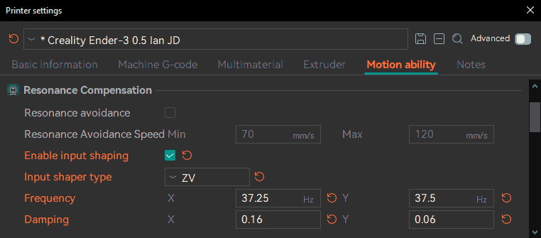

# Motion Ability¶

Settings related to the motion capabilities of the printer.

* [Emit limits to G-code](motion-ability.md#emit-limits-to-g-code)
* [Resonance Compensation](motion-ability.md#resonance-compensation)
  * [Resonance Avoidance](motion-ability.md#resonance-avoidance)
  * [Input Shaping](motion-ability.md#input-shaping)
    * [Input Shaping Type](motion-ability.md#input-shaping-type)
      * [Default](motion-ability.md#default)
      * [Version Table](motion-ability.md#version-table)
        * [Fixed-Time Motion](motion-ability.md#fixed-time-motion)
* [Speed limitation](motion-ability.md#speed-limitation)
* [Acceleration limitation](motion-ability.md#acceleration-limitation)
* [Jerk limitation](motion-ability.md#jerk-limitation)
  * [Maximum Jerk](motion-ability.md#maximum-jerk)
  * [Maximum Junction Deviation](motion-ability.md#maximum-junction-deviation)

## Emit limits to G-code[¶](motion-ability.md#emit-limits-to-g-code) 

[Mode](/broken/pages/246b4d07eed07a8ac878abc4613a350fbce2c022): `Advanced`.\
[Variable](/broken/pages/2ce6fff32f5448d0159c2e2dfbcb54f26d3c6918): `emit_machine_limits_to_gcode`.\
[Type](/broken/pages/726477a877bf7a8efe103413c86723285f8ca2eb#boolean): `Boolean`.\
[CLI Example](/broken/pages/f439233018f603f29dcf6b1fcc75b0ab21b6fd24#setting-overrides): `--emit-machine-limits-to-gcode=1`.\
If enabled, the machine limits will be emitted to G-code file. This option will be ignored if the G-code flavor is set to Klipper.

## Resonance Compensation[¶](motion-ability.md#resonance-compensation) 

Resonance Compensations are the methods used to reduce the vibrations of the printer during high-speed movements, which can cause ringing on the surface of the model.

### Resonance Avoidance[¶](motion-ability.md#resonance-avoidance) 

[Mode](/broken/pages/246b4d07eed07a8ac878abc4613a350fbce2c022): `Advanced`.\
[Variables](/broken/pages/2ce6fff32f5448d0159c2e2dfbcb54f26d3c6918): `resonance_avoidance`, `min_resonance_avoidance_speed`, `max_resonance_avoidance_speed`.\
[Type](/broken/pages/726477a877bf7a8efe103413c86723285f8ca2eb): `resonance_avoidance` (Boolean), `min_resonance_avoidance_speed` (Float), `max_resonance_avoidance_speed` (Float).\
[CLI Example](/broken/pages/f439233018f603f29dcf6b1fcc75b0ab21b6fd24#setting-overrides): `--resonance-avoidance=1` (`resonance_avoidance` shown; other variables above follow their own type).\
By reducing the speed of the outer wall to avoid the resonance zone of the printer, ringing on the surface of the model are avoided.

Tip

Check the [VFA Calibration](/broken/pages/ccf0c15f3bed88abec16bacceff4810aac275310).

### Input Shaping[¶](motion-ability.md#input-shaping) 

[Mode](/broken/pages/246b4d07eed07a8ac878abc4613a350fbce2c022): `Expert`.\
[Variables](/broken/pages/2ce6fff32f5448d0159c2e2dfbcb54f26d3c6918): `input_shaping_emit`, `input_shaping_freq_x`, `input_shaping_freq_y`, `input_shaping_damp_x`, `input_shaping_damp_y`.\
[Type](/broken/pages/726477a877bf7a8efe103413c86723285f8ca2eb): `input_shaping_emit` (Boolean), `input_shaping_freq_x` (Float), `input_shaping_freq_y` (Float), `input_shaping_damp_x` (Float), `input_shaping_damp_y` (Float).\
[CLI Example](/broken/pages/f439233018f603f29dcf6b1fcc75b0ab21b6fd24#setting-overrides): `--input-shaping-emit=1` (`input_shaping_emit` shown; other variables above follow their own type).\
During high-speed movements, vibrations can cause a phenomenon called "ringing," where periodic ripples appear on the print surface. Input Shaping provides an effective solution by counteracting these vibrations, improving print quality and reducing wear on components without needing to significantly lower print speeds.

Note

Some Printers have built-in accelerometers that can be used to **automatically** measure the resonant frequencies of the printer.\
If your printer has one, consider using it as it can provide more accurate results in less time and usually is autosaved into the printer firmware.

Tip

It's usually recommended to perform [Input Shaping calibration](/broken/pages/7c942f82d3b10b8ff692dcce023e796cd63e4900) once a year or after any mechanical or structural changes such as relocation, changing the support surface, new belts, motors, frame, etc.

Important

**RepRap** can only set one frequency for both X and Y axes so you will need to select a frequency that works well for both axes.

#### Input Shaping Type[¶](motion-ability.md#input-shaping-type) 

[Mode](/broken/pages/246b4d07eed07a8ac878abc4613a350fbce2c022): `Expert`.\
[Variable](/broken/pages/2ce6fff32f5448d0159c2e2dfbcb54f26d3c6918): `input_shaping_type`.\
[Type](/broken/pages/726477a877bf7a8efe103413c86723285f8ca2eb#choice): `Choice`.\
[Options](/broken/pages/726477a877bf7a8efe103413c86723285f8ca2eb#choice): `Default, MZV, ZV, ZVD, ZVDD, ZVDDD, EI, EI2, 2HUMP_EI, EI3, 3HUMP_EI, DAA, Disable`.\
[CLI Example](/broken/pages/f439233018f603f29dcf6b1fcc75b0ab21b6fd24#setting-overrides): `--input-shaping-type=Default`.\
The Input Shaping type determines the algorithm used to counteract the vibrations.\
It is usually recommended to use MZV, EI (specially for Delta printers) or ZV as a simple and effective solution.\
Not all Input Shaping types are available in all firmware and their performance may vary depending on the firmware implementation and the printer's mechanics.

**Default**[**¶**](motion-ability.md#default)

When "Default" is selected, the firmware's default input shaper will be used.\
Every firmware and even its version may have a different default type but usually are:

* Klipper: MZV
* Marlin: ZV
* RepRap:
  * Version >= 3.4: MZV
  * Version < 3.4: DAA
  * Version < 3.2: DAA (without damping option)

**Version Table**[**¶**](motion-ability.md#version-table)

| Type                                                                                        | Name                             | [Klipper](https://www.klipper3d.org/Resonance_Compensation.html#technical-details) | [RepRap](https://docs.duet3d.com/User_manual/Reference/Gcodes#m593-configure-input-shaping) | [Marlin 2](https://marlinfw.org/docs/features/ft_motion.html#more-complexity-zv-input-shaper) |
| ------------------------------------------------------------------------------------------- | -------------------------------- | ---------------------------------------------------------------------------------- | ------------------------------------------------------------------------------------------- | --------------------------------------------------------------------------------------------- |
| MZV                                                                                         | Modified Zero Vibration          | >=0.9.0                                                                            | >=3.4                                                                                       | -                                                                                             |
| ZV                                                                                          | Zero Vibration                   | >=0.9.0                                                                            | = 3.5                                                                                       | >2.1.2                                                                                        |
| ZVD                                                                                         | Zero Vibration Derivative        | >=0.9.0                                                                            | >=3.4                                                                                       | -                                                                                             |
| ZVDD                                                                                        | Zero Vibration Double Derivative | -                                                                                  | >=3.4                                                                                       | -                                                                                             |
| ZVDDD                                                                                       | Zero Vibration Triple Derivative | -                                                                                  | >=3.4                                                                                       | -                                                                                             |
| EI                                                                                          | Extra Insensitive                | >=0.9.0                                                                            | -                                                                                           | -                                                                                             |
| 2HUMP\_EI / EI2                                                                             | Two-Hump Extra Insensitive       | >=0.9.0                                                                            | >=3.4                                                                                       | -                                                                                             |
| 3HUMP\_EI / EI3                                                                             | Three-Hump Extra Insensitive     | >=0.9.0                                                                            | >=3.4                                                                                       | -                                                                                             |
| [FT\_MOTION](https://marlinfw.org/docs/features/ft_motion.html#fixed-time-motion-by-ulendo) | Fixed-Time Motion                | -                                                                                  | -                                                                                           | >2.1.3                                                                                        |
| DAA                                                                                         | Damped Anti-Resonance            | -                                                                                  | < 3.4                                                                                       | -                                                                                             |

**Fixed-Time Motion**[**¶**](motion-ability.md#fixed-time-motion)

TODO: This calibration test is currently under development. See the [Marlin documentation](https://marlinfw.org/docs/gcode/M493.html) for more information.

## Speed limitation[¶](motion-ability.md#speed-limitation) 

Safeguard maximum speeds for all axes. This will cap the speed set by the process if it exceeds these values.

## Acceleration limitation[¶](motion-ability.md#acceleration-limitation) 

[Modes](/broken/pages/246b4d07eed07a8ac878abc4613a350fbce2c022):\
`Simple` [Variables](/broken/pages/2ce6fff32f5448d0159c2e2dfbcb54f26d3c6918): `machine_max_acceleration_x`, `machine_max_acceleration_y`, `machine_max_acceleration_z`, `machine_max_acceleration_e`, `machine_max_acceleration_extruding`, `machine_max_acceleration_retracting`.\
`Advanced` [Variable](/broken/pages/2ce6fff32f5448d0159c2e2dfbcb54f26d3c6918): `machine_max_acceleration_travel`.\
[Type](/broken/pages/726477a877bf7a8efe103413c86723285f8ca2eb#list-types): `Float list`.\
[CLI Example](/broken/pages/f439233018f603f29dcf6b1fcc75b0ab21b6fd24#setting-overrides): `--machine-max-acceleration-x=1` (same pattern for the other variables above).\
Safeguard maximum accelerations for all axes. This will cap the acceleration set by the process if it exceeds these values.

## Jerk limitation[¶](motion-ability.md#jerk-limitation) 

Safeguard maximum jerks for all axes.

Tip

Check the [Cornering Calibration](/broken/pages/32e75ac81b67ea0e27c86dc13e73b020011ed424).

### Maximum Jerk[¶](motion-ability.md#maximum-jerk) 

[Mode](/broken/pages/246b4d07eed07a8ac878abc4613a350fbce2c022): `Simple`.\
[Variables](/broken/pages/2ce6fff32f5448d0159c2e2dfbcb54f26d3c6918): `machine_max_jerk_x`, `machine_max_jerk_y`, `machine_max_jerk_z`, `machine_max_jerk_e`.\
[Type](/broken/pages/726477a877bf7a8efe103413c86723285f8ca2eb#list-types): `Float list`.\
[CLI Example](/broken/pages/f439233018f603f29dcf6b1fcc75b0ab21b6fd24#setting-overrides): `--machine-max-jerk-x=1` (same pattern for the other variables above).\
Maximum [jerk](/broken/pages/7be52dd66f6f98ad86dab218c36e11ddebf56960) for each axis (M205 X, Y, Z, E, only apply if JD = 0 for Marlin 2 Firmware)

### Maximum Junction Deviation[¶](motion-ability.md#maximum-junction-deviation) 

[Mode](/broken/pages/246b4d07eed07a8ac878abc4613a350fbce2c022): `Advanced`.\
[Variable](/broken/pages/2ce6fff32f5448d0159c2e2dfbcb54f26d3c6918): `machine_max_junction_deviation`.\
[Type](/broken/pages/726477a877bf7a8efe103413c86723285f8ca2eb#list-types): `Float list`.\
[CLI Example](/broken/pages/f439233018f603f29dcf6b1fcc75b0ab21b6fd24#setting-overrides): `--machine-max-junction-deviation=1`.\
Maximum [junction deviation](/broken/pages/7be52dd66f6f98ad86dab218c36e11ddebf56960#junction-deviation) (M205 J, only apply if JD > 0 for Marlin Firmware. If your Marlin 2 printer uses Classic Jerk set this value to 0.)
