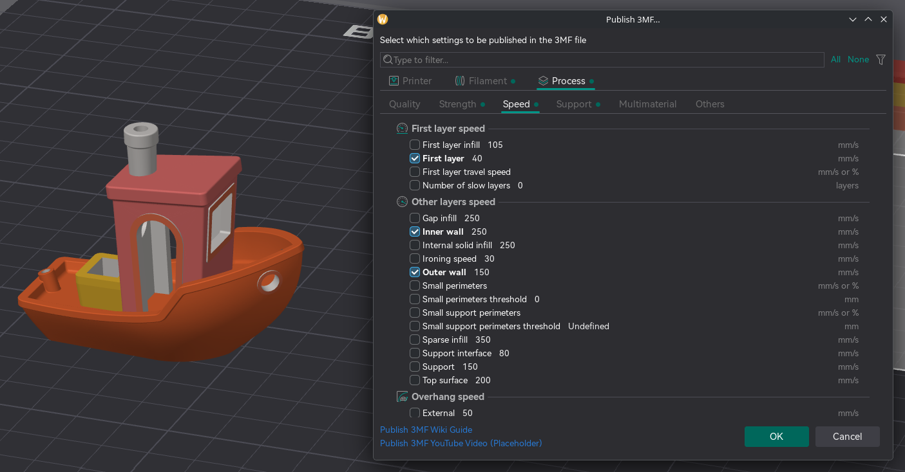
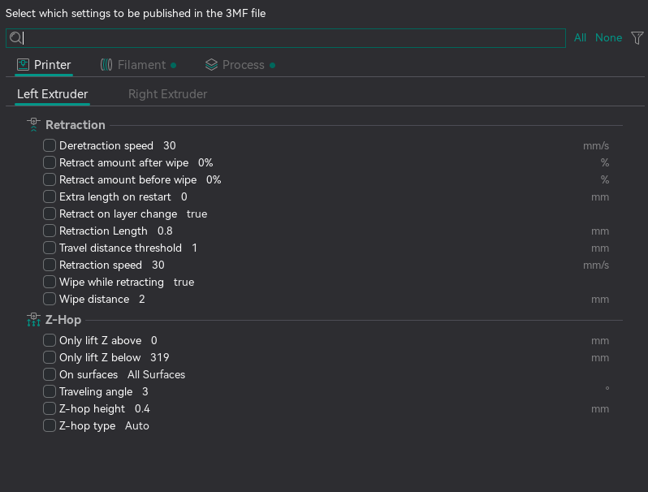
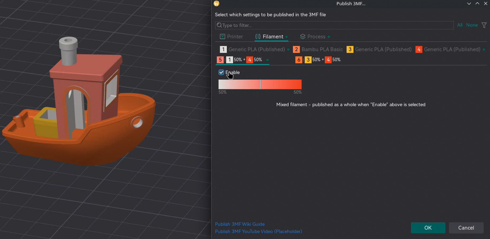
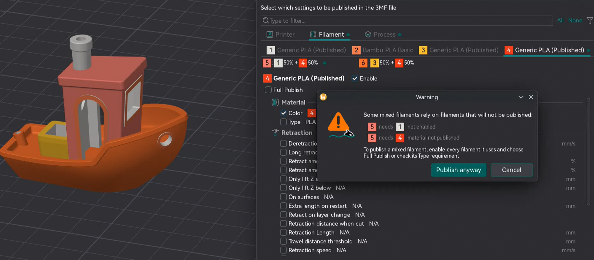
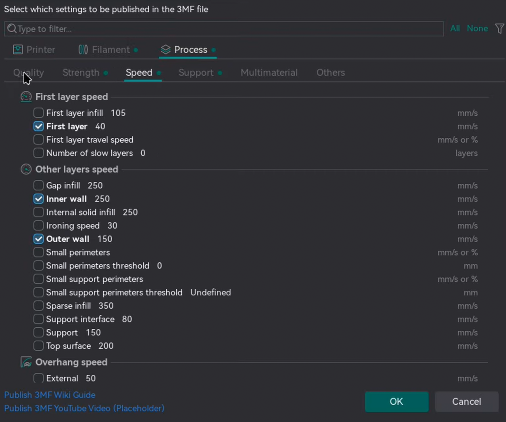

# For creators¶

Publishing lets you share a repeatable configuration with a model. You choose which settings are included, embed whole filament presets, and require or suggest the materials a design needs.

## Publishing a project[¶](for-creators.md#publishing-a-project) 

### Opening the dialog[¶](for-creators.md#opening-the-dialog) 

**File → Publish 3MF…**, or `Ctrl`/`Cmd` + `Shift` + `E`. (Needs at least one object on the plate.)

Settings that differ from your base presets are pre-checked and bold; the rest start unchecked.

### Choosing what to include[¶](for-creators.md#choosing-what-to-include) 

* **Filter box** ("Type to filter...").
* **All** / **None** buttons.
* **Filter menu** (right-click or the menu button): Select/Deselect All, Select/Deselect visible, and Filter selected / Filter non-selected.

If you check nothing, the file carries only the geometry.

### Printer tab[¶](for-creators.md#printer-tab) 

One tab per extruder, each listing that extruder's **Retraction** and **Z-Hop** values.

### Filament tab[¶](for-creators.md#filament-tab) 

One tab per filament slot. A slot publishes nothing until **Enable** is ticked.

An enabled slot offers:

* **Material** requirements (these don't publish values — they constrain what the receiver applies):
  * **Color** — the required filament colour.
  * **Type** — the required material family (e.g. `PLA`).
* **Full Publish** — embed the whole filament preset; disables the per-setting rows.

### Mixed filaments[¶](for-creators.md#mixed-filaments) 

Enabling a particular mixed filament automatically selects the required filament components. 

Note

If a mixed filament is enabled, but its required components are either disabled or have their type unchecked, a warning message will be shown. This does not prevent publishing. 

### Process tab[¶](for-creators.md#process-tab) 

Mirrors the Process settings that you see in the sidebar.

> 

## Tips[¶](for-creators.md#tips) 

* **Publish only what matters.** Include just the settings that affect how the model prints.
* **Use Full Publish for filaments you tuned hard** — it embeds the whole preset in the file.
* **Name files clearly** — OrcaSlicer suggests `.published.3mf`.
* **Check the tab indicator dots** to see what you've selected before **OK**.

## Things to note[¶](for-creators.md#things-to-note) 

* **A mixed filament needs its components to be published too** — otherwise they can lose their material on the other side.
* **Not every setting survives a round-trip** — mismatches are skipped and reported after load.
* **The receiver's preset library is never modified** — Full Publish presets live only in the loaded project.
* **Single-extruder printers get only the first extruder's values.**
