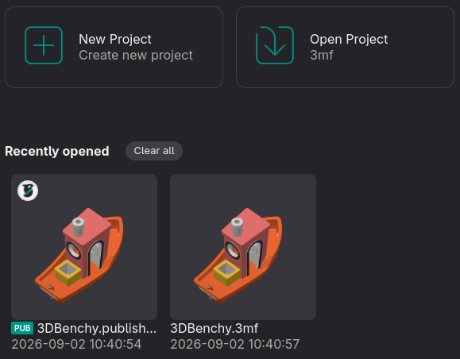
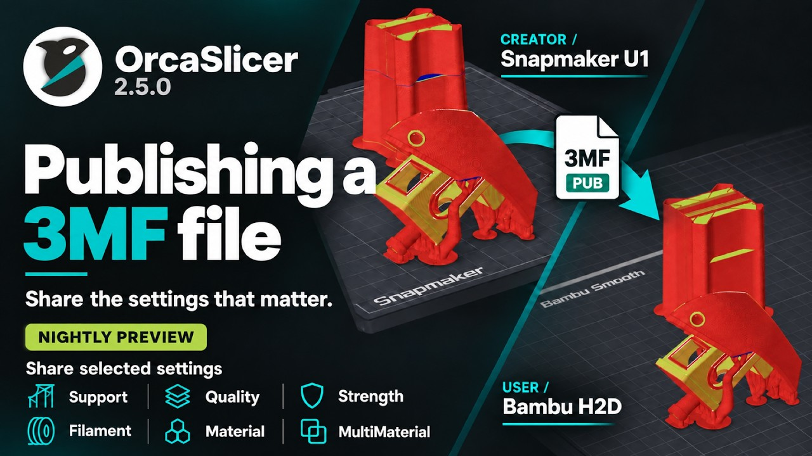

# What does Publish 3MF do?¶

Important

NEW FEATURE: **Publish 3MF** Available in: [Nightly builds](https://github.com/OrcaSlicer/OrcaSlicer/releases/tag/nightly-builds) or Releases greater than 2.5.0.

**Publish 3MF** embeds the settings you choose into a 3MF file, so the model and its configuration are shared together.

Unlike **Save Project**, which captures a full snapshot, you pick exactly which settings are required for the print and would be packaged together.

When another user opens it, nothing on the user's setup is overwritten; published settings are just applied on top.

## How to identify a Published 3MF file?[¶](what-does-publish-3mf-do.md#how-to-identify-a-published-3mf-file) 

A 3MF that's published from OrcaSlicer will show a little badge on the top-left corner of the file, along with green PUB text next to the file title.

## Opening a Published 3MF file[¶](what-does-publish-3mf-do.md#opening-a-published-3mf-file) 

Simply open it just like any 3MF file!

Your printer setup does not change, and the filament/process settings required to print the model are applied directly on top of your existing settings.

## Video Guide[¶](what-does-publish-3mf-do.md#video-guide) 

A Publish 3MF video guide is also available on our YouTube channel. [Link](https://www.youtube.com/watch?v=-xt1N29UIOg)

