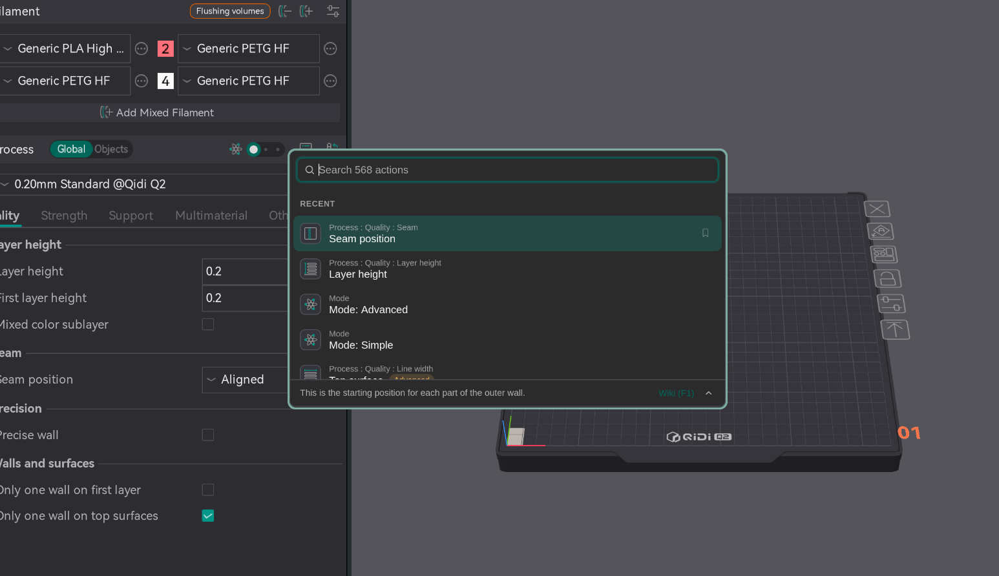
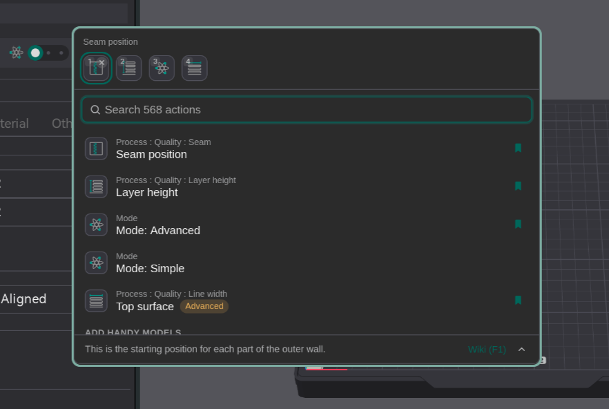
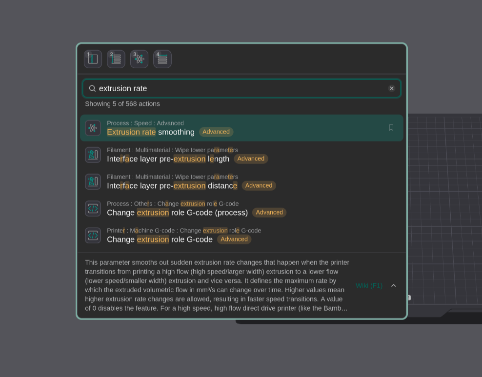
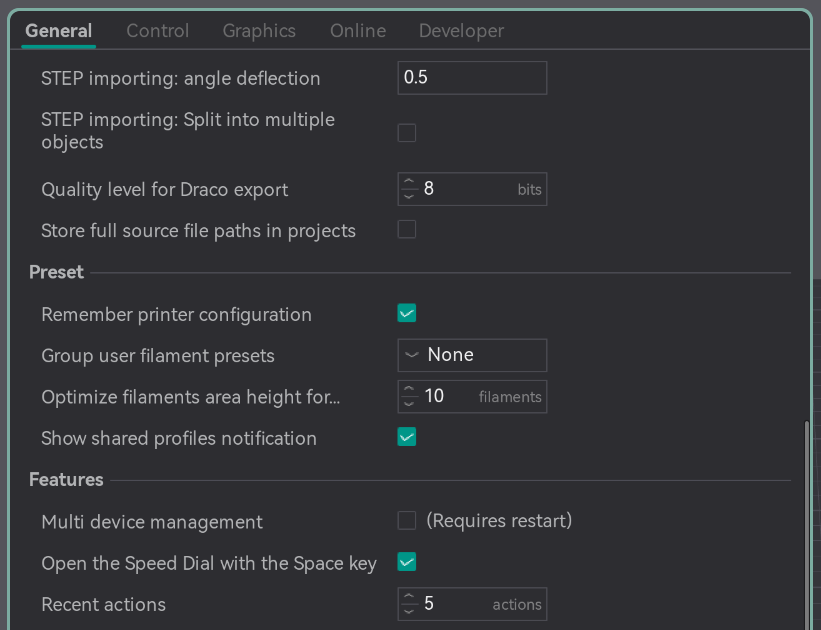
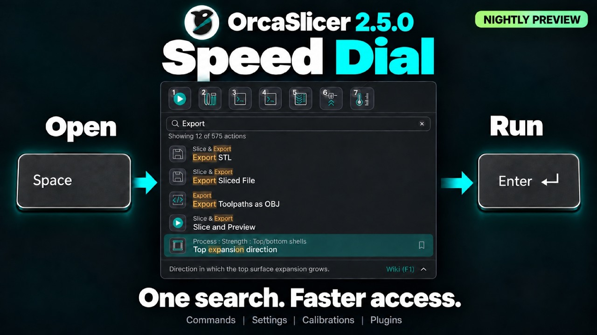

# Speed Dial¶

Important

NEW FEATURE: **Speed Dial**\
Available in: [Nightly builds](https://github.com/OrcaSlicer/OrcaSlicer/releases/tag/nightly-builds) or Releases greater than **2.4.2**.

The Speed Dial is a search-first launcher for everything runnable in OrcaSlicer: plugin script capabilities, built-in commands (slice and export, calibration, views, object and plate operations, help, and more), and individual settings. Open it from any page by pressing **Space**, or from the menu (**Open speed dial...**).

## How to use[¶](speed-dial.md#how-to-use) 

1. Press **Space** to launch the speed dial window.
2. Type to filter. The search matches the action name, its category, and its source, and accepts several words (for example `speed acceleration inner wall`).
3. Press **Enter** or double-click to run the highlighted action.
4. Press **Escape** to clear the search, then again to close.

## Favourites[¶](speed-dial.md#favourites) 

You can bookmark up to 10 actions in the favourites bar.

* Press **Ctrl/Cmd+B** to pin or unpin the highlighted action;
* Press **Alt/Option + 1-9** (**0** for the tenth) to launch a pinned action directly;
* Use the arrow keys to move between the favourites bar and the action list;
* Right-click a favourite to move it left or right, or unpin it.

## Recents and categories[¶](speed-dial.md#recents-and-categories) 

* Recently launched actions appear at the top of the list.
* Scrolling past them shows the full list of actions, sorted by category.

## Details and Wiki[¶](speed-dial.md#details-and-wiki) 

* Certain process settings show their tooltip in the footer.
  * Use the arrow button to expand or collapse it.
* Press **F1** (or click the **Wiki** link) to open its page.

## Plugins[¶](speed-dial.md#plugins) 

* Installed [Plugins](/broken/pages/25ed5e961c9cf2b4a9a7f0fd407df1c3101fedf4) also show up in the speed dial for easy access.

## Preferences[¶](speed-dial.md#preferences) 

Under **Preferences > General > Features**:

* **Open the Speed Dial with the Space key** turns the Space shortcut on or off.
* **Recent actions** sets how many recent actions to show. Set to 0 to hide all recent actions.

## Video[¶](speed-dial.md#video) 

A speed dial video guide is also available on our YouTube channel. [Link](https://www.youtube.com/watch?v=DxJPhETR1Hs)

