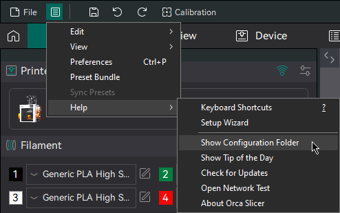
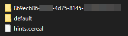

# OrcaSlicer User Profiles¶

This page explains where OrcaSlicer stores your user profiles and custom presets, how profile syncing works with OrcaCloud, and how to migrate your existing profiles.

* [Storage Location](orcaslicer-user-profiles.md#storage-location)
* [Finding the Configuration Folder](orcaslicer-user-profiles.md#finding-the-configuration-folder)
* [User Profile Folders](orcaslicer-user-profiles.md#user-profile-folders)
* [OrcaCloud Auto Migration](orcaslicer-user-profiles.md#orcacloud-auto-migration)
* [Manual Migration](orcaslicer-user-profiles.md#manual-migration)
* [Profiles Missing After Updating from Bambu Cloud](orcaslicer-user-profiles.md#profiles-missing-after-updating-from-bambu-cloud)

## Storage Location[¶](orcaslicer-user-profiles.md#storage-location) 

OrcaSlicer stores user profiles in the application's configuration directory. The exact location depends on your operating system:

| OS                        | Typical Path                                             |
| ------------------------- | -------------------------------------------------------- |
| Windows                   | `%APPDATA%\OrcaSlicer`                                   |
| macOS                     | `~/Library/Application Support/OrcaSlicer`               |
| Linux (AppImage / native) | `~/.config/OrcaSlicer`                                   |
| Linux (Flatpak)           | `~/.var/app/com.orcaslicer.OrcaSlicer/config/OrcaSlicer` |

Uninstalling/reinstalling OrcaSlicer does **not** delete these profiles, so your settings and custom presets are preserved across updates.

Profiles persist after uninstall

Uninstalling OrcaSlicer — including the **Microsoft Store** version — does not delete your configuration folder. Your profiles in `%APPDATA%\OrcaSlicer` (Windows) and the equivalent paths above are intentionally left in place so they survive reinstall and stay shared with other OrcaSlicer builds. To remove them, delete that folder manually after uninstalling.

Warning

On macOS, uninstalling OrcaSlicer may prompt you to delete the configuration directory. If you confirm, **all your user profiles will be permanently lost**. Only delete this directory if you are sure you no longer need your profiles.

## Finding the Configuration Folder[¶](orcaslicer-user-profiles.md#finding-the-configuration-folder) 

You can open the configuration folder directly from within OrcaSlicer:

1. Go to the menu bar and click **Help** > **Show Configuration Folder**.

## User Profile Folders[¶](orcaslicer-user-profiles.md#user-profile-folders) 

Inside the configuration folder, you will find a subfolder named `user`. This folder contains all your custom presets and user profiles.

The `user` directory may contain one or more of the following subfolders:

### `default`[¶](orcaslicer-user-profiles.md#default) 

This is the folder OrcaSlicer uses when you are **not** logged into any cloud syncing service. It is typically the only folder present if you have never used profile syncing.

### `<UUID>` (OrcaCloud)[¶](orcaslicer-user-profiles.md#uuid-orcacloud) 

A folder named with a UUID (e.g., `6b89c630-39bb-42cb-a1f0-476bef493c06`). This folder is created when you sign in to **OrcaCloud** (available from version 2.4 onwards). When you are logged in, OrcaSlicer automatically saves and loads your custom presets from this folder instead of `default`.

Note

**OrcaCloud is free.** Profile syncing and cloud backup stay free and remain free; see the [Orca Cloud FAQ](https://cloud.orcaslicer.com/wiki/#orca-cloud-faq) for details.

### `<10-digit number>` (Bambu Cloud)[¶](orcaslicer-user-profiles.md#10-digit-number-bambu-cloud) 

A folder named with a 10-digit number (e.g., `1509812367`). This folder was used by the legacy **Bambu Cloud** profile syncing feature.

Note

Starting from OrcaSlicer 2.4, Bambu Cloud is no longer supported for profile syncing. It has been replaced by OrcaCloud. Bambu Cloud for printer communication is unaffected.

### How OrcaSlicer Chooses a Folder[¶](orcaslicer-user-profiles.md#how-orcaslicer-chooses-a-folder) 

* **Logged into OrcaCloud** → uses the UUID folder
* **Not logged in** → uses the `default` folder

Switching login state automatically switches the active folder. No manual action is needed.

## OrcaCloud Auto Migration[¶](orcaslicer-user-profiles.md#orcacloud-auto-migration) 

Starting from version 2.4, OrcaSlicer includes an automatic migration feature to help you transition to OrcaCloud.

When you sign in to OrcaCloud for the **first time**, OrcaSlicer automatically copies your existing profiles from the `default` or Bambu Cloud folder into the new UUID-based folder. This means your custom presets are preserved and synced to the cloud without any manual steps.

Tip

After migration, you can verify your profiles are backed up by visiting [cloud.orcaslicer.com](https://cloud.orcaslicer.com/) and signing in with your account.

## Manual Migration[¶](orcaslicer-user-profiles.md#manual-migration) 

In most cases, the auto migration works smoothly. However, if your profiles do not appear after signing in to OrcaCloud, you can manually migrate them:

1. Copy the contents of your old profile folder (`default` or the 10-digit Bambu Cloud folder) into the new UUID folder.
2. Restart OrcaSlicer.
3. Wait 1–3 minutes for OrcaSlicer to detect the new profiles and sync them to OrcaCloud.

## Profiles Missing After Updating from Bambu Cloud[¶](orcaslicer-user-profiles.md#profiles-missing-after-updating-from-bambu-cloud) 

If you previously used **Bambu Cloud** for profile syncing and have chosen **not** to use OrcaCloud, you may open OrcaSlicer after updating and find that your custom presets appear to be missing. This is a known side effect of the transition away from Bambu Cloud syncing — **your profiles are not lost.**

Here is what is happening behind the scenes:

* Your profiles are still safely stored in the Bambu Cloud folder (the one named with a 10-digit number).
* Since Bambu Cloud syncing is no longer supported and you are not signed in to OrcaCloud, OrcaSlicer now loads and saves profiles from the `default` folder.
* If you only ever used Bambu Cloud, your `default` folder is empty, so it looks as if everything is gone.

You can bring your profiles back in either of the following ways. Both work — pick whichever suits you.

### Option 1: Copy your profiles locally (no account needed)[¶](orcaslicer-user-profiles.md#option-1-copy-your-profiles-locally-no-account-needed) 

If you prefer to keep working without any cloud account, simply move your profiles into the folder OrcaSlicer now uses:

1. Open the configuration folder via **Help** > **Show Configuration Folder**, then open the `user` subfolder.
2. Open your Bambu Cloud folder (the 10-digit one) and copy **all** of its contents.
3. Paste them into the `default` folder.
4. Restart OrcaSlicer.

Your profiles will reappear, and OrcaSlicer will continue to load and save them locally from `default`.

### Option 2: Sign in to OrcaCloud (automatic)[¶](orcaslicer-user-profiles.md#option-2-sign-in-to-orcacloud-automatic) 

If you would also like your profiles backed up and synced across devices, signing in to OrcaCloud will move them for you automatically. On first sign-in, OrcaSlicer copies your profiles from the Bambu Cloud folder into your new OrcaCloud folder. See [OrcaCloud Auto Migration](orcaslicer-user-profiles.md#orcacloud-auto-migration) for details.

Note

You might wonder why OrcaSlicer doesn't just copy your Bambu Cloud profiles into the `default` folder for you. Because the `default` folder lives only on your computer and isn't backed up to any cloud, automatically writing into it could unintentionally overwrite or mix up profiles you already keep there. To avoid touching your local data without your knowledge, OrcaSlicer leaves the `default` folder as-is and lets you decide how to migrate. Automatic migration only runs when you sign in to OrcaCloud, where the target folder is created fresh for your account.
