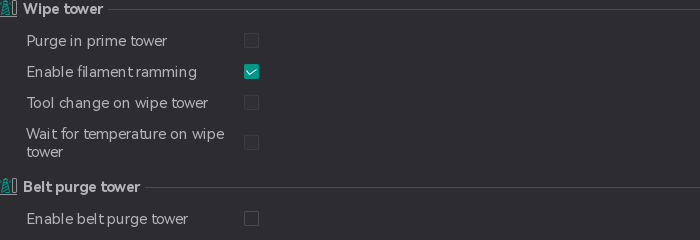

# Wipe Tower¶

[Mode](/broken/pages/246b4d07eed07a8ac878abc4613a350fbce2c022): `Advanced`.\
[Variable](/broken/pages/2ce6fff32f5448d0159c2e2dfbcb54f26d3c6918): `wipe_tower_type`.\
[Type](/broken/pages/726477a877bf7a8efe103413c86723285f8ca2eb#choice): `Choice`.\
[Options](/broken/pages/726477a877bf7a8efe103413c86723285f8ca2eb#choice): `type1, type2`.\
[CLI Example](/broken/pages/f439233018f603f29dcf6b1fcc75b0ab21b6fd24#setting-overrides): `--wipe-tower-type=type1`.\
The prime tower is a structure that is printed before the actual print to ensure that the nozzle is primed with the correct filament. It helps to prevent oozing and stringing during the print. The prime tower can be customized in various ways, such as its size, shape, and position.

## Purge in prime tower[¶](wipe-tower.md#purge-in-prime-tower) 

[Mode](/broken/pages/246b4d07eed07a8ac878abc4613a350fbce2c022): `Advanced`.\
[Variable](/broken/pages/2ce6fff32f5448d0159c2e2dfbcb54f26d3c6918): `purge_in_prime_tower`.\
[Type](/broken/pages/726477a877bf7a8efe103413c86723285f8ca2eb#boolean): `Boolean`.\
[CLI Example](/broken/pages/f439233018f603f29dcf6b1fcc75b0ab21b6fd24#setting-overrides): `--purge-in-prime-tower=1`.\
Purge remaining filament into prime tower.

## Enable filament ramming[¶](wipe-tower.md#enable-filament-ramming) 

[Mode](/broken/pages/246b4d07eed07a8ac878abc4613a350fbce2c022): `Advanced`.\
[Variable](/broken/pages/2ce6fff32f5448d0159c2e2dfbcb54f26d3c6918): `enable_filament_ramming`.\
[Type](/broken/pages/726477a877bf7a8efe103413c86723285f8ca2eb#boolean): `Boolean`.\
[CLI Example](/broken/pages/f439233018f603f29dcf6b1fcc75b0ab21b6fd24#setting-overrides): `--enable-filament-ramming=1`.\
Enable filament ramming

## Tool Change on Wipe Tower[¶](wipe-tower.md#tool-change-on-wipe-tower) 

[Mode](/broken/pages/246b4d07eed07a8ac878abc4613a350fbce2c022): `Advanced`.\
[Variable](/broken/pages/2ce6fff32f5448d0159c2e2dfbcb54f26d3c6918): `tool_change_on_wipe_tower`.\
[Type](/broken/pages/726477a877bf7a8efe103413c86723285f8ca2eb#boolean): `Boolean`.\
[CLI Example](/broken/pages/f439233018f603f29dcf6b1fcc75b0ab21b6fd24#setting-overrides): `--tool-change-on-wipe-tower=1`.\
Force the toolhead to travel to the wipe tower before issuing the tool change command (Tx).\
Only relevant for multi-extruder (multi-toolhead) printers using a Type 2 wipe tower.\
By default Orca skips the travel on multi-toolhead machines because the firmware handles the head swap, which can result in the Tx command being issued above the printed part.

Enable this option if you want the tool change to always be issued above the wipe tower instead.

## Wait for Temperature on Wipe Tower[¶](wipe-tower.md#wait-for-temperature-on-wipe-tower) 

[Mode](/broken/pages/246b4d07eed07a8ac878abc4613a350fbce2c022): `Advanced`.\
[Variable](/broken/pages/2ce6fff32f5448d0159c2e2dfbcb54f26d3c6918): `wait_for_temp_on_wipe_tower`.\
[Type](/broken/pages/726477a877bf7a8efe103413c86723285f8ca2eb#boolean): `Boolean`.\
[CLI Example](/broken/pages/f439233018f603f29dcf6b1fcc75b0ab21b6fd24#setting-overrides): `--wait-for-temp-on-wipe-tower=1`.

Important

NEW FEATURE: **Wait for temperature on wipe tower**\
Available in: [Nightly builds](https://github.com/OrcaSlicer/OrcaSlicer/releases/tag/nightly-builds) or Releases greater than **2.4.2**.

Only relevant for multi-extruder (multi-toolhead) printers using a Type 2 wipe tower.\
By default, the new tool's temperature wait happens immediately after the tool change command, wherever the toolhead is at that moment, which can leave ooze from the heat-up on top of the printed part.

Enable this option to defer that wait instead: the incoming tool's target temperature is raised ahead of the tool change rather than blocked on, the toolhead travels to the wipe tower, and only once parked beside it, right before purging, does it wait to actually reach temperature. Ooze from the heat-up then lands next to the tower instead of on the model, and the travel overlaps with the heat-up instead of adding to it.

Caution

Your firmware or tool change macro must not already wait for the temperature itself, or the toolhead will end up waiting twice.

## Belt purge tower[¶](wipe-tower.md#belt-purge-tower) 

[Mode](/broken/pages/246b4d07eed07a8ac878abc4613a350fbce2c022): `Advanced`.\
[Variable](/broken/pages/2ce6fff32f5448d0159c2e2dfbcb54f26d3c6918): `enable_belt_purge_tower`.\
[Type](/broken/pages/726477a877bf7a8efe103413c86723285f8ca2eb#boolean): `Boolean`.\
[CLI Example](/broken/pages/f439233018f603f29dcf6b1fcc75b0ab21b6fd24#setting-overrides): `--enable-belt-purge-tower=1`.

Important

NEW FEATURE: **Belt purge tower**\
Available in: [Nightly builds](https://github.com/OrcaSlicer/OrcaSlicer/releases/tag/nightly-builds) or Releases greater than **2.4.2**.

Enables a replacement for the prime tower on [belt printers](/broken/pages/226f2361e5d5e6ef3f7abf3becc7918d447a2ef7). This option is only shown when [belt printing](/broken/pages/00dcd987ac21f7e44ecf650ee21f58b8c880cf8a#enable-belt-printing) is enabled.

The standard prime tower cannot be used on a belt because it requires a flat bed and its G-code is not transformed for the tilted gantry. When this option is enabled and a plate uses more than one filament, OrcaSlicer adds a **Belt Purge Tower** object to that plate:

* It is a long, thin bar positioned beside the parts along the belt, flush with the belt's far edge.
* It appears in the object list and is sliced with the same tilted layers as the parts.
* Material is purged into it at every filament change, in the same way as [flushing into an object](/broken/pages/299e20c8d5eca9be9a5df6f35fcbdf89d2d746d6).
* It is created, resized and removed automatically as parts, filaments and settings change. Do not edit it by hand.

The tower's width is set by [Belt purge tower width](/broken/pages/5aa3302c55047356a98465bb114707e629d121d9#belt-purge-tower-width) in the process settings, and its length follows the parts along the belt. Its height is calculated so that a single tilted layer through the tower can accommodate the maximum purge volume required in any layer. This calculation uses the flushing volumes for a single-extruder multi-material printer with [Purge in prime tower](wipe-tower.md#purge-in-prime-tower) enabled, and the prime volume otherwise.

The printed tower is smaller than the object shown in Prepare: it ends after the last filament change, and infill that is not needed for purging is omitted.

Note

The belt purge tower is not generated when the print sequence is **By object**. In this mode, no purge is performed at filament changes.
